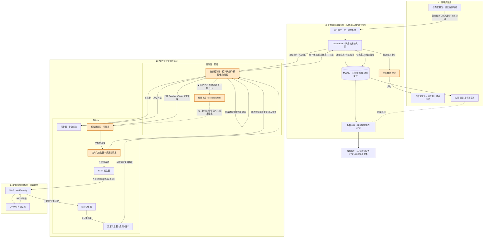
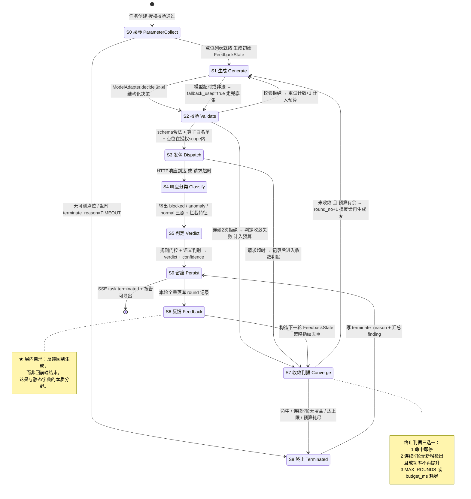
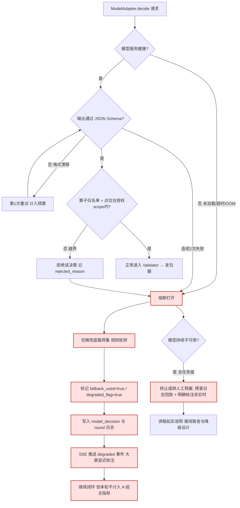
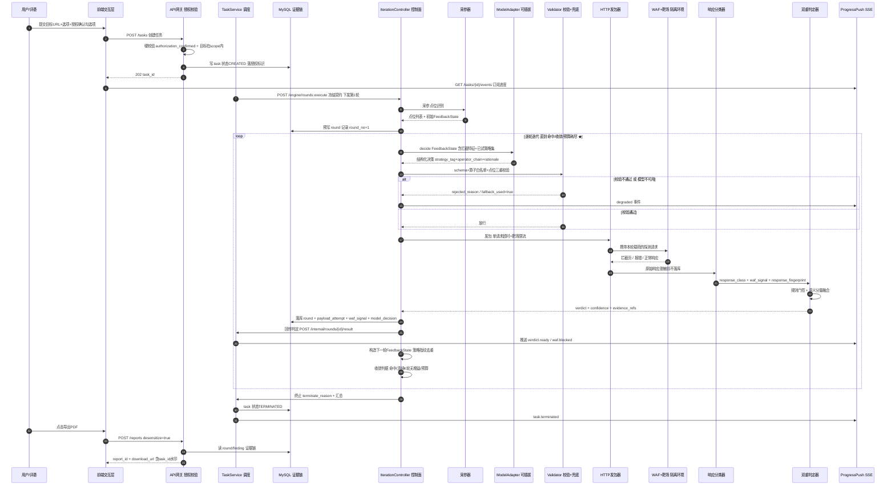
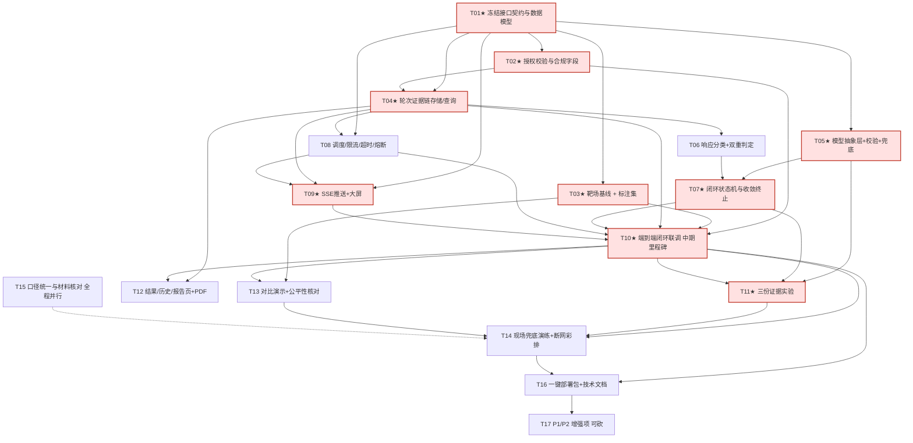

# AI自适应Web漏洞智能探测与绕过检测系统 — 项目分析总报告（整合版）

> 汇编人：齐活林（Qi）· 交付总监 ｜ 团队：software-nday-probe
> 本文件整合原《01-产品与评审分析》《02-架构与技术评审》《项目分析总报告》三份产出，去重后合并为一份权威分析稿。
> 分析依据：用户提供的三份材料（架构逐层拆解说明、四人分工表、系统架构图）与用户原话「相当于是 AI 自己去挖 nday 漏洞的一个系统」
> 性质：竞赛/答辩级作品的分析评审，不含实现代码、不含可用于攻击真实系统的载荷或操作步骤，不含编造的性能数据
> 成员原产出：许清楚（产品经理，产品与评审分析）、高见远（架构师，架构与技术评审）

---

## 文档导航（整合后文档集）

| 文件 | 内容 |
|---|---|
| `00-项目分析总报告（整合版）.md` | **本文件**：产品定位 + 架构评审 + 决策清单（整合 01/02/总报告） |
| `01-四号执行手册.md` | 4 号实操手册：契约桩 / 后端 / 数据库 / 前端顺序 / PDF / 联调 / 答辩保障 |
| `02-soul落地页技术拆解.md` | www.soul.io 落地页公开交付物技术拆解（前端设计参考） |
| `03-演示交付说明.md` | 答辩现场怎么用、哪句能说、哪句不能说 |
| `04-代码审查与测试报告.md` | 代码审查、单元测试（64/64）、安全审计 |

> 原始 7 份文档已归档至 `docs/archive/原文档备份/`，可随时回退。

---

## 0. 一句话结论

**这个项目的产品骨架做得不错，但它把唯一的创新点（"自适应闭环"）既说错了、又没在工程上做出来。**

产品侧与架构侧从两个角度指向同一根因：整个项目把赌注押在"AI 闭环自适应绕过 WAF"上，而现有材料里——口径上把它说成"AI 挖洞"（概念不成立），图纸上把它画成"一次性单向流水线"（闭环不可见），数据上三张表拼不出时间线（过程不可证），实验上没有任何可证伪的对照（创新不可验）。**这四件事其实是同一件事的四个面：闭环没有被定义、被表达、被留痕、被验证。**

好消息：这些全都是**低补法**问题，不需要重写系统。改口径零成本，补契约和轮次表各一两天，做消融实验靠一个可插拔适配层就能一行切换。按下面的优先级做，性价比极高。

**核心结论速览（先看）**
1. 项目当前最大风险不是技术，是"说错话"：口头"AI 挖 nday"与材料"不主打 0day、主打 WAF 环境下自适应绕过探测已知漏洞"是两套口径。
2. 实质定位：面向授权目标的、WAF 环境下的**已知漏洞类型探测（验证）辅助工具**，创新载体是"以 HTTP 响应为反馈状态、由本地大模型在线决策下一轮探测载荷变形"的闭环。
3. 创新成色取决于三份证据：消融实验、未见过的 WAF 规则泛化测试、轮次—成功率收敛曲线。
4. 与 sqlmap 的正确关系：不是"超越/替代"，而是"WAF 场景下的补充与增强"。
5. 人力风险高度集中在 1 号（创新成立与否全压在他一人），团队呈"前期偏闲、答辩前一周全挤在一起"的节奏风险。

---

## 1. 项目还原：它到底做了什么

### 1.1 四层架构与数据主线

| 层 | 内容 | 负责 |
|---|---|---|
| L1 前端交互层 | 任务配置 / 大屏监控 / 漏洞结果 / 历史记录 / 报告预览 5 个页面 | 4 号开发，3 号 UI |
| L2 业务调度&存储层 | 任务调度、MySQL 三张表、PDF 报告生成；材料明确"只做调度+存储+展示" | 4 号 |
| L3 AI 自适应探测核心层 | 5 个子模块闭环，项目创新核心 | 1 号（组长） |
| L4 靶场/目标层 | DVWA 基准靶机 + 自建带 WAF（ModSecurity）站点 | 1 号 |

主线：提交 URL → 建任务 → 采参 → AI 生成/变形 Payload → 发包 → 采响应（拦截/报错/正常）→ 反馈 AI 调整下一轮 → 判定漏洞 → 入库 → 展示 / 导出 PDF。

### 1.2 L3 的五个子模块（材料声称的闭环）

1. 页面爬虫 & 参数采集 → 待测试参数列表
2. 本地大模型推理（Ollama + 提示词工程）→ 依据上轮结果判断"被 WAF 拦 / 触发漏洞"，自动变形生成新一轮 Payload
3. HTTP 发包验证 → 记录完整请求/响应、状态码、WAF 拦截特征
4. 漏洞判定（规则 + AI 语义双重判定）→ 是否存在漏洞 + 风险等级
5. 自适应反馈迭代引擎 → 把本轮结果回传模型，动态调整下一轮策略

闭环链路：**生成 Payload → 发包 → 取结果 → 反馈 AI → 生成新 Payload**。材料强调"不是一次性跑完字典，是边测边学"。

### 1.3 团队分工

1 号（技术核心，AI 核心层 + 靶场 + 脚本/提示词/测试用例/技术文档）｜2 号（路演答辩，讲稿/题库/彩排）｜3 号（视觉材料，架构图/PPT/申报书/UI 设计）｜4 号（平台开发，前端 + 调度存储 + MySQL + PDF + 一键部署）。

---

## 2. 第一优先：把口径改对（定位澄清）

### 2.1 五个概念的区别

| 概念 | 准确含义 | 对应关键动作 | 本项目是否涉及 |
|---|---|---|---|
| **0day** | 未公开、厂商未知、无补丁的漏洞 | 漏洞研究 / 发现：fuzzing、代码审计、二进制分析、原创 PoC | **否**，材料已明确「不主打 0day」 |
| **nday（已知/已公开漏洞）** | 已公开、已有编号（CVE/CNVD 等）、通常已有补丁或检测规则的漏洞 | **复测、验证目标是否仍受影响**、POC 验证、补丁核查 | 弱相关，见 2.2 |
| **漏洞发现（Discovery）** | 找到前人不知道的漏洞，产出"新知识" | 研究、原创性验证 | **否** |
| **漏洞探测 / 验证（Detection & Verification）** | 判断某个目标**是否存在**某类或某个已知漏洞 | 发探测载荷 → 采响应 → 判定 → 出证据 | **是，这是项目实质** |
| **WAF 绕过（Evasion）** | 不改变漏洞本身，只改变载荷的"外观"（编码、混淆、等价变换等），使其穿过防护规则匹配 | 投递 / 规避技术 | **是，这是项目创新载体** |

一句话记住分类：**"发现"是产出新知识，"探测/验证"是判断已知知识在目标上是否成立，"绕过"是让探测流量不被中间设备挡住**。三者不在同一层。

### 2.2 「AI 自己去挖 nday 漏洞」为什么不准确

- **"挖"字用错**：nday 是"已知漏洞"，已知的东西谈不上"挖"（发现）；对已知漏洞只能做"验证/复测/检出"。说"挖"会让人自然联想到"发现新漏洞"。
- **连 nday 都算不上**：本项目测的是 SQL 注入 / XSS / 文件上传这类**漏洞类型（弱点大类，CWE 层面）**，并未绑定任何具体 CVE/CNVD 编号或具体产品的已知漏洞实例。因此它严格来说是**"已知漏洞类型的自动化探测"**，比"nday 复测"还要再泛一层。
- **与材料自相矛盾**：材料里已写好边界「Web 渗透测试辅助工具、企业自测、等保自查、不主打 0day」，口头却说"AI 自主挖洞"，等于团队自己给出两套定位。
- **真正的创新点被这句话埋没了**：项目最值钱的是"闭环自适应的 WAF 绕过 + 过程可解释"，而不是"AI 挖洞"。用"挖洞"当标题，等于把强项藏起来、把弱项顶到评委枪口上。

### 2.3 不改会怎样

评委一旦问「挖出了哪个 CVE / 有没有原创 PoC」，答不上即被判"夸大、不严谨"，全盘可信度受损；且会被按"漏洞挖掘/0day 研究"标准衡量一个扫描器范畴的作品，落差巨大；"AI 自主挖洞 / 攻击"还主动送上"套壳蹭概念"与合规质疑的把柄。**最可惜的是：项目最值钱的"闭环自适应 + 过程可解释"被这句话埋没了。**

### 2.4 建议的统一对外口径

**正式版（申报书 / PPT 首页 / 讲稿统一使用，一字不改）：**

> 本系统是面向**授权目标**的 Web 漏洞检测辅助工具：在存在 WAF 防护的场景下，通过**本地大模型对每轮探测响应做闭环反馈、自适应变形探测载荷**，提升对**已知漏洞类型**（SQL 注入、XSS、文件上传等）的检出能力并降低误判，用于企业自测与等保自查；**不涉及 0day 或未知漏洞挖掘，不用于未授权目标**。

**答辩口语版（一句话记住）：**

> "AI 不'挖'洞，AI 学'绕'——我们解决的是：有 WAF 挡着的时候，已知漏洞怎么还能被测出来、怎么把过程讲清楚。"

**用词替换表（供 2 号改讲稿、3 号改材料时逐条核对）：**

| 不要用 | 改成 |
|---|---|
| AI 挖漏洞 / AI 挖 nday / 自主挖洞 | AI 自适应探测 / 已知漏洞类型的自动化验证 |
| AI 发现漏洞 | AI 检出漏洞、识别出存在漏洞 |
| 攻击、打靶、拿下站点 | 探测、验证、授权测试 |
| 超越 sqlmap / 替代扫描器 | 对现有扫描器在 WAF 场景下的补充与增强 |
| 0day / 未知漏洞 | 已知漏洞类型、WAF 环境下的漏报问题 |

---

## 3. 目标用户、场景、痛点与创新拆解

### 3.1 目标用户分层

| 层级 | 用户 | 特征 | 与项目关系 |
|---|---|---|---|
| **主要** | 企业/单位内部安全自查人员、等保测评与合规自查的运维或安全工程师 | 有自查义务，但未必有专职渗透经验；需要**可留痕、可出报告**的结论 | 产品价值主张的核心对象 |
| **主要** | 无专业安全团队的中小开发团队（上线前自检） | 站点前挂了 WAF/云防护，扫不出东西就误以为"没漏洞" | 痛点最典型 |
| **次要** | 高校网络安全竞赛、教学/靶场实训 | 需要把黑盒过程**可视化、可讲解、可复现** | 大屏监控页与对比演示的直接受众，也是本项目的**实际评审场景** |
| **非目标** | 职业红队 / 漏洞研究员 | 已有 Burp + sqlmap + 手工经验与自研工具链 | 不是本产品的受众，答辩时不要拿他们当对标 |

> 判断（推断）：材料写"企业自测、等保自查"，但整套设计（大屏实时 payload、对比演示、四层架构图、4 人分工）明显更贴合**教学/竞赛作品**，而非商业化安全产品。建议答辩时把"企业自测"讲成**应用方向**，把"竞赛演示 + 方法验证"讲成**本作品定位**，不要反过来。

### 3.2 真实使用场景

| 场景 | 现状 | 本项目提供的价值 |
|---|---|---|
| **A. 上线前 / 等保自查** | 目标前面有 WAF，传统扫描器一扫全是拦截页，报告"未发现漏洞"——但这只是**没测到**，不是**没有** | 让探测载荷能穿过 WAF，暴露"绕过 WAF 后真实存在的漏洞"，把**假阴性**变成可确认结论 |
| **B. 合规留痕出报告** | 手工拼接请求包/响应包/证据链/风险等级，成本高、格式不统一 | 全量留痕（任务 / payload / 漏洞三张表）+ 自动产出对标等保测评风格的 PDF，证据链可追溯 |
| **C. 教学 / 竞赛演示** | WAF 绕过是黑盒经验，学生看不见"为什么这个变形能过" | 大屏逐轮展示"当前 payload → WAF 拦截标记 → AI 下一次怎么改"，把经验变成可讲解的过程 |

### 3.3 核心痛点与现有工具为何没解决好

| # | 痛点 | 现有工具为什么没解决好（定性推断） |
|---|---|---|
| 1 | **WAF 造成假阴性** | sqlmap/AWVS/ZAP 的探测载荷集是预定义的；遇到针对性 WAF 规则被整批拦截，扫描器要么报"无漏洞"要么报错退出。**"被拦"与"没洞"没被区分开**——这恰是本项目漏洞判定子模块要解决的 |
| 2 | **绕过靠人、不可复制** | 现有绕过高度依赖有经验的工程师手工试载荷、写 tamper 脚本；门槛高、难沉淀、换一个 WAF 规则就得重来 |
| 3 | **过程不透明、不可解释** | 扫描器是"批量跑字典"的黑盒，无法回答"为什么这次能过、WAF 规则是怎么被绕开的"；对自查报告与教学都缺说服力 |
| 4 | **误报与证据链** | 纯规则匹配误报偏高；报告证据需人工整理 |
| 5 | **联网与数据外泄** | 若用云厂商大模型做安全检测，请求包/响应包含 Cookie、Token、业务数据，企业不愿外传；比赛断网环境也无法调用 | 这是选**本地 Ollama** 的真实理由（**数据不出域 + 离线可用**），不只是"断网能跑" |

> 注意：痛点 5 是被材料轻描淡写、但**答辩时很能加分**的一条。建议把"离线推理"从"比赛应急措施"提升为"面向企业敏感数据的产品取舍"来讲。

### 3.4 创新性拆解：真创新 / 工程整合 / 伪创新

> 分类标准：**真创新** = 方法层面有可辩护的新颖性，且可用实验证伪；**工程整合创新** = 单点不新，但端到端完整度构成产品价值；**伪创新** = 名不副实或只是口号，若不主动降调/补证据会成为扣分项。

| 创新点 | 理由 | 评委要看到什么才算数（证据要求） |
|---|---|---|
| **真创新 ① 以 HTTP 响应为反馈状态的闭环自适应生成** | 把"本轮被拦 / 触发 / 正常"作为状态回传给模型，由模型决定**下一轮**变形方向；不是预置字典一次性跑完 | ① 同一 WAF、同一注入点的**多轮迭代日志**；② **消融实验**：去掉反馈后退化成随机变形，对比绕过成功率与收敛轮数 |
| **真创新 ②「WAF 拦截 vs 真正触发漏洞」的语义判别** | 区分这两类响应是消除假阴性的关键，规则关键词难以覆盖变形后的拦截页 | 一个小规模**标注样例集**（拦截 / 触发 / 正常三类）+ 判别混淆矩阵 |
| **真创新 ③ 离线、数据不出域的本地推理闭环** | 把大模型放进"发包—反馈—再生成"的自动控制回路且全程本地 | 断网环境下完整跑通；**网络抓包**证明零外部 API 调用 |
| **工程整合** 5 子模块串成端到端产品 | 爬虫采参 → 本地推理 → 发包验证 → 双重判定 → 反馈迭代，把 1 号的脚本"包装"成 Web 平台可调用、可监控、可导出 | 讲成"完整、可用、可复现的系统"，而非"发明了这些技术" |
| **工程整合** 大屏可视化 / 双重判定 / 留痕报告 / 一键部署 | 过程可解释、规则+语义降误报、证据链对标等保、降低复现成本 | 实打实的加分项，但属产品完整度而非技术突破 |
| **伪创新 / 易质疑** "AI 挖洞" | 名不副实 | **直接删除**，换成统一口径 |
| **伪创新 / 易质疑** "大模型生成 payload" | 若本质是把已有技巧写进提示词让模型复述 | 证明载荷由**本轮响应**驱动；用**未预设过的 WAF 规则**测试泛化 |
| **伪创新 / 易质疑** "自适应、边测边学" | 若成功率不随轮数提升 | 画**轮次—成功率曲线**；否则改称"自适应重试" |
| **伪创新 / 易质疑** "降低误报" / "本地部署" | 无量化即为口号 / 本身是选型非创新 | 标注集+对比；讲成"为离线与数据不出域做的取舍" |

---

## 4. 竞品对比与 sqlmap 的关系

> 以下为**定性判断**，不含版本号、性能数据或未核实的引用来源。

| 维度 | **sqlmap（含 tamper）** | **AWVS / Acunetix** | **Burp Suite（含插件）** | **OWASP ZAP** | **AI 辅助渗透类（PentestGPT 等，定性）** | **本项目** |
|---|---|---|---|---|---|---|
| Payload 生成方式 | 内置规则/字典 + 人写死的 tamper 变换函数 | 厂商私有规则库，随版本更新 | 人工构造 + 插件扩展 | 内置主动扫描策略 | 以对话/建议为主，输出思路与步骤 | 本地大模型**按每轮响应在线生成/变形** |
| WAF 绕过能力 | 有，但靠**预置 tamper 脚本**，需人选、可组合、不感知响应 | 有通用规避，策略封闭不可定制 | 靠人 + 插件，上限高但依赖经验 | 较弱，靠策略配置 | 通常不直接驱动绕过（推断） | **主打卖点**：反馈驱动的变形 |
| 闭环反馈 | **弱**：启发式/布尔盲注是"判定有无注入"的逻辑，不是"按 WAF 拦截反馈改写载荷"的生成逻辑 | 内部有，但对用户封闭 | 需自写扩展才有 | 有限 | 多为"人问机答"，非自动闭环（推断） | **核心差异点**：响应 → 模型 → 下一轮载荷 |
| 误报控制 | 规则为主，成熟稳定 | 厂商规则，成熟 | 人工确认，最可靠 | 规则为主 | 依赖人复核（推断） | 规则 + AI 语义双重判定（**待量化验证**） |
| 部署形态 | 本地 CLI，轻量 | 商业软件 / 服务端 | 本地客户端 + 插件生态 | 本地 / 开源 | 多为云端 API 对话（推断） | **本地 Ollama 全离线**，Web 平台 |
| 上手成本 | 低（命令行） | 低（图形化），但授权成本高 | 高（需专业经验） | 中 | 中（会提问即可） | 中低（网页提交 URL） |
| 受众 | 渗透工程师、自动化脚本 | 企业安全部门 | 专业渗透/红队 | 开发/安全入门、CI 集成 | 学习者、辅助参谋 | 自查人员、教学/竞赛演示 |
| 成熟度与覆盖面 | **很高**，漏洞类型覆盖广 | 很高 | 很高（生态） | 中 | 早期、形态未定（推断） | **低**：仅 3 类漏洞 + 自建靶场（推断） |

### 4.1 sqlmap 的 tamper + 启发式检测，和「AI 闭环」到底差在哪

**差在"状态"和"决策者"，不在"变换技巧"本身。**

| 对比项 | sqlmap tamper + 启发式 | 本项目 AI 闭环（若真正做到） |
|---|---|---|
| 变换从哪来 | 人事先写好的、有限的变换函数集合 | 模型在线生成/组合 |
| 是否感知本次响应 | **否**，tamper 与响应无关、无状态，按预设顺序串联 | **是**，本轮的拦截关键词、状态码、拦截页语义是下一轮的输入 |
| 谁决定"下一个怎么变" | 人（选脚本、排顺序）或固定策略 | 模型（依据本轮反馈做策略决策） |
| 遇到没见过的 WAF 规则 | 需人工新增 tamper 脚本 | 理论上可泛化（**需实验证明，不能只靠说**） |
| 过程可解释 | 弱 | 强（逐轮日志 + 模型输出可展示） |

一句话：**tamper 是"离线预定义的无状态变换"，AI 闭环是"以响应为状态的在线策略收敛"。** sqlmap 的**启发式检测 / 布尔盲注判定**解决的是"这里有没有注入"（判定问题），并不解决"WAF 把我拦了，我该怎么改载荷"（生成问题），两者不是同一件事。

### 4.2 这个差异够不够撑起一个项目？——分档判断

| 实现程度 | 判断 |
|---|---|
| 仅做到"模型替人挑/组合 tamper 技巧" | **撑不起核心创新**。应作为整合亮点讲，硬说成创新会被当场拆穿 |
| 做到"反馈驱动的策略收敛" + 对未预设 WAF 规则有泛化 + 有消融实验 | **足以撑起一个教学/竞赛级作品的创新点**，且"过程可解释 + 离线不出域 + 报告闭环"能构成完整产品叙事 |
| 声称"超越/替代 sqlmap" | **不成立**。覆盖面、稳定性、工程成熟度、漏洞类型数量均远不及（推断）；一句话讲"补充而非替代"最稳 |

**给答辩的定调建议**：把 sqlmap 设为**基线对照组**（这是对比演示已经在做的事），结论表述为"在 WAF 拦截这一特定条件下，闭环自适应相比静态 tamper 能显著降低假阴性"，而不是"我们比 sqlmap 强"。范围收窄，结论反而无可辩驳。

---

## 5. 需求池与人力分配评估

### 5.1 P0 / P1 / P2

| 优先级 | 需求 | 为什么是这个级别 |
|---|---|---|
| **P0** | 端到端闭环跑通一条完整链路（提交 URL → 采参 → 生成载荷 → 发包 → 采响应 → 反馈 → 下一轮 → 命中 → 判定 → 入库 → 前端展示），至少在自建带 WAF 靶场对 1–2 类漏洞成功 | 跑不通则整个作品不成立 |
| **P0** | **对比演示**：sqlmap 直跑被 WAF 拦、扫不出 → 本系统自适应绕过、成功检出 | 全项目唯一的"证明时刻"，缺了就没有说服力 |
| **P0** | 本地 Ollama 离线推理可用、断网可跑，零外部 API | 既是卖点也是比赛环境硬约束，现场翻车即崩 |
| **P0** | 大屏实时展示"当前 payload + WAF 拦截标记" | 评委直观看到"AI 在干活"的唯一窗口，比任何 PPT 都有效 |
| **P0** | **迭代日志 / 证据链留痕**：每轮请求包、响应、拦截判定、模型决策原文可查、可导出 | 直接应对"怎么证明不是硬编码"，是答辩命门 |
| **P0** | 漏洞结果页 + 至少能导出一版 PDF 报告 | 成果闭环，缺了像半成品 |
| **P0** | 授权与边界声明统一进申报书 / PPT / 讲稿 / 页面页脚 | 口径不一致即扣可信度分 |
| **P1** | 双重判定（规则 + AI 语义）+ 误报量化的小规模实验 | 支撑"降误报"从口号变结论 |
| **P1** | 消融实验、轮次—成功率收敛曲线 | 支撑创新成色 |
| **P1** | 三类漏洞（SQLi / XSS / 文件上传）全覆盖 | 完整度加分，但可先保 1–2 类 |
| **P1** | 报告对标等保风格的完整度、在线预览、历史记录页 | 产品完整度 |
| **P1** | 一键部署包、并发与超时控制 | 可复现性加分 |
| **P2** | 站内深度爬虫（可用单页 / 指定参数列表替代） | 演示用靶场页面少，收益低 |
| **P2** | UI 动效精修、多主题、图标体系 | 竞赛时间紧，专业感够用即可 |
| **P2** | 报告模板多样化、并发规模优化、更大规模绕过技巧库 | 锦上添花，可砍 |

> 收缩建议：若时间紧，**P0 里只保"1 类漏洞 + 1 个 WAF 规则 + 完整日志 + 对比演示"**，把 P1 全砍也仍能成立；反之若砍掉"迭代日志"或"对比演示"，创新与可信度会同时失守。

### 5.2 四人分工评估

| 成员 | 承担 | 负荷判断 | 主要风险 | 建议调整 |
|---|---|---|---|---|
| **1 号（组长）** | AI 核心层 5 子模块 + 靶场搭建 + Ollama 提示词 + 测试用例 + 技术文档 | **严重过载**，且是全队唯一技术风险集中点（单点故障） | 决定创新成立与否的**消融实验、泛化测试、证据链**也压在他身上；一旦他卡住，全队停摆 | 把**靶场搭建 / 测试用例 / 部分提示词**标准化后分出去；让 4 号承担"迭代日志存取接口" |
| **4 号（前后端）** | 5 个前端页面 + 业务调度 + MySQL + PDF 导出 + 一键部署 + 对接 AI 接口 | **偏重**，但工作可裁剪 | 强依赖 1 号接口稳定；接口一变，前后端全返工 | **尽早定死接口契约**（任务 ID、轮次日志结构、判定结果格式）；P2 的 UI 精修明确砍掉 |
| **2 号（主讲）** | 熟悉架构、讲稿、答辩题库、彩排 | **开发期明显不饱和，答辩期关键** | 若不早期介入技术细节，答辩题库会空 | 从第一周就跟着 1 号同步架构与实验数据，把"尖锐问题应对"当作**持续产出** |
| **3 号（文档美工）** | 架构图美化、PPT、申报书、展板、前端 UI 设计 | **前/后忙、中期可能闲置** | "UI 设计"与 4 号"前端实现"边界不清 → 返工 | 明确 3 号只出**设计稿/视觉规范**、4 号负责实现；把"全套材料用词统一检查"列为 3 号的正式交付项 |

**整体判断（推断）：**
- **技术风险单点化**：创新成立与否全系于 1 号一人，缺备份、缺文档沉淀，是本项目最大的组织风险。
- **节奏风险**：2、3 号的产出集中在后期，容易出现"前期都闲、答辩前一周全挤在一起"。
- **建议设一个中期里程碑**：「闭环跑通 + 对比演示录屏 + 迭代日志可导出」作为全队对齐点，在此之前 2 号开始写题库、3 号定视觉规范与口径表，把后期压力前移。

---

## 6. 架构评审：骨架合格，控制面缺失

> 本节约等于原《02-架构与技术评审》全文（去重），是整合版的核心工程内容。

### 6.1 定档评分表

| # | 评审维度 | 现状判断 | 档位 | 是否阻断答辩 |
|---|---|---|---|---|
| 1 | 分层清晰度（4 层纵向切分） | 前端 / 调度存储 / AI 核心 / 靶场，职责大类合理 | **A-** | 否 |
| 2 | 数据主线完整性 | 提交 URL → 任务 → 发包 → 响应 → 入库 → 展示 → 报告，主线无断点 | **B+** | 否 |
| 3 | 职责边界自洽性 | 调度层声称"不做判定"，但回流箭头标注含"识别漏洞"，易被读成调度层执行判定 | **B-** | 否（但需改标注） |
| 4 | **闭环回路在架构图上的表达** | 图3 只有**跨层单向反向箭头**，缺 AI 层**内部自环**与按轮次重复发包 | **D** | **是（P0）** |
| 5 | **任务/轮次状态机与收敛终止** | 材料完全未定义最大轮次、超时、去重、预算 | **D** | **是（P0）** |
| 6 | **逐轮迭代日志与证据链** | 三张表（任务/payload/漏洞）**丢了"轮次"这一维** | **D** | **是（P0，答辩命门）** |
| 7 | 模型输出约束与降级 | 材料只写"内置提示词工程"，无 schema、无非法拒绝、无兜底 | **D** | **是（P0）** |
| 8 | 模块间接口契约 | 1 号与 4 号之间无冻结契约；4 号强依赖，接口一变全返工 | **D** | **是（P0）** |
| 9 | 实时进度推送机制 | "大屏实时展示"是 P0 需求，但未定 WebSocket / SSE / 轮询 | **C-** | 是（可快速补） |
| 10 | 并发 / 限流 / 超时 / 熔断 / 靶场保护 | 只提"控制并发与超时"一句，无限流、熔断与靶场自我保护 | **C-** | 否（现场会翻车） |
| 11 | 授权校验与审计 | 页脚声明有，但**不是产品字段**；无授权标识入库、无脱敏、无报告分发控制 | **C-** | 是（合规口径） |
| 12 | 模型服务抽象层 | Ollama 直连写死在 AI 层，无法一键切"去掉模型/去掉反馈"的消融组 | **D** | **是（P0，创新证据）** |
| 13 | 双重判定与误报量化 | 有"规则 + AI 语义"设想，无组合方式、无置信度、无标注集 | **C** | 否（P1） |
| 14 | 靶场与对比演示公平性 | 有 DVWA + ModSecurity 与 sqlmap 对比设想，无"四同"控制变量、无兜底预案 | **B-** | 是（现场） |
| 15 | 可复现 / 一键部署 | 列入 4 号交付，方向正确 | **B** | 否 |

> **总体定档**：`分层 A- ／ 控制面 C- ／ 证据链与契约 D`。三个 D 类缺口互为因果，须作为一个**"控制面 + 证据链"整体补丁**一次性设计。

### 6.2 四层划分「名实相符」逐层核查

| 层 | 材料声称职责 | 实际承载 | 名实判断 | 备注 |
|---|---|---|---|---|
| L1 前端交互层 | 5 个页面，输入输出可视化 | 纯表现 + 用户入口，另**额外承担 PDF 导出触发** | **基本相符** | "导出"是动作不是层 |
| L2 业务调度&存储层 | 任务调度、并发超时、MySQL、"只做调度+存储+展示"，**不做 Payload 生成、不做漏洞判定** | 调度 + 持久化 + 报告生成 + 接口中转 | **基本相符，但箭头标注有歧义** | 见 6.3-A |
| L3 AI 自适应探测核心层 | 5 子模块闭环：采参 → 本地推理 → 发包验证 → 双重判定 → 反馈迭代 | **实际是"执行层 + 控制层"混装**：发包、判定属执行；反馈迭代属控制 | **名实部分不符** | 缺一个显式的**迭代控制器（控制面）** |
| L4 靶场/目标站点层 | DVWA + 自建带 WAF 站点，被测对象 | 被测环境 + 演示基线 | **相符** | 同时是"实验对照组环境" |

**关键判断（推断）**：L3 被命名为"核心层"却把**控制逻辑（决定下一轮、决定何时停）与执行逻辑（发一个包、判一个响应）混在同一层且无主从**，这是全部混乱的根源。建议不打乱四层骨架，只在 L3 内部**切出「控制面 / 执行面」两个子平面**，由控制面持有状态机与预算。

### 6.3 三处必须先厘清的结构性矛盾

**A. 「调度层不做判定」vs「AI 核心 → 识别漏洞、本轮探测结果 → 调度层」**

不是真正的职责冲突，是箭头标注歧义：漏洞判定由 L3 判定子模块执行，L2 只**接收结构化结果 → 落库 → 转发前端**，与"L2 不做判定"不矛盾。但图3 把「识别漏洞」写在 L3 → L2 的回流箭头上，视觉上等于把"判定"挂在了跨层传输上。
**最小修法**：① 箭头标注改为「本轮判定结果（结构化：verdict / confidence / evidence_round_ids）」；② 写死「**判定的唯一执行主体是 L3 判定器，L2 只做透传与持久化，不得改写 verdict**」；③ 由 5.2 节契约冻结字段。

**B. 「成果输出：安全测评报告」独立方框但由前端导出，是否算一层？**

**不算一层，且不应算。** 四层按**职责/运行时位置**切，"安全测评报告"按**交付物产物**切，维度不同。它实际横跨 L1（预览/导出触发）与 L2（读取记录、渲染 PDF），是**跨层的输出支路**。
**最小修法**：在架构图把它从"独立方框"降级为**从 L2 引出的输出支路**（虚线箭头，标注「报告渲染：读 round/finding 证据链 → 生成 PDF」），前端只保留"预览 + 触发导出"；同时 L2 明确**只有一个报告生成入口**。

**C. 闭环回路在架构图上是否被完整表达？**

**否，这是本次评审发现的最严重表达缺口。** 图3 只有一条单向箭头、无层内自环、无"× N 轮"标注、反向链路未分叉回 L3。后果：整张架构图读起来是「提交一次 → 发一次包 → 收一次响应 → 出一次结果」的**单向流水线**，评委第一印象就是"这不就是扫描器跑了一遍字典"。
**最小修法**：在 L3 内部画一个带`自环`的控制面节点，把"发包"箭头标注为「按轮次重复（上限 N）」；反向链路在 L3 处分叉：一条回控制面（反馈，带轮次号），一条去 L2（留痕/展示）。

### 6.4 修正后的分层与闭环数据流（图 1-1）

> 图中橙色节点为**原材料缺失、本次评审建议新增/显式化**的组件。★ 标记即图3 缺失的层内闭环自环。

### 6.5 必须补齐的结构性缺口（重点）

> 统一格式：**缺口 → 风险 → 最小补法**。全部按"竞赛级作品、4 人、时间紧"给最省的工程实现。

| 缺口 | 风险（不加会怎样） | 最小补法 |
|---|---|---|
| **① 状态机与终止** | 循环失控、无法定义收敛、现场卡死 | `max_rounds`(8–12)、`budget_ms`、枚举状态机、`terminate_reason`、三条终止判据 |
| **② 逐轮迭代日志与证据链** | **答辩命门**：无法回答"怎么证明不是硬编码" | 新增 `round` 表为主轴，强制 `prev_round_id`，原 payload 表降为 `payload_attempt` |
| **③ 模型输出结构化约束与校验** | 格式漂移打断链路、越界输出造成工程与合规事故 | 固定 JSON Schema + 算子白名单 + 点位校验三重门 + 2 次重试即兜底，**未校验不得进发包器** |
| **④ L3↔L2 接口契约冻结** | 1 号改一次输出结构，4 号前后端全返工 | T01 冻结 `api-contract.md`，统一响应格式，幂等键 `(task_id, round_no)`，只增字段不改语义 |
| **⑤ 实时进度推送** | 大屏看不到逐轮过程 | **选 SSE**（单向事件流、原生重连、现场穿透好），WebSocket 过重、轮询仅作降级 |
| **⑥ 并发/限流/超时/熔断/靶场保护** | 多任务多轮把自己靶场打垮，演示失去被测对象 | 默认单活跃任务、单请求超时、靶场侧限流、模型熔断 |
| **⑦ 授权校验与审计** | 合规质疑一问就穿（完整请求响应含 Cookie/Token 入库并导出） | 创建任务强制授权勾选、服务端 scope 硬校验、入库脱敏、报告水印、`audit_log` |
| **⑧ 模型服务抽象层** | **三份证据做不出来**：每组消融都要改闭环代码，最后必然放弃 | `ModelAdapter` 四实现（Ollama / 无反馈 / 无模型 / 静态基线），`group_tag` 一行切换零代码改动 |

> 关键洞察：⑧ 是**用架构缺口卡死实验能力**的典型——它直接决定三份证据能不能做。补它比多写两个页面重要得多。

### 6.6 闭环自适应状态机设计

**一轮流转**：采参 → 生成 → 校验 → 发包 → 响应分类 → 判定 → 留痕 → 反馈 → 收敛判据 →（未收敛且预算有余）回到生成 ★。

#### 「反馈状态」FeedbackState 字段定义

> 这是整个项目**最关键的一个数据结构**：它定义了"模型凭什么决定下一轮"。字段不全，"自适应"就退化为"换载荷重试"。

| 字段 | 类型 | 含义 | 为什么必须有 |
|---|---|---|---|
| `task_id` / `round_no` | string / int | 本轮坐标 | 幂等键、可溯源 |
| `prev_round_id` | string | 上一轮 ID | **证明因果链：本轮由哪条响应触发** |
| `waf_signal` | object | 拦截特征：类型枚举、状态码、拦截页指纹、证据等级 | 区分"被拦"与"没洞"，消除假阴性的输入 |
| `http_status` | int | 状态码 | 基础响应特征 |
| `response_fingerprint` | string | 响应体去噪后哈希/摘要 | **不存全文也能比对"这轮和上轮是不是同一个拦截页"** |
| `response_class` | enum | `BLOCKED / ANOMALY / NORMAL / TIMEOUT` | 三态分类结果，模型的主要输入 |
| `hit_signal` | bool + enum | 是否命中漏洞信号、命中类型 | 判定与终止依据 |
| `verdict` / `confidence` | enum / float | 上轮判定与置信度 | 让模型知道"上轮判成什么" |
| `history_summary` | string | 历史轮次**压缩摘要**（最近 K 轮：轮次号 / 策略标签 / 结果三元组） | **上下文长度控制**：不把全量请求响应塞给小模型 |
| `tried_strategies` | set | 已尝试策略标签 + 算子组合指纹集合 | **策略去重，防止随机重试** |
| `failed_strategies` | map | 失败策略 → 失败原因 | **失败策略记忆**，模型不得重复推荐已证伪组合 |
| `budget_remaining` | object | 剩余轮次 / 剩余毫秒 / 剩余重试次数 | 让模型与控制器共同感知预算 |
| `model_decision_raw` | string | 上轮模型输出原文 | 可解释性、答辩取证 |
| `adapter_name` / `group_tag` | string | 本轮使用的适配器与实验分组 | 消融实验归因 |
| `degraded_flag` | bool | 本轮是否走兜底链路 | **诚信标记**，降级必须可见 |

**设计要点（推断）**：`history_summary` + `tried_strategies` + `failed_strategies` 三者合起来，是把"多轮对话"改造成**固定长度的紧凑状态对象**。这既规避本地小模型上下文累积问题，又让"学习"有可检查的载体。

#### 如何避免退化成「随机重试」

| 机制 | 具体做法 | 对应可展示证据 |
|---|---|---|
| **策略指纹去重** | 每轮决策生成 `strategy_fingerprint`，与 `tried_strategies` 比对，命中则强制换策略 | 轮次日志中不存在两条相同指纹 |
| **失败策略记忆** | `failed_strategies` 连同失败原因回写，下轮提示词里显式列出"禁止重复" | 模型输出原文里能看到"避开已失败策略" |
| **响应驱动而非计数驱动** | `FeedbackState` 必须含 `waf_signal` 与 `response_fingerprint`；若上轮与本轮响应指纹相同，则该策略记为无效增益 | 「第 2 轮的变形是针对第 1 轮的拦截特征做的」可逐条对上 |
| **收敛判据** | 连续 K 轮（建议 K=2~3）无新增检出且累计绕过成功率不再提升 → 终止 | 轮次—成功率曲线出现平台段 |
| **预算硬上限** | `max_rounds` + `budget_ms` + 单轮超时 | 不存在无限循环 |
| **消融可证伪** | B 组（去掉反馈）与 C 组（去掉模型）应表现为成功率更低 / 收敛轮数更多 | 三组曲线分离，即证明"不是随机重试" |

> **判定标准**：若 A 组（完整闭环）与 B 组（无反馈）曲线几乎重合，则**必须如实把"自适应"降调为"自适应重试"**。架构上要预留这个诚实退路。

#### 轮次—成功率收敛曲线：实验设计

**采什么数据**（全部来自 `round` 表，无需额外埋点）：`group_tag`、`round_no`、`response_class == BLOCKED?`、`hit_signal`/`verdict`、`model_decision_raw`/`strategy_fingerprint`、`cost_ms`/`terminate_reason`、`fallback_used`/`degraded_flag`。

**实验分组矩阵**（由 `ModelAdapter` 一行切换）：

| 组 | 反馈状态 | 模型 | 载荷来源 | 验证的命题 |
|---|---|---|---|---|
| **A** 完整闭环 | 有 | 有 | 模型在线决策 | 主实验组 |
| **B** 去掉反馈 | **无**（固定/空状态） | 有 | 模型但看不到本轮响应 | 反馈是否真的有用 |
| **C** 去掉模型 | 有 | **无** | 兜底载荷集规则轮转 | 模型是否真的有用 |
| **D** 静态基线 | 无 | 无 | 预置无状态变换序列 | 对标 sqlmap tamper 类基线 |
| **E** 纯规则判定 | — | — | 同 A 的发包序列，仅换判定器 | 单独验证"降误报" |

**控制变量**：同注入点、同漏洞类型、同 WAF 规则集、同 `max_rounds`、同 `budget_ms`、同起始点位、每组重复多次取分布。**诚信约束**：曲线必须标注样本量与降级轮次；样本不足就写"小样本验证，列为后续工作"，不编数字、不美化坐标轴。

### 6.7 本地大模型能力边界的硬判断

> 全部为**定性推断**，不含任何实测数值。具体数字必须由团队在自己的现场机器上实测后填入讲稿。

| # | 约束维度 | 定性判断（推断） | 对本项目的直接影响 |
|---|---|---|---|
| 1 | **指令遵循稳定性** | 小参数量模型对复杂多约束提示词的遵循度波动明显 | 若不加强校验，"偶发格式漂移"会随机打断闭环 |
| 2 | **结构化输出可靠性** | 纯靠提示词要求 JSON 并不可靠 | 必须把"校验+重试+兜底"做成硬链路 |
| 3 | **上下文长度与多轮历史累积** | 若把每轮完整请求包/响应包塞进上下文，很快触顶并显著变慢 | **禁止全量历史入模**，必须压缩为固定长度的 `history_summary` |
| 4 | **单轮延迟与演示节奏** | 本地 CPU/弱 GPU 推理耗时可能达到"评委能明显感知等待"的量级 | 大屏必须有"模型思考中"的进度态与逐轮事件 |
| 5 | **温度 / 确定性** | 高温度增加多样性但加剧输出不稳定 | 建议低温度 + 固定随机种子 + 服务端记录 `temperature/seed` |
| 6 | **模型规模与硬件** | 模型越大越吃内存与算力，与"现场笔记本/断网/无 GPU"直接冲突 | 选型须以**现场机器实测**为准 |
| 7 | **并发能力** | 本地单实例推理并发能力有限 | 与缺口 ⑥ 呼应：**默认单活跃任务** |

**由此产生的 5 条设计取舍**：
1. **把"生成"收窄为"策略选择/组合"**：不让模型自由写载荷文本，只在预置算子白名单内选编号序列并给理由。
2. **把多轮对话改造成固定长度状态对象**：`FeedbackState` 是定长的，不随轮次增长。
3. **把模型放在"建议者"位置**：模型的输出是**建议**，经 `Validator` 放行后才成为动作。
4. **用确定性换可复现**：低温度 + 固定种子 + `prompt_version`/`schema_version` 落库。
5. **把"离线"讲成取舍而非纯优势**：牺牲模型能力换"数据不出域 + 断网可用"。

**模型应该承担 / 不应该承担**：

| ✅ **应该承担** | ❌ **不应该承担** |
|---|---|
| **策略选择**：依据 `waf_signal` 判断拦截类型，选择下一轮变形方向 | **最终漏洞判定**：判定结论必须由规则门控 + 语义判别融合后由判定器给出 |
| **算子组合**：在白名单内给出算子编号序列及理由 | **发包控制**：目标、参数位、请求头、并发、超时一律由执行面按授权 scope 决定 |
| **拦截类型归因**：对变形后的拦截页做语义辅助分类 | **无校验的自由生成**：任何输出必须经 schema + 白名单 + 点位三重校验 |
| **语义辅助判别**：对"规则命中但存疑"的响应给出语义异常分，**只作融合分量** | **轮次预算与终止决策**：`max_rounds`/`budget_ms`/收敛判据属于控制器 |
| **生成 `rationale` 短文本**用于大屏展示与证据链 | **凭据/敏感数据处理**：脱敏在入库前由工程层完成 |

> **一句话**：**模型管"下一轮怎么变"，工程管"能不能变、发不发、算不算、停不停"**。

#### 模型不可用 / 输出非法时的降级链路（图 4-1）

**三条铁律**：① **降级必须可见**：`degraded_flag` 落库 + SSE 事件 + 大屏角标，三处同步。**偷偷降级等于学术不端**。② **降级轮次须从实验指标中单列**。③ **最后的兜底是"诚实的预案"**：现场可切换到事先录制的逐轮日志回放，但必须**当场声明"当前为非实时回放"**。

### 6.8 模块与接口设计

**模块划分原则**：不打乱原四层，只在 L3 内切控制面/执行面，并把横切关注点（证据链、审计、配置）显式化。

| 模块 | 归属 | 职责 | 责任角色 |
|---|---|---|---|
| `web/` 前端交互层 | L1 | 任务配置（含授权勾选）、大屏（SSE 消费）、结果/历史/报告预览 | 4 号实现，3 号出视觉规范 |
| `api/` 网关与鉴权 | L2 | 统一响应格式、授权 scope 硬校验、参数校验 | 4 号 |
| `scheduler/TaskService` | L2 | 任务状态机编排、并发信号量、预算与超时、熔断 | 4 号 |
| `scheduler/ReportService` | L2 | 读证据链渲染 PDF（**唯一报告入口**） | 4 号 |
| `scheduler/ProgressPush` | L2 | SSE 事件发布 | 4 号 |
| `storage/` | L2 | MySQL 表定义、脱敏、审计、留存清理 | 4 号 |
| `engine/IterationController` **（新增）** | L3 控制面 | 状态机、收敛判据、`FeedbackState` 构造、预算扣减 | **1 号** |
| `engine/FeedbackState` **（新增）** | L3 控制面 | 定长反馈状态对象 + 策略去重/失败记忆 | **1 号** |
| `engine/ParameterCollector` | L3 执行面 | 采参、点位识别 | 1 号 |
| `engine/ModelAdapter` **（新增抽象层）** | L3 执行面 | 可插拔决策接口 + 4 个实现（含消融组） | **1 号** |
| `engine/Validator` **（新增）** | L3 执行面 | JSON Schema + 算子白名单 + 点位校验 + 兜底集 | **1 号** |
| `engine/HttpClient` | L3 执行面 | 发包、原始请求/响应采集、**脱敏前不落库** | 1 号 |
| `engine/ResponseClassifier` | L3 执行面 | `BLOCKED/ANOMALY/NORMAL/TIMEOUT` 三态+超时 | 1 号 |
| `engine/VerdictJudge` | L3 执行面 | 规则门控 + 语义分量融合、置信度 | 1 号 |
| `target/` 靶场环境 | L4 | DVWA + ModSecurity、WAF 规则集版本管理、对比基线 | 1 号 |
| `crosscut/` 契约与枚举 | 横切 | `api-contract.md`、状态/事件/终止原因枚举、脱敏规则 | **1 号 + 4 号共同冻结** |

**组织建议**：把 `target/` 靶场搭建与 `crosscut/` 契约文档从 1 号身上分出去，让 1 号专注 `IterationController` + `ModelAdapter` + 实验。

#### 核心 API 契约表（T01 冻结）

**统一约定**：所有响应 `{ code, data, message, trace_id, server_time }`；时间 ISO 8601 UTC；写接口幂等键 `(task_id, round_no)`；错误码枚举化；`degraded_flag` 在相关响应中一律回传。

| # | 接口 | 方向 | 输入要点 | 输出要点 | 同步/异步 |
|---|---|---|---|---|---|
| 1 | `POST /api/v1/tasks` 创建任务 | FE → L2 | `target_url`, `vuln_types[]`, `ai_mode`, `authorization_confirmed`, `authorization_id`, `scope`, `group_tag`, `max_rounds`, `budget_ms`, `model_profile` | `task_id`, `status=CREATED` | **异步 202** |
| 2 | `GET /api/v1/tasks/{task_id}` 查询进度 | FE → L2 | `task_id` | `status`, `current_round`, `rounds_done`, `budget_remaining`, `terminate_reason?`, `degraded_flag` | 同步 |
| 3 | `GET /api/v1/tasks/{task_id}/rounds` 轮次日志 | FE/报告 → L2 | `task_id`, `page`, `size` | `[]round`: `round_no`, `prev_round_id`, `strategy_tag`, `model_decision_raw`, `validation_result`, `http_status`, `response_class`, `waf_signal`, `hit_signal`, `verdict`, `confidence`, `cost_ms`, `fallback_used`, `degraded_flag` | 同步、分页 |
| 4 | `POST /api/v1/engine/rounds:execute` 下发单轮 ★ | L2 → L3 | `task_id`, `round_no`, `param_ref`, `feedback_state`, `budget_remaining`, `exec_mode=sync\|async` | `round_id`, `response_class`, `verdict`, `next_feedback_state`, `degraded_flag`, `cost_ms` | 同步阻塞或异步 202 |
| 5 | `POST /api/v1/internal/rounds/{round_id}/result` 回传判定 | L3 → L2 回调 | `task_id`, `round_no`, `verdict`, `confidence`, `response_class`, `waf_signal`, `degraded_flag` | `ack`, `persisted=true` | 异步回调 |
| 6 | `POST /api/v1/reports` 导出报告 | FE → L2 | `task_id`, `desensitize=true` | `report_id`, `download_url`, `watermark=task_id` | 异步 202 |
| 7 | `GET /api/v1/tasks/{task_id}/events` SSE 订阅 | L2 → FE | `task_id`, `Last-Event-ID` | `round.started`/`payload.generated`/`request.sent`/`waf.blocked`/`verdict.ready`/`degraded`/`task.terminated` | **长连接单向** |
| 8 | `GET /api/v1/health/model` 模型健康 | L2/大屏 → L3 | — | `model_name`, `loaded`, `adapter_name`, `circuit_state` | 同步 |
| 9 | `POST /api/v1/tasks/{task_id}:cancel` 取消 | FE → L2 | `task_id`, `reason` | `status=CANCELLED` | 同步 |
| 10 | `PUT /api/v1/tasks/{task_id}/experiment` 消融组配置 | 内部/评委 → L2 | `group_tag ∈ {A,B,C,D,E}` | `applied`, `adapter_name` | 同步 |

> **冻结要求（T01 验收）**：接口 4 与 5 的字段、状态枚举、事件枚举、终止原因枚举、`verdict` 取值域一次性定死并落成 `api-contract.md`；此后**只增字段、不改语义**。

#### MySQL 表结构补充建议

原有三张表的**结构性问题**：`task` 状态单值且无授权字段；`payload` 扁平表、无轮次、无模型原文、无拦截特征；三者**无法拼出时间线**，故须以 `round` 为主轴重构。

| 表 | 定位 | 关键新增/改造字段 |
|---|---|---|
| `task`（改造） | 任务级元数据与预算 | `authorization_id`, `authorized_by`, `scope`, `authorization_confirmed`；`status`(枚举状态机), `max_rounds`, `budget_ms`, `terminate_reason`, `degraded_flag`；`group_tag`, `seed`, `temperature` |
| `round` **（★ 新增，证据链主轴）** | 每一轮完整快照 | `round_id`, `task_id`, `round_no`, `prev_round_id`（因果链主键）；`history_summary`, `tried_strategies`, `failed_strategies`；`strategy_fingerprint`, `response_class`, `waf_signal_id`；`hit_signal`, `verdict`, `confidence`, `model_decision_id`, `fallback_used`, `degraded_flag`；`started_at`, `ended_at`, `cost_ms` |
| `payload_attempt`（由原 payload 改造） | 轮次下具体尝试 | `attempt_id`, `round_id`, `operator_chain`(算子编号序列，**非具体载荷**), `is_blocked`, `is_hit`；`redacted_request`, `redacted_response`, `desensitized` |
| `waf_signal`（新增） | 拦截结构化证据 | `signal_id`, `round_id`, `signal_type`, `http_status`, `matched_rule_hint`, `fingerprint` |
| `model_decision`（新增，答辩命门） | 模型输出原文 | `decision_id`, `round_id`, `adapter_name`, `prompt_version`, `schema_version`, `raw_output`, `parsed_output`, `is_valid`, `fallback_used`, `latency_ms` |
| `finding`（改造） | 结论 | `finding_id`, `task_id`, `round_id`, `evidence_round_ids[]`, `vuln_type`, `risk_level`, `verdict_source`, `confidence`, `review_status` |
| `audit_log`（新增） | 操作留痕 | `actor`, `action`, `target`, `task_id`, `timestamp`, `detail` |
| `experiment_run`（新增/可选） | 消融实验批次 | `run_id`, `group_tag`, `config_snapshot`, `sample_count`, `metrics` |

**三条建表原则**：① `round` 是主轴，其余表通过 `round_id` 挂载；② **默认脱敏、默认不存原始凭据**；③ `model_decision.raw_output` 必须原样保存（含格式漂移的非法输出）。

#### 一次完整探测的调用链（图 5-1）

### 6.9 双重判定与误报控制的工程方案

**组合方式：规则门控 + 语义分量融合（串行门控 + 并行取信）**。不采用"规则与 AI 各自独立出结论再投票"（小模型稳定性不足，会让它一票否决规则强信号）；不采用"AI 全量判定"（延迟与成本随轮次线性上升）。**串行门控的实际收益**：只有"规则判不准"的存疑样本才调模型，既省推理、又把模型放在辅助位，且让"降误报"的作用域清晰可量化。

**置信度表达**：输出三态 `存在漏洞 / 未发现 / 需复核`（**显式三态**，避免二值化逼出误报）；`response_class=BLOCKED` **不进入漏洞判定统计**，单独计入"WAF 拦截"类——这是消除"把被拦当成没洞"这一假阴性来源的关键。

**小规模标注集**：三类 `BLOCKED / ANOMALY / NORMAL`，**仅限本地隔离靶场**产生；双人独立标注 + 分歧仲裁；**不得用模型自己生成的样本当标注真值**；入库前统一脱敏。

**混淆矩阵与指标**（不编数字，只定义口径）：`准确率 / 各类 FP、FN / 拦截识别率 / 存疑样本复核率 / 与纯规则基线的 FP 差值`。**与「纯规则基线」的对比**：让两组**共享同一份响应样本**再做离线重判，避免"绕过成功率不同"污染误报对比。

### 6.10 靶场与对比演示的可行性评审

**ModSecurity + DVWA 分档判断**：足以支撑"存在性与可行性"演示，不足以支撑"泛化性与优越性"结论。

| 结论层级 | 是否支撑 | 理由 |
|---|---|---|
| "在自建 WAF 规则下，闭环自适应比静态基线多检出" | ✅ | 给定规则集内的对照实验，控制变量可锁定 |
| "本地离线闭环可完整跑通、过程可解释" | ✅ | 工程演示，与 WAF 强弱无关 |
| "对未预设的 WAF 规则也有泛化能力" | ⚠️ | 须**另备至少一套未参与提示词/算子设计的规则**做泛化组 |
| "比 sqlmap 强 / 可替代扫描器" | ❌ | 覆盖面、成熟度、稳定性均不可比 |

**对比公平性「四同」控制变量**：同注入点、同漏洞类型、同 WAF 规则集版本、同轮次预算（外加同起点、同一时间窗）。**避免「演示硬编码」嫌疑**：现场 live 跑 + 请评委随机指定 + 开放逐轮迭代日志（`model_decision.raw_output` 原样存）+ 降级显式标注 + 可复现配置。

**现场兜底预案**：

| 触发信号 | 预案 |
|---|---|
| 断网 | 全链路本地，抓包自证零外部 API 调用；直接把断网变成卖点 |
| 无 GPU / 模型加载慢 | 开场前预热；大屏加"思考中"进度态；健康检查预告警 |
| 模型崩 / 输出持续非法 | 熔断 → 兜底载荷集 → `degraded_flag` 显式标注 → 继续闭环 |
| 模型完全不可用 | 切**预录逐轮日志回放**并**当场声明非实时** |
| 靶场被自己打垮 | 默认单活跃任务 + 靶场侧限流 + 快速重启 |
| WAF 规则误配导致一轮就过 | 演示前用"预检任务"确认收敛轮数落在 2–4 轮区间 |

**演示脚本**：创建任务（带授权勾选）→ 大屏逐轮展示（当前载荷 / 拦截标记 / 模型改了什么）→ 终止并展示收敛曲线 → 打开逐轮日志请评委随机抽一轮核对 → 切换 WAF 规则或消融组重跑 → 导出脱敏 PDF 报告。

### 6.11 技术风险清单

| # | 风险描述 | 等级 | 缓解措施 | 责任角色 |
|---|---|---|---|---|
| R1 | **闭环不收敛 / 无限循环** | 高 | 策略指纹去重 + 失败记忆 + 收敛判据 + 硬上限；A/B/C 组曲线分离验证 | 1 号 |
| R2 | **模型输出不可控** | 高 | JSON Schema 强校验 + 算子白名单 + 点位校验 + 2 次重试即兜底 | 1 号 |
| R3 | **WAF 拦截特征难区分** | 高 | 结构化 `waf_signal` + 响应指纹 + 规则门控 + 三类标注集 | 1 号 |
| R4 | **靶场过简单导致结论不可推广** | 高 | 备 ≥2 套 WAF 规则；规则强度调到需 2–4 轮；结论收窄 | 1 号 + 2 号 |
| R5 | **接口变更致前后端返工** | 高 | **T01 冻结契约**，只增字段不改语义 | 1 号 + 4 号 |
| R6 | **现场性能翻车** | 高 | 预热；SSE 细粒度事件；健康检查；实测数据填讲稿 | 1 号 + 4 号 |
| R7 | **留痕数据量膨胀** | 中 | 只存指纹与脱敏片段；分页；留存期与清理入口 | 4 号 |
| R8 | **合规边界失守** | 高 | 服务端 scope 硬校验 + 脱敏 + 报告水印 + `audit_log` | 4 号 + 全队 |
| R9 | **技术单点全压 1 号** | 高 | 靶场/契约分出；2 号从首周同步；文档沉淀 | 全队 |
| R10 | **并发打垮靶场 / 任务僵死** | 中 | 默认单活跃任务；超时；限流；熔断；幂等 | 4 号 + 1 号 |
| R11 | **降级未标注的诚信风险** | 高 | `degraded_flag` 三处同步；降级轮次单列；回放声明 | 全队 |
| R12 | **证据链时间线不可信** | 中 | `round` 主轴强制 `prev_round_id` + 时间戳；导出 JSON | 4 号 + 1 号 |
| R13 | **消融实验做不出来 / 结论失真** | 高 | `ModelAdapter` 四实现 + `group_tag` 切换；降级轮次单列 | 1 号 |
| R14 | **报告与前端重复定义** | 低 | 报告渲染收敛到 L2 唯一入口 | 4 号 |

> **风险分布判断**：高等级风险绝大多数落在「控制面 + 证据链 + 契约」，与八个缺口高度重叠。**本项目当前的技术风险不是"AI 会不会生成载荷"，而是"闭环有没有被工程化地定义、留痕和证伪"**。

### 6.12 改进后的实施顺序 / 任务分解

> P0 关键路径以 ★ 标注，顺序不可调换；验收标准均为可当场检查的产出物。

| 编号 | 任务 | 依赖 | 负责 | 优先级 |
|---|---|---|---|---|
| **T01 ★** | **冻结接口契约与数据模型**：`api-contract.md`、状态/事件/终止原因/`verdict` 枚举、表结构 DDL、脱敏规则 | — | **1 号 + 4 号** | **P0** |
| **T02 ★** | **授权校验与合规字段落地** | T01 | 4 号 | **P0** |
| **T03 ★** | **靶场基线环境与标注样例集**：≥2 套规则集、强度 2–4 轮收敛 | T01 | 1 号 + 2 号 | **P0** |
| **T04 ★** | **轮次证据链存储与查询接口** | T01, T02 | 4 号 | **P0** |
| **T05 ★** | **模型抽象层 + 结构化校验 + 兜底集** | T01 | 1 号 | **P0** |
| **T06** | **响应分类与双重判定器** | T01, T04 | 1 号 | P1（P0 可先规则版） |
| **T07 ★** | **闭环状态机与收敛终止** | T05, T06 | 1 号 | **P0** |
| **T08** | **任务调度、并发/限流/超时/熔断** | T01, T04 | 4 号 | P0（现场） |
| **T09 ★** | **SSE 实时推送 + 大屏** | T01, T04, T08 | 4 号 + 3 号 | **P0** |
| **T10 ★** | **端到端闭环联调（中期里程碑）** | T02–T09 | 1 号 + 4 号 | **P0** |
| **T11 ★** | **三份证据实验**：消融/收敛曲线/泛化 | T05, T07, T10 | 1 号 + 2 号 | **P0** |
| **T12** | **结果/历史/报告页 + PDF 导出** | T04, T10 | 4 号 | P0（可先简版） |
| **T13** | **对比演示脚本与公平性核对** | T03, T10 | 1 号 + 2 号 | **P0** |
| **T14** | **现场兜底演练 + 断网彩排** | T10–T13 | 全队 | **P0** |
| **T15** | **口径统一与材料核对** | 全程 | 3 号 + 2 号 | **P0** |
| **T16** | **一键部署包 + 技术文档** | T10–T14 | 4 号 + 1 号 | P1 |
| **T17** | **P1 增强项**（三类漏洞全覆盖、报告模板、UI 精修、更大算子库） | T10 之后 | 全队 | P1 / P2 |

**排期要点**：① T01 是唯一不可跳过的起点，且必须在 1 号动手写闭环之前完成；② T03/T04/T05/T09 可与 T07 并行；③ T10 是全队对齐点；④ T11 常被挤掉但绝不能砍——它是"真创新 vs 套壳"的分水岭；⑤ 收缩底线：时间极紧时保 `1 类漏洞 + 1 套 WAF 规则 + 完整日志 + 对比演示 + 消融曲线`。

---

## 7. 评审视角：最可能被追问的尖锐问题与应对

| # | 评委可能怎么问 | 应对思路（要点，不是逐字稿） |
|---|---|---|
| 1 | **"这不就是套壳调大模型吗？把 GPT 套了个壳。"** | ① 把价值锚定在**闭环控制与反馈状态设计**；② 出示**消融实验**；③ 展示提示词与状态机设计，说明载荷依据是本轮响应；④ 补一个**未预设过的 WAF 规则**上的泛化测试 |
| 2 | **"和 sqlmap 的 tamper 到底有什么区别？"** | ① "tamper 是无状态、与响应无关、人写死的变换；我们是以响应为状态、模型在线决策的策略收敛"；② 澄清启发式检测属于**判定**不是**生成**；③ **不硬刚"超越"**，主动把 sqlmap 设为基线对照组；④ 承认覆盖面与成熟度远不及 |
| 3 | **"怎么证明不是提前硬编码好的演示？"** | ① **现场 live 跑，不播录像**；② 请评委**随机指定**参数 / 换 WAF 规则；③ 开放**逐轮迭代日志**（每轮载荷由哪条响应触发、模型输出原文、时间戳）；④ 提供可复现录屏与日志备查 |
| 4 | **"'降低误报'怎么量化？凭什么这么说？"** | ① 定义清楚降的是哪类误判；② 给标注集 + 混淆矩阵 + 与"纯规则判定"基线对比；③ **不编数字**；样本不足就如实说明是小样本验证 |
| 5 | **"本地小模型能稳定生成可用载荷吗？断网、性能、现场翻车怎么办？"** | ① 坦承小模型稳定性是**真实短板**；② 用**实测**给出成功率、收敛轮数、单轮耗时区间；③ 工程兜底：规则校验 + 兜底载荷集 + 轮次上限 + 超时控制；④ 把"离线不出域"讲成**取舍**；⑤ 准备人工兜底预案 |

> 补充（选备）：若被问"这东西会不会被拿去做未授权攻击"，直接引到第 9 部分的边界声明，**主动先讲比被追问更好**。

---

## 8. 合规与伦理边界（务实版）

| 边界项 | 产品/材料层面怎么落地 |
|---|---|
| **授权测试** | 只用于自己拥有或已获**书面授权**的目标。任务配置页加**必填的授权确认勾选项**，并把授权标识写入任务表留痕，让"授权"成为**可追溯的产品字段** |
| **靶场自测** | 演示一律在 DVWA / 自建带 WAF 靶场进行；材料明确标注"演示环境为本地隔离靶场"；不出现任何真实域名、IP 或真实站点截图 |
| **不对未授权目标使用** | 申报书、PPT、展板、讲稿统一加边界声明；全程使用"探测 / 验证 / 授权测试"措辞，禁用"AI 自主攻击"类表述 |
| **数据留存风险** | 系统留存完整请求包/响应包，可能含 Cookie、Token、业务数据 → **脱敏后入库/导出**，限定留存范围与访问 |
| **报告输出风险** | 导出的"成功绕过载荷"与请求/响应证据属敏感内容 → 报告标注"仅限授权范围内使用"、任务 ID 水印、控制分发 |
| **答辩材料体现** | ① 首页与页脚固定一行："授权自测工具，不用于未授权目标，不涉及未知漏洞挖掘"；② 单设一页「合规与边界」；③ **讲稿开头主动先讲边界**；④ 与第 2.4 节统一口径严格一致 |

> 本部分仅讨论产品设计与材料呈现边界，不提供任何针对真实系统的操作指引。

---

## 9. 风险优先级与行动清单

### 9.1 风险优先级（Top 清单）

| 级别 | 风险 | 所有权 |
|---|---|---|
| **最高** | 口径错（AI 挖洞 / 0day / 超越 sqlmap）→ 可信度全盘受损 | 全队，2 号讲稿 + 3 号材料核对 |
| **最高** | 闭环在设计上不成立：无状态机、无层内自环、无收敛定义 | 1 号（控制面） |
| **最高** | 逐轮证据链缺失 → "怎么证明不是硬编码"无解 | 4 号建表 + 1 号产出字段 |
| **最高** | 三份证据做不出来 → 创新降级为"套壳/工程整合" | 1 号（ModelAdapter + 实验） |
| **最高** | 接口未冻结 → 最后一周前后端返工 | 1 号 + 4 号共同（T01） |
| **高** | 技术单点全压 1 号，实验最容易被挤掉 | 全队排期 |
| **高** | 模型输出不可控、闭环不收敛、拦截特征难区分 | 1 号（Validator / 去重 / 标注集） |
| **高** | 合规边界失守（未授权目标、原始凭据入库、报告含敏感内容） | 4 号 + 全队口径 |
| **高** | 降级未标注的诚信风险 | 全队 |
| 中 | 留痕数据膨胀、靶场被打垮、证据链时间线不可信、报告出口重复 | 4 号 |

### 9.2 行动清单（按性价比排序）

**立刻做（零成本 / 低风险）**
1. **改口径**：按 2.4 统一申报书、PPT、展板、讲稿、页面页脚，删掉"挖洞/0day/超越 sqlmap"，单设「合规与边界」页。由 3 号逐条核对用词替换表，2 号讲稿开头主动先讲边界。
2. **改架构图**：在 L3 内部补**层内自环**，把发包箭头标注「按轮次重复（上限 N）」，反向链路在 L3 处分叉，「成果输出」降格为输出支路。

**第一周（决定后面会不会返工）**
3. **T01 冻结 `api-contract.md`**：十接口字段、状态/事件/终止原因/verdict 枚举、表结构、脱敏规则一次性定死，1 号 4 号共同确认。
4. **补 `round` 轮次表 + 逐轮日志接口**：任取一轮能回答"第几轮 / 依据上轮哪条响应 / 模型原文 / 校验是否放行 / 本轮结论与耗时"。
5. **做 `ModelAdapter` 四实现**：`group_tag` 一行切换消融组。

**中期里程碑（全队对齐点）**
6. **端到端跑通 1 类漏洞 + 1 套 WAF 规则 + 完整日志 + 对比演示录屏**。在此之前 2 号开始写答辩题库、3 号定视觉规范与用词表。
7. **跑三组实验出收敛曲线**，如实标注样本量与降级轮次。

**收缩底线**：时间极紧时保「1 类漏洞 + 1 套规则 + 完整日志 + 对比演示 + 消融曲线」；**砍"迭代日志"或砍"消融实验"，创新与可信度会同时失守**。

---

## 10. 待确认问题（决定后续判断精度）

| # | 问题 | 为什么关键 |
|---|---|---|
| 1 | **"自适应"目前实现到什么程度**：模型真读本轮响应后生成新载荷，还是提示词里列若干变形技巧让模型挑/组合？有没有显式反馈状态对象？ | 决定创新成色、答法能否站住、控制面是"补"还是"从零建" |
| 2 | **有没有实测与消融数据**：绕过成功率、收敛轮数、误报对比、与 sqlmap/tamper 基线对比；是否已在未预设 WAF 规则上跑通 | "真创新 vs 套壳"的分水岭 |
| 3 | **竞赛类别与评分口径**：网安作品赛 / 创新创业 / 毕设？权重偏原创性还是工程完整度 | 决定答辩把"闭环创新"还是"系统完整度"放前面 |
| 4 | **现场硬件与模型规格**：CPU/内存、有无 GPU、拟用 Ollama 模型、冷启动与单轮推理**实测**耗时 | 决定降级预案、大屏进度态、讲稿能否给实测区间 |
| 5 | **WAF 规则可调性与套数**：能否新增一套未参与设计的规则、强度能否调到 2–4 轮收敛 | 决定泛化测试与对比演示能否成立 |
| 6 | **时间表与当前完成度**：距答辩多久、5 个子模块各自进度、对比演示是否已录屏 | 决定 P0 是否进一步收缩、中期里程碑设在哪一周 |

其中 **#1、#2、#5** 建议优先确认：分别决定控制面工作量、创新证据能否成立、泛化测试能否做。

---

## 附：给主理人的一句话总结

**先把口径改对（AI 不挖洞、AI 学绕），再把三份证据做出来（消融实验、泛化测试、收敛曲线），然后把 sqlmap 当基线而不是对手——这个项目的答辩风险就化解了大半；而工程上，把逐轮状态机、轮次表、结构化校验、冻结契约和模型抽象层一次性补齐（T01/T04/T05/T07），闭环才从一句口号变成可运行、可终止、可取证、可消融证伪的工程事实。**
