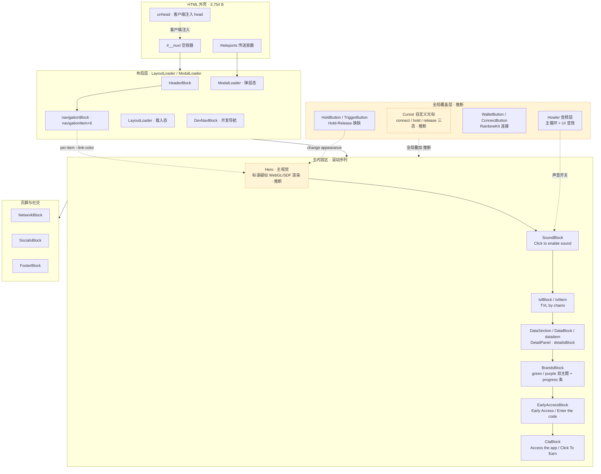
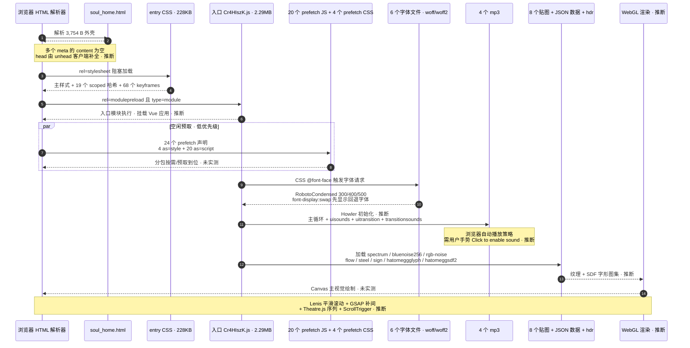
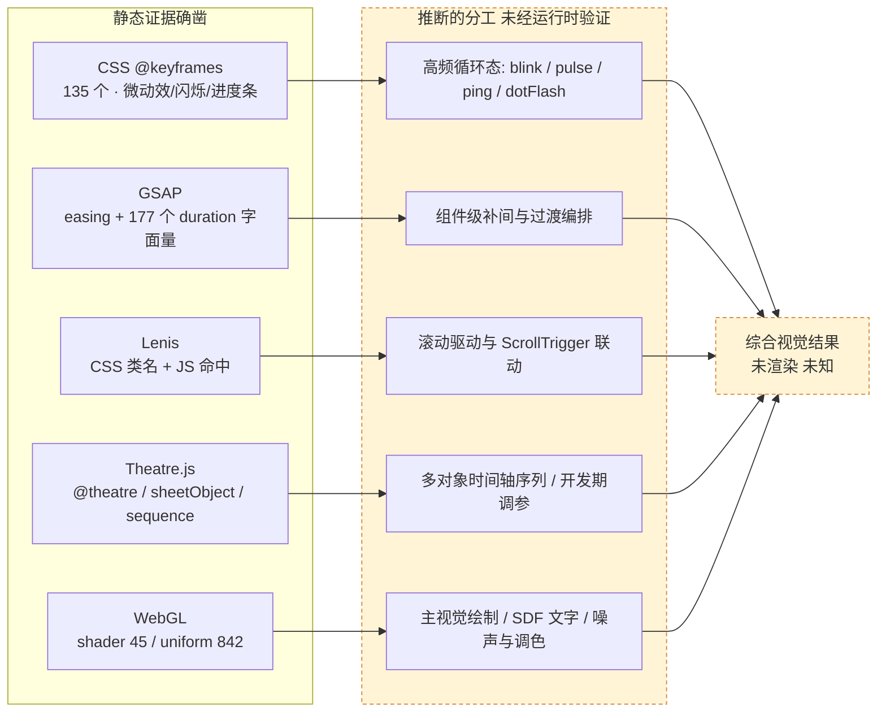

# www.soul.io 落地页 — 公开静态交付物技术拆解报告

> 文档类型：第三方站点**公开静态交付物观察性分析**（独立任务，与本项目此前的架构设计结论无关）
> 分析对象：`https://www.soul.io/?ref=landing.love` 落地页（仅 www 落地页，不外推至应用站）
> 用途：学习前端设计思想
> 分析人：架构师 高见远（Gao）｜团队：software-nday-probe
> 取证日期：本次会话｜证据均为本地已下载的公开静态文件

---

## 1. 结论速览 + 合规与证据边界声明

### 1.1 一句话结论

**这是一个「Nuxt SPA 外壳 + 客户端全量渲染」的重视觉落地页：HTML 只有 3,754 B 的空壳，实际内容由 21 个 JS 分包（5,665,720 B）与 5 个 CSS（444,628 B）在浏览器端组装；技术选型上同时叠加了 WebGL/Three 渲染链、Theatre.js 序列编排、GSAP 补间、Lenis 平滑滚动、Howler 音频与 RainbowKit/wagmi/viem 钱包链，视觉系统以「黑底 + per-item CSS 变量色 + 高密度 scoped keyframes + SDF/噪声贴图」为特征。** 所有结论均来自**静态交付物字符串与样式规则观察**，不是运行时实测。

### 1.2 合规边界声明（**先读**）

| # | 约束 | 本报告如何执行 |
|---|---|---|
| C1 | 目标为第三方商业站点，用户未声明权利人或书面授权 | **不执行逆向工程流程** |
| C2 | 不反编译 / 不去混淆打包产物 | 仅对交付物做**字符串命中统计与 CSS 规则文本读取**；不还原模块语义、不重命名变量、不重构控制流、不生成可读源码 |
| C3 | 不绕过任何技术保护、不尝试未授权访问 | 未发起任何请求；**全部证据为用户预先下载到本地的公开静态文件** |
| C4 | 不提取非公开接口或数据 | 只记录交付物中已存在的路径字符串；不构造请求、不探测端点、不读取任何响应数据 |
| C5 | 不去除版权信息、不提供破解或仿冒方法 | 报告不含任何此类内容；第 13 章明确排除复制品牌表达与受版权保护资源 |
| C6 | 仅限浏览器正常访问即会下载的公开静态交付物 | HTML / CSS / JS / 字体 / 音频 / 贴图的**引用字符串**；不涉及其余资产 |
| C7 | **禁止输出任何客户端配置值** | HTML 中确有公开 runtime config；本报告**仅列键名，值一律不复述**（见 1.4） |
| C8 | `/v1/...`、`/docs/contract/...` 等路径归属未知 | 一律标注「**归属未知**」，不断言为 soul.io 自有后端接口（见第 10 章） |

> **关于 C7 的具体执行**：HTML 外壳中存在公开客户端配置项，可识别的**键名**为 `PROJECT_ENV`、`APP_URL`、`GOOGLE_G4_ID`、`RAINBOWKIT_PROJECT_ID`、`CACHE_ENABLED`、`DATE`（6 个）。本报告仅记录「存在公开客户端配置项（值不复述）」与键名清单，**不输出任何值、标识串、token、日期或 URL**。这些键名的存在本身即为「存在公开客户端配置项（值不复述）」的证据。

### 1.3 本报告未做的事 / 未实跑项（**避免把静态观察当成运行时实测**）

| 项 | 状态 | 说明 |
|---|---|---|
| 浏览器渲染 | ❌ 未做 | **本环境无浏览器**，未打开页面、未截图、未观察布局与视觉呈现 |
| 性能实测 | ❌ 未做 | 未测首屏、LCP、FPS、内存、解码耗时；第 11 章只做**体积与声明层面的静态观察** |
| 网络抓包 | ❌ 未做 | 未记录实际请求顺序、状态码、缓存头、CDN 行为、并发数；第 6 章时序图是**基于 HTML 声明与资源引用字符串的静态推断** |
| 运行时行为验证 | ❌ 未做 | 交互、动画播放、音频播放、WebGL 绘制、钱包连接流程均**未实跑** |
| 接口调用 / 端点探测 | ❌ 未做 | 未对任何路径发起请求（C3/C4） |
| 反编译 / 去混淆 | ❌ 未做 | 见 C2 |
| 资源本体获取 | ❌ 未在证据集 | 字体、音频、贴图、图标、favicon、og:image **只有引用字符串，文件本体未下载**，故体积/内容/编码均未知 |

> 因此本报告中所有关于「加载」「播放」「渲染」「交互」的描述，均指**交付物中声明或引用了相应资源/代码**，不代表已观察到其真实运行效果。

### 1.4 分级标记约定

全文逐条标注：**【事实】**＝可在指定文件中直接复现的字节/字符串/规则；**【推断】**＝由事实出发的合理解释，可能不成立；**【未知】**＝现有证据无法判定，并说明原因。每条结论附证据来源（文件名或脚本口径）。

### 1.5 主理人前序对照信息（非本次取证）

主理人前序工作已确认：**应用站（另一域名）为独立的 Next.js 工程**，采用另一套 CSS、Tailwind + RainbowKit + ScrambleText，与本次落地页**不是同一前端工程**。该信息作为对照输入，非本报告实测结论；**本报告全部结论只针对 www.soul.io 落地页，不外推到应用站**。

---

## 2. 取证方法与证据指纹

### 2.1 取证方法（4 步，全部可复现）

1. **字节级盘点**：Python 读取本地文件，记录字节数与 SHA-256 前 10 位。
2. **结构读取**：直接读 HTML 外壳（3,754 B）与 `js_list.txt`（441 B），统计标签/属性/链接类型。
3. **字符串命中统计**：对 `soul_all.js` 合并文本做**大小写不敏感的子串计数**（`text.lower().count(term.lower())`），并同步对「21 个分包纯拼接文本」重算一遍做交叉校验。
4. **CSS 规则文本解析**：正则提取 `data-v-` 哈希、`@keyframes` 名称、`@font-face`、hex 颜色、`animation:` 简写、CSS 变量与组件类名。

> **计数口径声明**：所有命中数均为**子字符串**计数（例如 `audio` 会计入 `WebAudio`，`uniform` 会计入 `uniforms`），不是词频、不是模块数、不是依赖数。引用这些数字时不得解释为「使用了 N 个库」或「有 N 个组件实例」。

### 2.2 证据文件清单与指纹

| 文件 | 字节数 | SHA-256 前 10 位 | 角色 |
|---|---:|---|---|
| `soul_home.html` | 3,754 | `2644b6a221` | 落地页 HTML 外壳 |
| `soul_all.js` | 5,672,176 | `0ea0abf761` | 21 个 JS 分包的合并文本 |
| `js_list.txt` | 441 | `9d283279d1` | 21 个分包 URL 清单 |
| `entry.CG3DmlIv.css` | 228,045 | `0eb0a73b39` | 主样式表（HTML 直接 `stylesheet`） |
| `default.DAGq2E0M.css` | 99,697 | `ed2738ffe7` | prefetch 样式分包 |
| `SoundBlock.BuaL1dOp.css` | 97,676 | `ca7f7f62c1` | prefetch 样式分包 |
| `CtaBlock.BOL_Ipwf.css` | 10,070 | `0d36dee2b7` | prefetch 样式分包 |
| `proto.UKBeBuwh.css` | 9,140 | `6c18c5d8d2` | prefetch 样式分包 |
| `soul_js/`（21 个文件） | 5,665,720 | `29a29db368`¹ | 原始 JS 分包 |
| 5 个 CSS 合计 | 444,628 | `968fafe4a3`¹ | 样式总量 |

> ¹ 为「按文件名排序后字节流拼接」的聚合 SHA-256 前 10 位；`soul_all.js` 的哈希单独列出，二者不同（见 2.3）。

### 2.3 合并文本的完整性校验【事实】

- `soul_all.js` = 5,672,176 B；21 个分包原始字节和 = 5,665,720 B；**差值 6,456 B**，为合并工具插入的分隔/标注文本（字符层面同为 6,456，说明是纯 ASCII）。【事实｜证据：字节盘点 + 字符数比对】
- **该插入文本不影响本报告任何计数**：对全部 80+ 个检索词，在「合并文本」与「分包纯拼接文本」上的命中数**逐一比对，无一项出现差异**。【事实｜证据：交叉校验脚本】
- 分隔标记的具体格式**未能从文本中直接识别** → 归入【未知】（见 12.3-U5）。

### 2.4 独立复核差异清单（**以实测为准**）

> 主理人给出的 12 组证据已逐条复跑。✅＝一致；⚠️＝需修正/补充；➕＝新发现。

| # | 主理人清单 | 我的实测 | 判定 |
|---|---|---|---|
| D1 | 体积：HTML 3,754 B；CSS 444,628 B；JS 5,665,720 B；合并 5,672,176 B | 完全一致 | ✅ |
| D2 | 21 个分包最大/最小字节 | 完全一致（`Cr4HIszK.js` 2,293,760；`TDtrdbi3.js` 239；`DLfPzRJb.js` 258） | ✅ |
| D3 | 40 个 `data-v-xxxxxxxx` | 40 个并集；且 5 个 CSS 分别为 19/10/9/1/1，无重叠 | ✅ |
| D4 | 技术栈 15 个词命中数 | 全部一致（nuxt 44 / vue 107 / lenis 39 / gsap 45 / three 38 / howler 46 / tweakpane 9 / rainbowkit 43 / wagmi 14 / viem 7 / webgl 101 / canvas 142 / audio 185 / webaudio 50 / scrolltrigger 10） | ✅ |
| D5 | `shader 45 / uniform 842 / palette 22 / appearance 28 / theme 106` | 全部一致 | ✅ |
| D6 | 8 条文案「各出现 1 次」 | `Access the app` 1、`Enter the code` 1、`Click to enable sound` 1、`Click To Earn` 1、`Hold to change appearance` 1、`Release to change appearance` 1 ✅；但 **`TVL by chains` = 2、`Early Access` = 2** | ⚠️ 以实测为准 |
| D7 | Hero 标语 `Unify / Liquidity / Borrowing Power` 0 命中；`Ethereum` 358 / `Earn` 140 / `$SO` 7 | 完全一致 | ✅ |
| D8 | 字体 6 文件、`.woff`+`.woff2`、`font-display:swap`、字重 300/400/500 | 一致；**但 `RobotoCondensed` 在合并 JS 中 0 命中，仅 CSS 中 456 次** | ✅ / ➕ 见 7.2 |
| D9 | 音频 4 个 mp3 | 一致（且 4 个文件本体**均不在证据集**） | ✅ / ➕ |
| D10 | 导航 4 个 `--link-color` 彩色项 | 实际 **5 个**：`index #917ffe` / `claim #e1ff69` / `leaderboard #2fb1b1` / `documentation #e059f5` / **`interactiveexperience #3bad76`**；另有默认 `--link-color:#fff` | ⚠️ 补充第 5 项 |
| D11 | `change-bar 2.6s cubic-bezier(.445,.05,.55,.95) .6s` | 实测 `change-bar-07240cb7 2.6s cubic-bezier(.445,.05,.55,.95) .6s **infinite**` | ⚠️ 补 `infinite` |
| D12 | `dotFlash 2s`（0/.2/.4s 三点错峰） | 存在**两组**：`dotFlash 2s 0s infinite`（全局）与 `dotFlash-988597a8 **3s** 0s/.2s/.4s infinite`（scoped 三点错峰）。三点错峰那组是 **3s 而非 2s** | ⚠️ 需区分两组 |
| D13 | GSAP easing 列表 | 一致（`power1.in`1 / `power2.out`8 / `power2.in`2 / `power3.in`1 / `power4.out`9 / `power4.in`4 / `easeIn`4 / `easeOut`2）；另有 `expo.out` 2 | ✅ / ➕ |
| D14 | duration 常见值 `0.1 / 0.15 / 0.2 … 2.2` | **值集合一致但形式不同**：打包器省略前导零，实际为 `.6 / .2 / .3 / .9 / .1 / .4 / .5 / .45 / .75 / .15 / 1 / 1.2 / 1.8 / 2 / 2.2 / 0`。按 `duration:0.6` 形式检索 **0 命中**；共 177 个数值字面量 duration，**`.6` 占 107 次（约 60%）** | ⚠️ 形式与分布需修正 |
| D15 | 配色清单 | team-lead 所列颜色全部存在；实测共 **20 个唯一 hex**，另有高频 `#90ee90`(42)、`#ff0`(41)、`#3b3b3b`(6)、`#999`(2)、`#575757`、`#add8e6` 未列入 | ✅ / ➕ |
| D16 | `keyframes` 代表性名称 | 实测 **135 个唯一**（大量带 8 位 scoped 哈希后缀的 `blink-*` / `pulse-*` / `change-bar-*` 副本） | ⚠️ 补规模 |
| D17 | HTML 外壳 | 一致；**新增**：22 个 meta、10 个空 `content` 属性、`robots noindex,nofollow`、`unhead:payload`、viewport 禁缩放、PWA meta、og:image / favicon 路径 | ✅ / ➕ |
| D18 | `1 modulepreload + 24 prefetch` | 一致；细分为 **4 个 `as=style` + 20 个 `as=script`**；HTML 中 21 个 JS 引用与 `js_list.txt` 21 条**完全一致** | ✅ / ➕ |
| D19 | 路径线索 | 命中数复核：`/claim`3 `/leaderboard`3 `/ico`2 `/privacy`2 `/404`1 `/channel`1 `/uploads/`3 `/api/proxy/`1 `/dist`5 `/e2e/`5；**以下归属未知**：`/v1/chains`37 `/docs/contract/`20 `/v1/accounts`6 `/v1/subscriptions`2 `/v1/auth/nonce`1 | ✅ 全部按「归属未知」处理 |
| D20 | 组件标识 | JS 侧 17 个标识一致；**CSS 侧另有 19 个组件类名**（含 `tvlBlock` / `detailsBlock` / `navigationBlock` 等 JS 清单未列项） | ✅ / ➕ |

> **结论**：主理人的核心数字（体积、分包、技术栈命中、0 命中标语、颜色、路径）**全部可复现**；需修正的是 6 处计数/节奏细节（D6、D10–D12、D14、D16），不影响整体判断。

### 2.5 覆盖边界【事实】

- **在证据集内**：HTML 外壳、5 个 CSS、21 个 JS 分包、合并 JS 文本、分包 URL 清单。
- **不在证据集内**：6 个字体文件、4 个 mp3、8 个贴图、约 99 个被引用资源（含链图标 / 钱包图标 / i18n locale JSON / 3D 数据 JSON / `.hdr` / `.theatre-project-state.json`）、favicon、og:image、服务端响应、运行时 DOM。
- **因此**：资源体积、压缩率、解码成本、实际加载顺序、缓存策略、是否真的被请求，**全部未知**。

---

## 3. 交付物清单与体积分析

### 3.1 CSS 交付物【事实｜证据：字节盘点 + CSS 解析】

| 文件 | 字节数 | HTML 声明方式 | scoped 哈希数 | `@keyframes` 数 |
|---|---:|---|---:|---:|
| `entry.CG3DmlIv.css` | 228,045 | `rel="stylesheet"`（阻塞） | 19 | 68 |
| `default.DAGq2E0M.css` | 99,697 | `prefetch as=style` | 10 | 33 |
| `SoundBlock.BuaL1dOp.css` | 97,676 | `prefetch as=style` | 9 | 28 |
| `CtaBlock.BOL_Ipwf.css` | 10,070 | `prefetch as=style` | 1 | 3 |
| `proto.UKBeBuwh.css` | 9,140 | `prefetch as=style` | 1 | 3 |
| **合计** | **444,628** | 1 阻塞 + 4 预取 | **40（并集，无重叠）** | **135** |

### 3.2 JS 交付物（21 个分包，按体积降序）【事实】

| 排名 | 文件 | 字节数 | 占比 |
|---:|---|---:|---:|
| 1 | `Cr4HIszK.js` | 2,293,760 | 40.5% |
| 2 | `BSjeif5a.js` | 1,492,284 | 26.3% |
| 3 | `rF7OYusr.js` | 704,622 | 12.4% |
| 4 | `2belj-F3.js` | 570,203 | 10.1% |
| 5 | `B3e2Bcy6.js` | 398,678 | 7.0% |
| 6 | `D6gZ1Dks.js` | 75,794 | 1.3% |
| 7 | `BKEuji4Z.js` | 45,610 | 0.8% |
| 8 | `BewmGAi7.js` | 22,955 | 0.4% |
| 9 | `BxBswHn7.js` | 15,992 | 0.3% |
| 10 | `BwWndK-6.js` | 13,525 | 0.2% |
| 11 | `B0OdL-3F.js` | 6,135 | — |
| 12 | `KGUVgr45.js` | 6,111 | — |
| 13 | `BingjDjf.js` | 5,946 | — |
| 14 | `9jx_tBlf.js` | 5,635 | — |
| 15 | `KnMpFb_e.js` | 2,934 | — |
| 16 | `BNyUu-jl.js` | 2,756 | — |
| 17 | `6IyiQrsp.js` | 945 | — |
| 18 | `Dt2fdkLM.js` | 815 | — |
| 19 | `dmM-zT56.js` | 523 | — |
| 20 | `DLfPzRJb.js` | 258 | — |
| 21 | `TDtrdbi3.js` | 239 | — |
| | **合计** | **5,665,720** | 100% |

### 3.3 体积结构观察【事实 + 推断】

- **前 2 个分包占 66.8%，前 5 个占 96.4%**【事实】。入口 `Cr4HIszK.js` 单独 2.29 MB，且是唯一 `modulepreload` 与唯一 `type="module"` 脚本【事实｜证据：HTML 第 25、50 行】。
- **粒度两极分化**：既有 2.29 MB 的巨包，也有 239 B / 258 B / 523 B / 815 B 的极小包【事实】→【推断】极小包更像路由级/组件级动态 import 的占位胶水，巨包则可能内含第三方 SDK 全量代码（钱包、i18n、3D 加载器）；**此为体积形态推断，未做模块归属验证**。
- **合并文本与分包之和差 6,456 B**：为合并工具插入内容，不影响计数【事实｜见 2.3】。
- **约 99 个被引用资源文件名**出现在 JS/CSS 字符串中，包含 4 个 mp3、8 个贴图、6 个字体、以及大量链/钱包 SVG、i18n locale JSON（`en_US.json`、`zh_CN.json` 等）、3D 数据 JSON（`cloth_mesh*`、`lofi_egg_spawn`、`octree_data17` 等）、`.hdr` 通配与 `.theatre-project-state.json`【事实】。这些资源本体均不在证据集，**体积未知**。

---

## 4. 技术栈还原

> 置信度定义：**高**＝有明确标识符/文件名/API 名且与多处证据互证；**中**＝有字符串命中但可能来自第三方依赖或仅为注释/常量；**低**＝仅由间接线索推断。

| 层 | 还原结果 | 观察证据（命中数／位置） | 置信度 |
|---|---|---|---|
| 应用框架 | Nuxt（SPA 模式） | `
`、`__NUXT_DATA__`、`data-ssr="false"`；`nuxt` 44、`vue` 107 | **高** |
| 视图层 | Vue 3 scoped SFC 样式 | 40 个 `data-v-` 8 位哈希；CSS 按组件分包命名 | **高** |
| 构建 | 带内容哈希的 ES module 分包 | 文件名形如 `Cr4HIszK.js`；`import ... from "./xxx.js"`；`modulepreload` + `prefetch` | **高** |
| Head 管理 | unhead（客户端注入） | `<script id="unhead:payload">`；10 个空 `content` 属性 | **中** |
| 平滑滚动 | Lenis | `lenis` 39（JS）；CSS 中 `.lenis / .lenis-smooth / .lenis-stopped` 相关字符串 462 次 | **高** |
| 补间动画 | GSAP（+ ScrollTrigger） | `gsap` 45、`scrolltrigger` 10；easing 名 `power2.out` 等；177 个数值 `duration:` | **高** |
| WebGL 渲染 | Three.js / WebGL 渲染链 | `three` 38、`webgl` 101、`canvas` 142、`shader` 45、`uniform` 842；`KTX2Loader`3、`DRACOLoader`4、`OglTextureLoader`1、`OglGltfLoader`1 | **高** |
| 序列编排 | Theatre.js（推断） | `.theatre-project-state.json` 1、`@theatre` 29、`sheetObject` 126、`onValuesChange` 6、`sequence` 288、`SequenceEditorPanel` 4、`OutlinePanel` 10 | **中-高** |
| 文字渲染 | SDF / 字形图集（推断） | `hatomeggglyph.png`、`hatomeggsdf2.png`；`glyph` 22、`sdf` 4、`basis` 152 | **中** |
| 音频 | Howler / WebAudio | `howler` 46、`webaudio` 50、`audio` 185；4 个 mp3 引用；`Click to enable sound` 文案 | **高** |
| 钱包连接 | RainbowKit / wagmi / viem（含其样式变量） | `rainbowkit` 43、`wagmi` 14、`viem` 7、`ConnectButton` 78；CSS 中 `--rk-vue-radii-*` 5 个变量、`.grecaptcha-badge` 42 | **高**（作为打包依赖存在） |
| 调试面板 | Tweakpane | `tweakpane` 9（JS）；CSS 中 210 次 | **中**（是否生产启用未知） |
| 配置与埋点 | 存在公开客户端配置项（值不复述） | HTML 内联 runtime config，6 个键名；具体值**按 C7 不复述** | **高**（仅存在性） |
| 字体 | Roboto Condensed 300/400/500 | CSS `@font-face` × 129 处声明，`font-display:swap`；6 个唯一字体 URL | **高** |
| 服务端渲染 | **未启用**（`ssr=false`） | `__NUXT_DATA__` 中 `serverRendered` 对应 `false`；`data-ssr="false"`；`__nuxt` 容器为空 | **高** |

> **重要限定**：上表「命中数」是子字符串计数，**不代表依赖数量或代码占比**；第三方 SDK（尤其钱包/i18n/3D 加载器）会同时贡献多个命中，因此不能据此推断各库的实际权重。

---

## 5. 页面结构与组件地图

### 5.1 证据

- **JS 侧组件标识**【事实】：`SoundBlock`、`BrandsBlock`、`SocialsBlock`、`FooterBlock`、`HeaderBlock`、`EarlyAccessBlock`、`DataSection`、`DataBlock`、`DetailPanel`、`NetworkBlock`、`DevNavBlock`、`LayoutLoader`、`ModalLoader`、`HoldButton`、`TriggerButton`、`WalletButton`、`ConnectButton`（78 次，其余多为 1–9 次）。
- **CSS 侧组件类名（19 个）**【事实】：`headerBlock`、`navigationBlock`、`navigationItem`、`soundBlock`、`tvlBlock`、`tvlItem`、`dataSection`、`dataBlock`、`dataItem`、`detailsBlock`、`detailsItem`、`brandsBlock`、`earlyAccessBlock`、`ctaBlock`、`socialsBlock`、`footerBlock`、`networkBlock`、`devNavBlock`、`holdButton`。
- **文案锚点**【事实】：`Access the app`(1)、`TVL by chains`(2)、`Early Access`(2)、`Enter the code`(1)、`Click to enable sound`(1)、`Click To Earn`(1)、`Hold to change appearance`(1)、`Release to change appearance`(1)。
- **Hero 主标语**【事实】：`Unify` / `Liquidity` / `Borrowing Power` 在合并 JS 中**均 0 命中**；`Ethereum` 358、`Earn` 140、`$SO` 7。

> 【推断】Hero 大标语未以 DOM 文本形式出现在打包 JS 中，结合 SDF 字形图集与高 `uniform` 命中，可能由 **WebGL/SDF 文字贴图渲染**，或来自**运行时数据/未在本次证据集内的资源**；亦可能是主理人观察时看到的是运行时渲染结果。**三种可能均无法在静态证据内排除**（见 12.3-U1）。

### 5.2 组件地图（图 5-1）

> 虚线框＝【推断】的叠加关系；实线＝组件标识与文案在静态交付物中可定位。图中**顺序为按文案与语义组织的示意**，不等于 DOM 真实顺序（未渲染，未知）。

---

## 6. 资源加载时序

> ⚠️ **本图不是网络抓包结果**。它是依据 HTML 中 `link` 标签的声明顺序、以及 JS/CSS 中的资源引用字符串，重构出的**静态加载意图推断图**。实际请求顺序、是否命中缓存、是否被真正请求，均【未知】。

**静态依据**【事实】：HTML 第 24–50 行依次为 1 个 `stylesheet`、1 个 `modulepreload`、24 个 `prefetch`、1 个 `type=module`；CSS 中 `@font-face` 的 `src` 指向 6 个字体；JS 中 4 个 mp3 与 8 个贴图文件名可定位。

---

## 7. 视觉系统拆解

### 7.1 配色 token【事实｜证据：5 个 CSS 的 hex 统计与规则文本】

全量 20 个唯一 hex，按角色分组：

| 角色 | 值（频次） | 说明 |
|---|---|---|
| 底色 | `#000`(169)、`#0c0c0c`(1)、`#101010`(1)、`#101010`/`#2f2f2f`(各 1)、`#252c32`(3) | `body.bg--black` 与 `html/body` 背景为 `#000`；`bg--black` 字符串 42 次 |
| 文本/中性 | `#fff`(34)、`#999`(2)、`#6c7177`(9)、`#575757`(1)、`#3b3b3b`(6) | 导航默认 `--link-color:#fff` |
| 导航 per-item 色 | `#917ffe`(5, index)、`#e1ff69`(10, claim)、`#2fb1b1`(3, leaderboard)、`#e059f5`(2, documentation)、**`#3bad76`(4, interactiveexperience)** | 通过 `navigationItem.<name>{--link-color:...}` 分配，且**两套 scoped 哈希下各定义一遍** |
| 品牌/强调 | `#537fee`(1)、`#f85c76`(1)、`#3bad76`(4) | `brandsBlock.green → --title-color:#3bad76`；`.purple → #917ffe`；默认 `#fff` |
| 高频亮色（用途未知） | `#90ee90`(42)、`#ff0`(41)、`#add8e6`(1) | 疑似第三方组件默认/占位色 → 【未知】，未做归属验证 |
| 浏览器 UI 主题色 | `#ffffff` | `theme-color` 与 `msapplication-TileColor`，**与页面黑底不一致**【事实】 |

> **设计观察**【推断】：导航彩色不是写死在具体元素上，而是通过**按项设置 CSS 自定义属性 `--link-color` / `--title-color`**，由组件内部统一消费。这是典型的「状态色 token 化」做法。

### 7.2 字体【事实｜证据：CSS `@font-face`】

| 项 | 观察 |
|---|---|
| 家族 / 字重 | `RobotoCondensed`，300 / 400 / 500 三档 |
| 文件 | 每档 `.woff` + `.woff2`，共 **6 个唯一 URL**（带内容哈希文件名） |
| `font-display` | `swap`，129 处声明值全部为 `swap` |
| 数据/标签字体 | `monospace` 在 CSS 中 82 次 |
| **归属层** | `RobotoCondensed` 在合并 JS 中 **0 命中**，仅 CSS 中 456 次 → 字体完全由 CSS 驱动 |
| 工程细节 | `@font-face` 内写成**两条独立的 `src:` 声明**（先 `.woff` 后 `.woff2`），而非逗号分隔的多格式列表 →【推断】按 CSS 层叠规则后者覆盖前者，实际可能只使用 `.woff2`；未做浏览器验证 |

### 7.3 圆角、边框与装饰【事实】

| 项 | 观察 |
|---|---|
| `border-radius` | 15 处；值含 `50%`(3)、`1px`、`6px`、`10px`、`13px`、`25%`、`9999px`，以及 5 个 `--rk-vue-radii-*` 变量（来自钱包 UI 组件） |
| 进度条 | `.brandsBlock__progress{background:var(--title-color);bottom:0;height:2px;position:absolute;transform-origin:left;width:1.5rem}` — 2px 高、左端为变换原点、1.5rem 宽 |
| 其他装饰 | `conic-gradient` 1 次；`backdrop-filter` 2 次；`clip-path` / `mix-blend-mode` **0 次** |
| 禁用选择 | `.no-select` 42 次；`pointer-events` 93 次 |
| 光标 | `cursor:pointer`(86)、`cursor:default`(41)、**`cursor:none`(2)** → 配合自定义光标【推断】 |
| 调试/第三方痕迹 | `.tweakpane` 210 次、`.grecaptcha-badge` 42 次、`.lenis*` 462 次（用途归属见第 12 章 U4） |

---

## 8. 动效系统

### 8.1 CSS `@keyframes` 节奏表【事实｜证据：`animation:` 简写正则提取，14 条含时长声明】

| 动画（含 scoped 后缀） | 节奏 | 备注 |
|---|---|---|
| `autoloop-a6a0c329` | `5s linear infinite`（×2） | 自动循环 |
| `change-bar-07240cb7` | `2.6s cubic-bezier(.445,.05,.55,.95) .6s **infinite**` | 进度条；主理人清单漏 `infinite` |
| `blink-circle-d1bb4f75` | `1.3s cubic-bezier(.445,.05,.55,.95) 1.5s infinite` | 在 `#fff` ↔ `#e1ff69` 间跳 |
| `blink-text-d1bb4f75` | `1.3s cubic-bezier(.445,.05,.55,.95) 1.5s infinite` | 与上一项成对 |
| `dotFlash-988597a8` | **`3s` 0s / .2s / .4s infinite**（三点错峰） | 主理人清单写 2s，实为 3s |
| `dotFlash` | `2s 0s infinite` | 另一组全局版本 |
| `ping-824ab742` | `1.5s ease-out infinite` | 扩散提示 |
| `b2j2x51` | `3s linear infinite` | 哈希命名 |
| `m1pf4y1` | `1s linear infinite` | 哈希命名 |
| `_1xq15pn0` / `_1xq15pn1` | `.35s cubic-bezier(.15,1.15,.6,1)` / `.15s ease` | 弹性入场 |

**规模观察**【事实】：共 **135 个唯一 `@keyframes` 名称**，其中大量为 `blink-<8位哈希>`、`pulse-<8位哈希>`、`change-bar-<8位哈希>` 的 scoped 副本；5 个 CSS 文件分别含 68 / 33 / 28 / 3 / 3 个 → 【推断】同一动画逻辑随 scoped 组件在各 CSS 分包中重复生成，是 Vue SFC scoped 样式 + 按组件分包的副产物，会带来一定 CSS 体积冗余。

### 8.2 分工推断（图 8-1）

### 8.3 各层证据强度【事实 → 推断 分级】

| 层 | 静态证据 | 判断 | 未验证项 |
|---|---|---|---|
| CSS keyframes | 135 个名称 + 14 条含时长的 `animation:` 声明 | 【事实】存在；【推断】用于微动效与循环提示 | 实际触发条件、播放时序 |
| GSAP | easing 名命中；`duration:` 228 处、其中 177 个数值字面量；`.6` 占 107 次 | 【事实】存在补间配置；【推断】用于组件级过渡 | 绑定对象、时间轴结构 |
| Theatre.js | `@theatre` 29、`sheetObject` 126、`onValuesChange` 6、`sequence` 288、`.theatre-project-state.json` 1 | 【事实】打包内存在序列编排框架代码 | 是否在生产启用、状态文件内容 |
| Lenis | JS `lenis` 39；CSS `.lenis*` 462 | 【事实】存在；【推断】与 ScrollTrigger 联动 | 滚动参数、联动方式 |
| WebGL shader | `shader` 45、`uniform` 842、`palette` 22、`appearance` 28、`theme` 106、SDF 字形图集 2 个 | 【事实】存在渲染链与主题/外观相关标识；【推断】用于主视觉与换肤 | 着色器内容、换肤实际效果 |
| Tweakpane | JS 9 / CSS 210 | 【事实】打包内存在调试面板代码 | 【未知】是否生产可见 |

> **注意**：`appearance`(28)、`theme`(106)、`palette`(22) 的高命中与 `Hold to change appearance` / `Release to change appearance` 文案相互呼应，但「长按换肤 → 改变 WebGL 调色板」这条因果链**仍是推断**，未做运行时验证。

---

## 9. 交互状态

> **整体限定**：本节所有状态名均为**依据文案与组件标识重构的语义标签**，未在代码中找到显式状态机标识（`cursorState` / `cursor--` / `is-holding` 均 **0 命中**）。除文案与样式规则外，均为【推断】。

| 状态 / 交互 | 静态证据 | 分级 |
|---|---|---|
| **声音关闭 → 开启** | 文案 `Click to enable sound`(1)；4 个 mp3 引用；`howler` 46 / `webaudio` 50 | 【事实】开关文案与音频资源存在；【推断】受浏览器自动播放策略约束需用户手势 |
| **长按换肤（Hold）** | 文案 `Hold to change appearance`(1)；`HoldButton` 组件；`holdButton` CSS 类；`hold` 90 次 | 【事实】文案+组件存在；【推断】按下进入换肤态 |
| **松开换肤（Release）** | 文案 `Release to change appearance`(1)；`release` 133 次 | 【推断】松开提交/复位 |
| **连接态（connect）** | `ConnectButton` 78、`WalletButton` 1、`connect` 2918、`rainbowkit` 43 | 【事实】钱包连接组件打包存在；【推断】光标 connect 态 |
| **自定义光标三态** | `cursor:none` 2 次 + 上述文案 + Hold/Connect 组件 | 【推断】「connect / hold / release」三态为语义归纳，**非代码中的状态枚举** |
| **导航彩色 hover** | 5 个 `navigationItem.<name>{--link-color:...}`，两套 scoped 哈希各一遍 | 【事实】按项配色规则存在；【推断】hover 时启用该色 |
| **邀请码** | 文案 `Enter the code`(1)、`Early Access`(2)；`invite` 28 次 | 【事实】文案存在；【推断】对应邀请码校验流程（端点归属未知） |
| **Click To Earn** | 文案 `Click To Earn`(1)；`/claim` 3、`/leaderboard` 3 | 【事实】文案与路径字符串存在；【推断】对应积分/领取流程（未验证） |
| **禁用缩放 / 禁选** | viewport `maximum-scale=1,user-scalable=0,minimal-ui`；`.no-select` 42 | 【事实】；【推断】沉浸式/游戏化交互意图 |
| **进度/载入态** | `LayoutLoader` / `ModalLoader`；`brandsBlock` 默认 `opacity:0;visibility:hidden`；`autoloop 5s` | 【事实】；【推断】存在载入遮罩与循环进度动画 |

---

## 10. 路由与数据

### 10.1 已知路径（**仅表示交付物中出现的字符串**）【事实】

| 路径 | 命中 | 说明 |
|---|---:|---|
| `/claim`、`/leaderboard`、`/ico`、`/privacy`、`/404`、`/channel` | 3 / 3 / 2 / 2 / 1 / 1 | 落地页相关路由字符串 |
| `/uploads/`、`/api/proxy/` | 3 / 1 | 资源/代理路径字符串 |
| `/dist`、`/e2e/` | 5 / 5 | 构建/测试目录字符串（很可能来自第三方依赖或构建元数据） |
| `/images/share/…`、`/images/favicon/…` | HTML 各 1 | 分享图与图标路径 |

> 上表**不代表这些路径可访问、可请求或返回什么**；本报告未对任何路径发起请求（C3/C4）。

### 10.2 归属未知路径（**不得断言为 soul.io 自有后端接口**）

| 路径字符串 | 命中 | 归因处理 |
|---|---:|---|
| `/v1/chains` | 37 | **归属未知** — 高频出现更接近 SDK 链配置常量 |
| `/docs/contract/…` | 20 | **归属未知** — 疑为依赖内文档/ABI 引用 |
| `/v1/accounts` | 6 | **归属未知** |
| `/v1/subscriptions` | 2 | **归属未知** |
| `/v1/auth/nonce` | 1 | **归属未知** |

**为什么标注归属未知**【推断】：`rainbowkit`/`wagmi`/`viem` 命中分别为 43/14/7，且证据集中约 99 个引用资源里包含大量链图标、钱包图标与 i18n locale JSON，符合「第三方 Web3 SDK 被整包打进产物」的形态；`/v1/chains` 出现 37 次也更像 SDK 内的链清单常量而非业务接口。**但这只是形态推断，本报告未做模块归属验证，因此一律保持「归属未知」，不写作「soul.io 的 API」。**

### 10.3 数据相关观察【事实】

- `__NUXT_DATA__` 内容为空壳结构（含 `serverRendered:false`、`data`/`state`/`once` 均为空对象、`["Set"]`），**没有任何预取的业务数据** → 【推断】页面内容依赖客户端运行时获取或由渲染层生成。
- 引用了多个 JSON 数据文件（3D 网格 / 布料 / 特效生成 / 网络数据等）与 `.theatre-project-state.json`【事实】；**文件内容不在证据集，结构与用途未知**。
- 存在公开客户端配置项（值不复述），含环境、应用地址、埋点标识、钱包项目标识、缓存开关、构建时间戳共 6 个键名【事实｜仅键名】。

---

## 11. 工程特征与性能观察（**纯静态，不声称实测**）

| # | 观察 | 证据 | 静态解读（不越界） |
|---|---|---|---|
| 1 | `data-ssr="false"` + 空 `#__nuxt` + `__NUXT_DATA__` 无业务数据 | HTML 第 51 行 | **SSR 关闭**：HTML 不携带渲染内容，首屏内容依赖 JS 执行；【推断】不利于无 JS 环境与爬虫可见性。与 `robots noindex,nofollow` 同时出现 |
| 2 | 22 个 meta，其中 **10 个 `content` 属性无值**；`unhead:payload` 仅含空标题 | HTML head | 【推断】head 由客户端 unhead 运行时补全；静态 HTML 的 SEO/分享元数据不完整 |
| 3 | `robots noindex, nofollow` | HTML head | 【事实】；【未知】是有意的落地页策略还是构建产物默认值 |
| 4 | 5.67 MB JS（21 包）+ 444 KB CSS | 字节盘点 | 【事实】未压缩前的交付物字节规模；**不含字体/音频/贴图**（本体未知），故总传输量更大且未知 |
| 5 | 前 2 个 JS 包占 66.8% | 体积表 | 【推断】入口粒度较粗，第三方 SDK 可能未充分拆分 |
| 6 | 1 个 `modulepreload` + 20 个 `as=script` prefetch + 4 个 `as=style` prefetch | HTML 第 25–49 行 | 【事实】预取策略覆盖全部 21 个 JS；【推断】意图是把后续路由/组件分包提前放入缓存。**是否实际触发、命中率、带宽影响均未实测** |
| 7 | HTML 中 21 个 JS 引用与 `js_list.txt` 21 条完全一致 | 集合比对 | 【事实】证据集覆盖完整，无遗漏分包 |
| 8 | 40 个 scoped 哈希、135 个 keyframes、5 个 CSS 分包 | CSS 解析 | 【推断】按组件切分 CSS 带来同逻辑动画的 scoped 副本冗余 |
| 9 | 字体双格式 6 文件 + `font-display:swap` | CSS `@font-face` | 【事实】；`swap` 意味着回退字体先显示【推断，基于规范】；实际是否产生布局偏移未实测 |
| 10 | 音频 4 个 mp3、贴图 8 个、约 99 个引用资源 | JS/CSS 字符串 | 【事实】仅引用；**全部本体不在证据集，体积/编码/加载优先级未知** |
| 11 | `tweakpane`(JS 9 / CSS 210)、`grecaptcha-badge`(42) | 字符串命中 | 【事实】调试面板与验证码相关样式被打包；【未知】是否生产启用 |
| 12 | viewport 禁缩放 + PWA meta + `theme-color` 白 / 页面黑底 | HTML head | 【事实】；【推断】沉浸式移动端体验取向 |

> **性能相关禁语**：以上不含 FCP/LCP/TTI/FPS/内存/解码耗时等任何实测数值，也不含「快/慢/卡顿」等体验结论。这些需要浏览器环境，本次未做。

---

## 12. 观察 / 推断 / 未知 三段清单

### 12.1 【观察】— 可在指定文件中直接复现

| O# | 观察 | 证据来源 |
|---|---|---|
| O1 | HTML 3,754 B；`#__nuxt` 与 `#teleports` 空容器；`data-ssr="false"` | `soul_home.html` |
| O2 | 1 `stylesheet` + 1 `modulepreload` + 24 `prefetch`（4 style / 20 script）+ 1 `type=module` | `soul_home.html` |
| O3 | 21 个 JS 分包共 5,665,720 B；5 个 CSS 共 444,628 B；合并 JS 5,672,176 B（多 6,456 B 插入标记） | 字节盘点 |
| O4 | 40 个 `data-v-` 哈希；135 个唯一 `@keyframes`；14 条含时长的 `animation:` 声明 | 5 个 CSS |
| O5 | 15 个技术栈字符串命中数、5 个渲染词命中数，全部与主理人清单一致 | `soul_all.js` 子串计数 |
| O6 | `Unify` / `Liquidity` / `Borrowing Power` 均 0 命中；`Ethereum` 358、`Earn` 140、`$SO` 7 | `soul_all.js` |
| O7 | 6 个字体 URL（3 字重 × woff/woff2）、`font-display:swap`、双独立 `src:` 写法 | CSS `@font-face` |
| O8 | 4 个 mp3、8 个贴图、约 99 个被引用资源名；**本体均不在证据集** | JS/CSS 字符串 + 目录检查 |
| O9 | 5 个导航 `--link-color` 彩色项 + 默认 `#fff`；20 个唯一 hex | CSS 规则 |
| O10 | `brandsBlock__progress`：2px 高、`transform-origin:left`、1.5rem 宽 | CSS 规则 |
| O11 | 177 个数值 `duration:` 字面量，`.6` 占 107 次；easing 名 8 类 + `expo.out` | `soul_all.js` |
| O12 | 路径字符串命中数（已知路径 + 归属未知路径） | `soul_all.js` |
| O13 | 22 个 meta、10 个空 `content`、`robots noindex,nofollow`、viewport 禁缩放、PWA meta | `soul_home.html` |
| O14 | 存在公开客户端配置项，键名 6 个（**值不复述**） | `soul_home.html` |
| O15 | HTML 中 21 个 JS 引用与 `js_list.txt` 21 条集合完全一致 | 集合比对 |

### 12.2 【推断】— 由观察出发、可能不成立

| I# | 推断 | 依据 | 为何只是推断 |
|---|---|---|---|
| I1 | Hero 主标语由 WebGL/SDF 文字贴图渲染，或来自运行时数据 | O6 + SDF 图集 + `uniform` 842 | 未在证据集内找到标语文本；也可能在未被采集的资源/运行时接口中，三选一无法排除 |
| I2 | Theatre.js 用于多对象时间轴序列与开发期调参 | `@theatre` 29 / `sheetObject` 126 / `sequence` 288 / `SequenceEditorPanel` | 打包存在 ≠ 生产启用 |
| I3 | WebGL 承担主视觉与「换肤」调色 | `shader` 45 / `palette` 22 / `appearance` 28 / 换肤文案 | 未读着色器逻辑、未渲染 |
| I4 | Lenis 与 ScrollTrigger 联动做滚动驱动动画 | 两者同时命中 + `lenis*` CSS 类 | 未验证绑定关系 |
| I5 | 135 个 keyframes 中的 scoped 副本是 SFC 分包冗余 | 命名规律 `blink-<8位哈希>` + 各 CSS 分包分布 | 未做去重收益测算 |
| I6 | `@font-face` 的 `.woff` 声明被后一条 `.woff2` 覆盖 | 同一规则内重复 `src:` 属性 | 依据 CSS 层叠规范推断，未做浏览器验证 |
| I7 | `prefetch` 策略意在提前缓存后续路由/组件分包 | 24 个 prefetch 覆盖全部分包 | 未抓包，不知实际触发与命中 |
| I8 | `tweakpane` / 钱包 SDK / i18n 为打包进产物的第三方依赖 | 命中 + 99 个第三方风格资源名 | 未做模块归属验证 |
| I9 | `robots noindex` 与空 meta 说明该页不面向 SEO，而是投放/体验页 | O13 | 无法排除构建默认值 |
| I10 | 「光标 connect / hold / release 三态」是合理交互归纳 | 文案 + Hold/Connect 组件 + `cursor:none` | **代码中无显式状态枚举**（`cursorState` 等 0 命中） |
| I11 | 前 2 个巨包含未充分拆分的第三方 SDK | 体积分布 + 第三方资源数量 | 未做包内容归属分析（C2 禁止） |

### 12.3 【未知】— 现有证据无法判定，并说明原因

| U# | 未知项 | 为什么无法确定 |
|---|---|---|
| U1 | Hero 标语的确切渲染方式与来源 | 静态交付物 0 命中；标语可能在未采集的图片/JSON、运行时接口，或直接由 WebGL 图集绘制；无浏览器渲染可对照 |
| U2 | 字体/音频/贴图/JSON 的真实体积、编码、加载优先级 | 资源本体**不在证据集**，只有引用字符串 |
| U3 | 实际请求顺序、缓存命中、CDN 行为、并发数、压缩后传输量 | 未做网络抓包（1.3）；`prefetch` 只是意图声明 |
| U4 | `tweakpane`、`grecaptcha-badge`、`/dist`、`/e2e/` 是否生产可见/可达 | 仅有字符串命中；未请求、未渲染、未做归属分析 |
| U5 | `soul_all.js` 多出的 6,456 B 分隔标记的具体格式 | 文本中未识别到明确标记行；只能确认是纯 ASCII 插入内容，且不影响任何计数 |
| U6 | `/v1/...`、`/docs/contract/...` 的真实归属与用途 | 未做模块归属验证（C2/C4）；按 C8 一律保持「归属未知」 |
| U7 | 首屏性能、FPS、内存、交互流畅度 | 本环境无浏览器，未做性能实测 |
| U8 | 邀请码 / Click To Earn / 换肤 / 钱包连接的真实业务行为 | 未渲染、未交互、未调用任何端点 |
| U9 | 应用站与落地页的共享代码/组件程度 | 应用站证据不在本次范围；仅据主理人对照信息知道是独立工程 |
| U10 | `#90ee90`(42) / `#ff0`(41) 等高频亮色的用途 | CSS 中仅有色值，无足够上下文判定是占位、调试还是高亮态 |
| U11 | `theme-color` 白与页面黑底不一致的原因 | 无设计文档、无渲染截图 |

---

## 13. 对我们自己项目的设计启示（**仅为「设计选择」，不是复制建议**）

> 背景：我们自己的作品是「AI 自适应 Web 漏洞探测」的演示前端（科技风大屏 + 功能页）。以下每一条都是**方法层面的取舍建议**，明确标注为设计选择；**不复制其品牌表达、配色组合、字体文件、贴图、音频、SDF 字形图集或任何受版权保护的资源**，也不提供任何仿冒方法。

| # | 观察到的做法 | 我们的**设计选择**（独立决策） | 边界 |
|---|---|---|---|
| 1 | 用 `--link-color` / `--title-color` 按项分配状态色，组件内部统一消费 | **把状态色 token 化**：我们大屏的 `BLOCKED / ANOMALY / NORMAL / TIMEOUT` 四态各绑定一个 CSS 变量，判定结果只切换变量名，不散落硬编码色值 | 色值自选，不沿用其配色 |
| 2 | CSS 微动效 / GSAP 补间 / WebGL 主视觉分层 | **明确动效预算分层**：CSS 只做「状态指示类」微动效（拦截闪烁、进度条），JS 只做「状态切换」过渡；**不引入 WebGL**，因为我们零依赖单文件的约束下收益不抵复杂度 | 不引入 3D 引擎 |
| 3 | 逐轮动画、进度条、`autoloop` 循环态 | **把状态机映射到 UI 状态**：每一轮迭代对应一个可辨认的视觉阶段（生成 → 校验 → 发包 → 判定 → 反馈），与我们的 `round` 证据链一一对应，让「AI 在干活」可见 | 抽象为状态可视化，不仿其视觉 |
| 4 | 5.67 MB JS + 444 KB CSS + 约 99 个资源 | **反向取舍：坚持零依赖单文件**，把体积预算当作硬约束；这恰是我们相对重视觉站点的差异化优势 | 不评价对方优劣，只说明我们选另一条路 |
| 5 | `font-display:swap`、声音需用户手势、`cursor:none` | **可访问性兜底**：字体回退、声音默认关闭且显式开关、自定义光标必须提供系统光标降级 | 通用工程实践 |
| 6 | `data-ssr="false"` + 空 meta + 客户端补 head | **我们保留静态可检索的 HTML 骨架**：关键标题/说明写在 HTML 里，不依赖 JS 才能看到基本内容 | 与对方选择相反，基于演示可复现性 |
| 7 | 135 个 scoped keyframes 副本 | **动效集中定义、按状态复用**，避免同一动画生成多份 scoped 副本 | 通用工程实践 |
| 8 | 存在公开客户端配置项 | **演示原型不内联任何标识符/密钥形态字符串**；需要配置时用占位名并在文档中说明 | 与本次 C7 合规口径一致 |
| 9 | 逐轮/分阶段资源声明清晰 | **把我们自己的证据链做成可视化主线**：轮次号、上轮响应指纹、模型决策摘要、拦截标记，作为大屏核心信息架构 | 完全自主的信息设计 |

> **不采纳清单（明确排除）**：其品牌名称与标识、品牌色组合、Roboto Condensed 字体文件、4 个 mp3、8 个贴图（含 SDF 字形图集）、钱包/链图标、i18n 文案、任何 Theatre.js 项目状态文件内容，以及一切可能受版权或商标保护的表达。本报告仅讨论「怎么组织」，不提供「拿什么来组织」。

---

## 14. 未解问题与后续取证建议

> **范围限定**：以下建议**全部限定在公开静态交付物范围内**，不含任何越权操作。凡涉及「请求端点」「登录」「绕过」「解析非公开数据」的做法一律不建议、不列出。

| # | 未解问题 | 合规的后续取证建议 |
|---|---|---|
| 1 | Hero 标语来源（U1） | 在**已下载的公开静态资源**范围内，检查后续可合法获取的图片/JSON 引用清单里是否有文字图集元数据；仅记录文件名与格式，不解析受保护内容 |
| 2 | 资源真实体积（U2） | 仅使用浏览器正常访问即会下载的公开资源，记录其 `Content-Length` 与格式；**不构造非常规请求** |
| 3 | 135 个 keyframes 的冗余比例（I5） | 对已取得的 5 个 CSS 做纯文本去重统计，量化 scoped 副本占比（静态文本分析，无需浏览器） |
| 4 | 第三方依赖形态（I8 / U6） | 在**不做反编译/去混淆**前提下，仅统计公开字符串中的包名与资源目录命名规律，持续保持「归属未知」标注 |
| 5 | 字体双 `src:` 的实际生效格式（I6） | 查阅公开 CSS 规范文字即可得出结论，无需对目标站点做任何操作 |
| 6 | 动效分工（I2/I3/I4） | 若后续获得**公开可用的浏览器环境**，可做纯观察性记录（渲染截图、动画名称与时长对照），但不抓取业务数据、不探测接口 |
| 7 | 应用站与落地页关系（U9） | 属另一次独立分析范围；本报告结论不外推 |

**本报告的收敛点**：在不越出「公开静态交付物 + 字符串/规则级观察」边界的前提下，可确定的技术画像已经完整；再往下（运行时行为、接口归属、性能数值、视觉真实呈现）**必须依赖浏览器渲染或网络观测，本次环境不具备，且按合规约束不主动扩展**。

---

## 附：给主理人的一句话总结

**这是一个 HTML 只有 3.7 KB 空壳、内容全靠 5.67 MB JS 客户端组装的 Nuxt SPA 重视觉落地页，技术特征是「WebGL/SDF 主视觉 + Theatre.js 序列 + GSAP/Lenis 补间与滚动 + Howler 音频 + 钱包 SDK 整包」以及「黑底 + per-item CSS 变量色 + 135 个 scoped keyframes」——我们独立复核了全部核心数字（一致），修正了 6 处计数与节奏细节，并把所有运行时、接口归属、性能与视觉呈现问题诚实地留在「未知」里。**

> 声明：本报告为第三方站点**公开静态交付物的观察性分析**，未执行逆向工程、未反编译/去混淆、未绕过技术保护、未尝试未授权访问、未提取非公开接口或数据、未去除版权信息、未提供破解或仿冒方法；**未输出任何客户端配置值**；`/v1/...` 等路径一律标注「归属未知」；本环境无浏览器，未做渲染、性能实测与网络抓包；所有静态观察均未描述为运行时实测。
