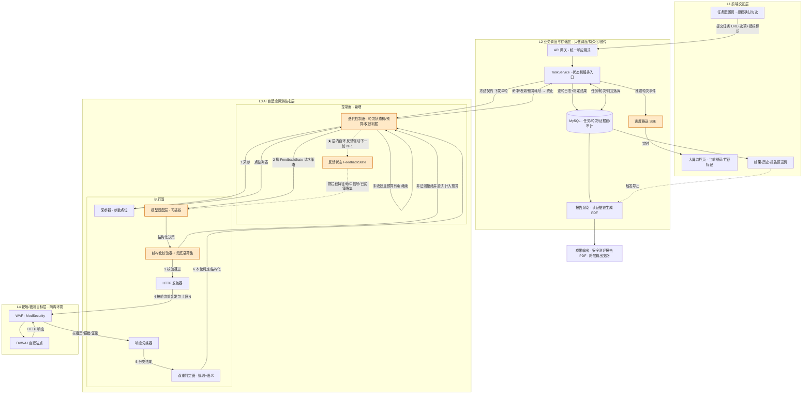
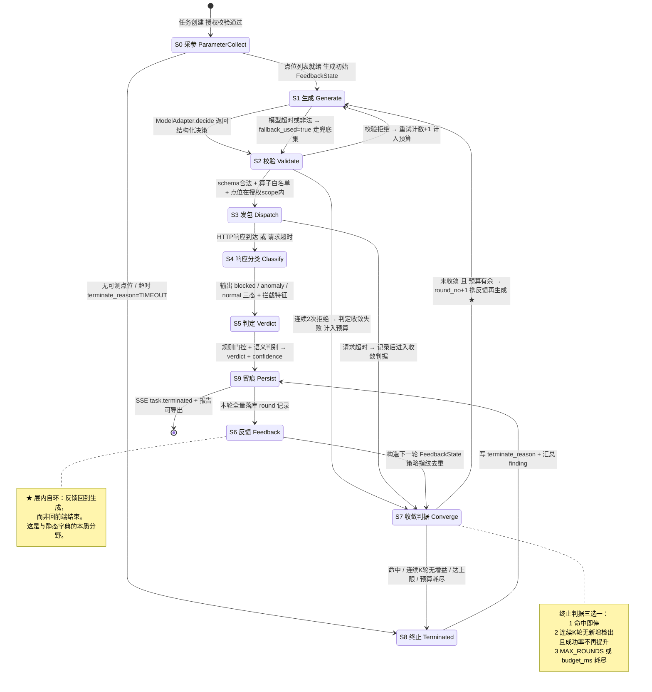
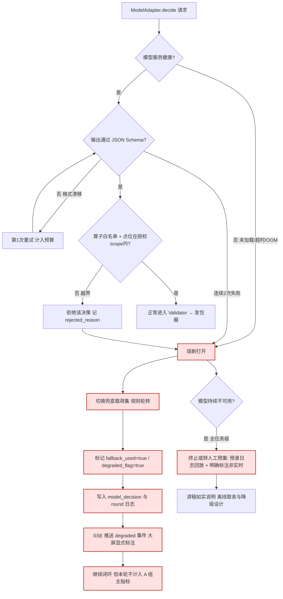
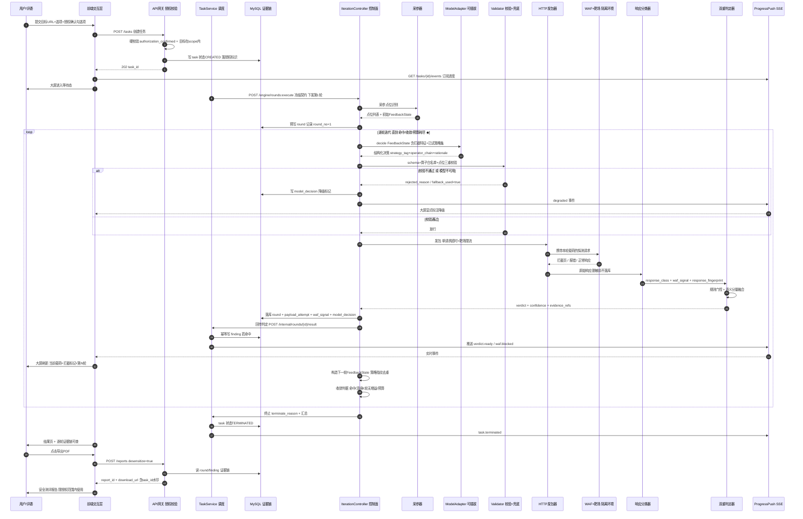
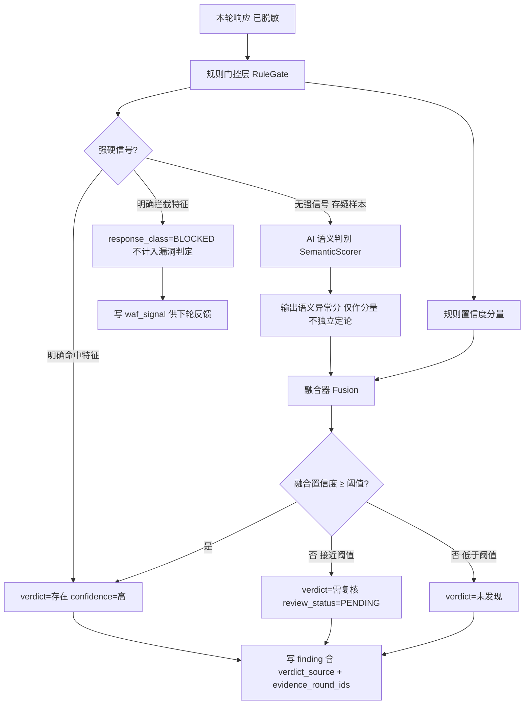
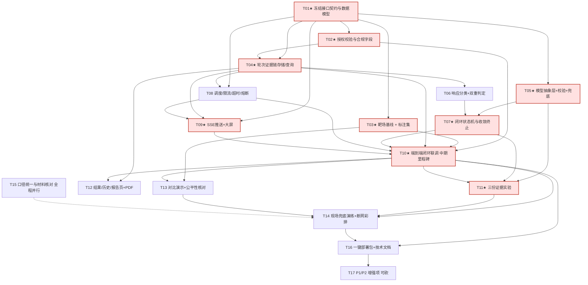

# AI自适应Web漏洞智能探测与绕过检测系统 — 系统架构与技术可行性评审

> 文档类型：架构评审 + 技术可行性判断 + 实施顺序建议（**评审/设计类，非实现类**）
> 评审依据：产品经理《01-产品与评审分析.md》全文、原始材料图1（架构逐层拆解）、图2（四人分工）、图3（系统架构图），及主理人转交的综合结论
> 评审人：架构师 高见远（Gao）｜团队：software-nday-probe
> 适用对象：4 人学生团队、竞赛/答辩级作品
>
> **声明与边界**：
> 1. 本文不写实现代码、不创建工程、不运行靶场、不发包；仅给出接口契约、数据结构、状态机、Mermaid 图与伪代码级状态定义。
> 2. 全文**不含任何可用于攻击真实系统的载荷、命令或操作步骤**；涉及变形技术时一律以「算子编号 / 策略标签」抽象表述，不外露具体内容。
> 3. 不编造模型性能数据、benchmark 或引用来源；凡属定性推断处均标注「推断」。
> 4. 本文承接产品经理的定位结论（"AI 不挖洞，AI 学绕"、sqlmap 为基线对照组、三份证据），**不重复其产品分析**，只做技术判断与工程落地设计。

---

## 0. 评审结论速览

**一句话结论**：原架构**四层骨架清晰、纵向数据主线成立**，但它是"一次性请求/响应流水线"的画法，**没有把项目最值钱的「逐轮反馈自适应闭环」画成可运行、可终止、可取证的控制回路**；同时缺少状态机、证据链、结构化输出校验、接口契约、实时推送、并发保护、授权审计与模型抽象这 8 类工程组件。按竞赛/答辩级作品评价，可定档为 **「架构骨架合格（B），控制面缺失（C-），证据链与接口契约缺失（D，P0 必修）」**——补齐后足以支撑创新主张，不补齐则"闭环自适应"在设计文档层面即不成立，答辩无法自证。

### 0.1 分档评分表

| # | 评审维度 | 现状判断 | 档位 | 是否阻断答辩 |
|---|---|---|---|---|
| 1 | 分层清晰度（4 层纵向切分） | 前端 / 调度存储 / AI 核心 / 靶场，职责大类划分合理，符合"表现—控制—执行—被测"的直觉 | **A-** | 否 |
| 2 | 数据主线完整性 | 提交 URL → 任务 → 发包 → 响应 → 入库 → 展示 → 报告，主线无断点 | **B+** | 否 |
| 3 | 职责边界自洽性 | 存在标注歧义：调度层声称"不做判定"，但回流箭头标注含"识别漏洞"，易被读成调度层执行判定 | **B-** | 否（但需改标注） |
| 4 | **闭环回路在架构图上的表达** | 图3 只有**跨层单向反向箭头**，缺 AI 层**内部自环**与按轮次重复发包；"自适应"在图上不可见 | **D** | **是（P0）** |
| 5 | **任务/轮次状态机与收敛终止** | 材料完全未定义最大轮次、超时、去重、预算；任务表只有一个"探测状态"单值 | **D** | **是（P0）** |
| 6 | **逐轮迭代日志与证据链** | 三张表（任务/payload/漏洞）**丢了"轮次"这一维**，无法证明"第 N+1 轮由第 N 轮响应触发" | **D** | **是（P0，答辩命门）** |
| 7 | 模型输出约束与降级 | 材料只写"内置提示词工程"，无 schema、无非法拒绝、无兜底载荷集、无降级链路 | **D** | **是（P0）** |
| 8 | 模块间接口契约 | 1 号与 4 号之间无冻结契约；4 号强依赖，接口一变全返工（PM 已列为组织风险） | **D** | **是（P0）** |
| 9 | 实时进度推送机制 | "大屏实时展示"是 P0 需求，但材料未定 WebSocket / SSE / 轮询 | **C-** | 是（可快速补） |
| 10 | 并发 / 限流 / 超时 / 熔断 / 靶场保护 | 只提"控制并发与超时"一句，无限流、熔断与靶场自我保护 | **C-** | 否（现场会翻车） |
| 11 | 授权校验与审计 | 页脚声明有，但**不是产品字段**；无授权标识入库、无脱敏、无报告分发控制 | **C-** | 是（合规口径） |
| 12 | 模型服务抽象层 | Ollama 直连写死在 AI 层，无法一键切"去掉模型/去掉反馈"的消融组 | **D** | **是（P0，创新证据）** |
| 13 | 双重判定与误报量化 | 有"规则 + AI 语义"设想，无组合方式、无置信度、无标注集与基线对比 | **C** | 否（P1） |
| 14 | 靶场与对比演示公平性 | 有 DVWA + ModSecurity 与 sqlmap 对比设想，无"四同"控制变量、无兜底预案 | **B-** | 是（现场） |
| 15 | 可复现 / 一键部署 | 列入 4 号交付，方向正确 | **B** | 否 |

> **总体定档**：`分层 A- ／ 控制面 C- ／ 证据链与契约 D`。三个 D 类缺口（4、5、6、7、8、12）互为因果，须作为一个**"控制面 + 证据链"整体补丁**一次性设计，不能零散补。

---

## 1. 架构总体评价

### 1.1 结论

**分层清晰 / 边界基本合理 / 存在 3 处结构性名实不符 + 8 处工程缺口**。原架构是一张**"功能框图"而非"控制架构图"**：它正确回答了"有哪些模块、数据往哪流"，但没有回答"一轮怎么结束、下一轮凭什么开始、什么时候停、怎么证明这一过程真实发生过"。对以"闭环自适应"为唯一创新点的作品，这恰恰是评审最会追打的地方。

### 1.2 四层划分「名实相符」逐层核查

| 层 | 材料声称职责 | 实际承载 | 名实判断 | 备注 |
|---|---|---|---|---|
| L1 前端交互层 | 5 个页面（配置/大屏/结果/历史/报告预览），输入输出可视化 | 纯表现 + 用户入口，另**额外承担 PDF 导出触发** | **基本相符** | "导出"是动作不是层，见 1.3-B |
| L2 业务调度&存储层 | 任务调度、并发超时、MySQL、"只做调度+存储+展示"，**不做 Payload 生成、不做漏洞判定** | 调度 + 持久化 + 报告生成 + 接口中转 | **基本相符，但箭头标注有歧义** | 见 1.3-A；另"报告生成"被塞进本层，与"前端导出"重复定义 |
| L3 AI 自适应探测核心层 | 5 子模块闭环：采参 → 本地推理 → 发包验证 → 双重判定 → 反馈迭代 | **实际是"执行层 + 控制层"混装**：发包、判定属执行；反馈迭代属控制 | **名实部分不符** | 缺一个显式的**迭代控制器（控制面）**；5 个子模块目前是并列罗列，没有谁是"循环的主人" |
| L4 靶场/目标站点层 | DVWA + 自建带 WAF 站点，被测对象 | 被测环境 + 演示基线 | **相符** | 但它同时是"实验对照组环境"，应显式承担实验控制变量 |

**关键判断（推断）**：L3 被命名为"核心层"却把**控制逻辑（决定下一轮、决定何时停）与执行逻辑（发一个包、判一个响应）混在同一层且无主从**，这是全部混乱的根源。建议不打乱四层骨架，只在 L3 内部**切出「控制面 / 执行面」两个子平面**，由控制面持有状态机与预算。这是对原设计改动最小、收益最大的修法。

### 1.3 三处必须先厘清的结构性矛盾

#### A. 「调度层不做判定」vs「AI 核心 → 识别漏洞、本轮探测结果 → 调度层」

**判断：不是真正的职责冲突，是箭头标注歧义，但会直接演变成接口契约缺失。**

- 动作主体其实一致：漏洞判定由 L3 的判定子模块执行，L2 只**接收结构化结果 → 落库 → 转发前端**。这与"L2 不做判定"不矛盾。
- 但图3 把「识别漏洞」四个字写在 **L3 → L2 的回流箭头上**，视觉上等于把"判定"这个动作挂在了跨层传输上；再叠加 L2 里还有一个"报告生成模块读取探测记录"，很容易被读成 L2 也在做结论性判断。
- **后果**：判定结果的**格式、置信度、来源标记、可复核状态**没人定义 → 4 号按自己的理解建漏洞表，1 号按自己的理解回传，联调时才发现字段对不上（PM 已预警的"接口一变全返工"）。
- **最小修法**：① 箭头标注改为「本轮判定结果（结构化：verdict / confidence / evidence_round_ids）」；② 在架构说明里写死一句「**判定的唯一执行主体是 L3 判定器，L2 只做透传与持久化，不得改写 verdict**」；③ 由本文第 5.2 节的 `POST /api/v1/internal/rounds/{round_id}/result` 契约冻结字段。

#### B. 「成果输出：安全测评报告」独立方框但由前端导出，是否算一层？

**判断：不算一层，且不应算。**

- 四层是按**职责/运行时位置**切的（前端、服务、核心、被测环境），"安全测评报告"是按**交付物产物**切的，两者分类维度不同。把它升格为第 5 层会造成"层"的定义自相矛盾，答辩时容易被追问"第五层和第一层什么关系"。
- 它实际横跨 L1（预览/导出触发）与 L2（读取记录、渲染 PDF、文件落盘），是**跨层的输出支路**，不是运行时层。
- **最小修法**：在图3 中把它从"独立方框"降级为**从 L2 引出的输出支路**（虚线箭头，标注「报告渲染：读 round/finding 证据链 → 生成 PDF」），前端只保留"预览 + 触发导出"；同时在 L2 明确**只有一个报告生成入口**，消除 L1/L2 重复定义。

#### C. 闭环回路在架构图上是否被完整表达？

**判断：否，这是本次评审发现的最严重表达缺口。**

| 应表达的回路 | 图3 现状 | 缺什么 |
|---|---|---|
| AI 层**内部**「本轮结果 → 反馈 → 再生成下一轮 Payload」 | 无 | **层内自环**完全缺失 |
| 「AI 核心 → 目标站点」按轮次**重复发包** | 只有一条单向箭头 | 缺「× N 轮 / 直到收敛」标注 |
| 目标 → AI 核心 → **再回 AI 核心**（而非回前端就结束） | 反向箭头一路穿到前端 | 反向链路在 L3 处没有**分叉回边** |
| 终止条件（最大轮次 / 命中 / 超时 / 预算） | 无 | 收敛出口缺失 |

**后果（推断）**：整张架构图读起来是「提交一次 → 发一次包 → 收一次响应 → 出一次结果」的**单向流水线**。评委看图第一印象就是"这不就是扫描器跑了一遍字典"，而项目唯一的创新点恰恰是"跑了很多轮且每轮依据上轮响应改变策略"。**图纸自己否认了自己的卖点**，比讲稿讲错更致命。

**最小修法**：见下图 1-1。在 L3 内部画一个带`自环`的控制面节点，并把"发包"箭头标注为「按轮次重复（上限 N）」；反向链路在 L3 处分叉：一条回控制面（反馈，带轮次号），一条去 L2（留痕/展示）。**不需要新增层，只需补边与标注。**

### 1.4 修正后的分层与闭环数据流（图 1-1）

> 图中橙色节点为**原材料缺失、本次评审建议新增/显式化**的组件。★ 标记即图3 缺失的层内闭环自环。

---

## 2. 必须补齐的结构性缺口（重点）

> 统一格式：**缺口 → 风险（不加会怎样）→ 最小补法**。全部按"竞赛级作品、4 人、时间紧"给最省的工程实现，不引入重型中间件。

### 缺口 ① 任务/轮次状态机与收敛终止条件

- **缺口**：材料只有"探测状态"一个单值，没有轮次概念、没有终止条件。未定义最大轮次、单轮超时、任务总预算、载荷/策略去重、命中即停。
- **风险**：① 闭环可能无限循环或长时间空转，现场演示卡死；② 没有"收敛"定义，"自适应/边测边学"无法证伪，直接落入 PM 第 3.3 节的"随机重试"质疑；③ 无预算则消融实验的"收敛轮数"无从统计。
- **最小补法**：`task` 增 `max_rounds`（建议默认 8–12，可配置）、`budget_ms`、`status` 改为**枚举状态机**（`CREATED → PARAM_COLLECTING → ITERATING → TERMINATED → REPORTED`，另 `CANCELLED / FAILED / DEGRADED`）；`round` 增 `round_no`、`terminate_reason`（枚举：`HIT / CONVERGED / MAX_ROUNDS / TIMEOUT / CANCELLED / MODEL_FALLBACK_EXHAUSTED`）。终止判据写死三条：**命中即停 / 连续 K 轮无新增检出且成功率不再提升 / 预算耗尽**。详见第 3 节。

### 缺口 ② 逐轮迭代日志与证据链的数据模型（**答辩命门**）

- **缺口**：原 `payload` 表字段是「原始 payload、AI 变形后 payload、是否被 WAF 拦截、是否触发漏洞」——这是一张**扁平记录表**，没有 `round_no`、没有"本轮由哪条响应触发"、没有模型决策原文、没有时间戳链路。三张表之间只有任务级关联，拼不出时间线。
- **风险**：面对"怎么证明不是提前硬编码好的演示"（PM 第 6 节问题 3），团队**拿不出可查证的逐轮因果链**；报告里的"成功绕过载荷"也无法溯源到具体某一轮的响应。这是 P0 里最不能砍的一项。
- **最小补法**：把「轮次」升格为**证据链主轴**，新增 `round` 表；原 `payload` 表降级为 `round` 的子记录 `payload_attempt`（外键 `round_id`）；新增 `model_decision`（模型输出原文 + schema 版本 + 是否触发兜底）、`waf_signal`（拦截特征）、`audit_log`。每条 `round` 必须可回答五问：**第几轮 / 依据上轮哪条响应 / 模型原文说了什么 / 校验是否放行 / 本轮结论与耗时**。字段清单见 5.3 节。

### 缺口 ③ 模型输出的结构化约束与校验

- **缺口**：材料只写"内置提示词工程"，模型输出直接进发包器，没有 schema、没有合法性校验、没有非法载荷拒绝、没有兜底载荷集。
- **风险**：① 本地小模型输出格式漂移（多一段解释、少一个字段），发包器解析失败 → 整条链路崩；② 模型可能输出越界内容（超出授权范围、非预期目标、非预期参数位），既是工程事故也是**合规事故**；③ 无法区分"模型生成的"和"兜底集抽的"，消融实验失真。
- **最小补法**：`ModelAdapter` 强制返回固定 JSON（`strategy_tag` 枚举 + `operator_chain` 算子编号序列 + `rationale` 短文本 + `confidence`），用 **JSON Schema 强校验**；校验器 `Validator` 做三道门：**schema 合法 / 算子在预置白名单内 / 目标参数位不超出本任务授权点位**，任一不过即拒绝并计入预算重试（最多 2 次），两次仍失败切**兜底载荷集**（预置、规则轮转、明确标记 `fallback_used=true`）。**任何未经校验的输出不得进入发包器**。

### 缺口 ④ AI 核心层 ↔ 调度层接口契约（PM 组织风险的直接解药）

- **缺口**：1 号写"AI 脚本"，4 号"包装成网页可调用接口"，但两者之间没有冻结契约。任务 ID 格式、轮次号归属、判定结果格式、同步/异步、回调/轮询、失败重试全部未定。
- **风险**：4 号按猜测建表建页面，1 号改一次输出结构，前后端全返工；竞赛节奏下这是最常见的"最后一周崩盘"原因。PM 已把"尽早定死接口契约"列为组织风险对策。
- **最小补法**：**T01 就把 5.2 节的契约表冻结成一份 `api-contract.md`，双方签字式确认，之后只增字段不改语义**。统一 `{code, data, message, trace_id, server_time}`；任务创建异步（202 + `task_id`）；单轮执行支持 `exec_mode = sync|async`（同步阻塞带 timeout 便于调试，异步用回调 `POST .../result` 便于大屏实时）；所有写接口幂等键 = `(task_id, round_no)`；失败码枚举化。服务间不共享数据库表，只走契约。

### 缺口 ⑤ 实时进度推送机制

- **缺口**："大屏实时展示当前 payload 与 WAF 拦截标记"是 P0，但材料未定推送方式。
- **风险**：若用前端定时轮询全量任务表，① 数据量大时 DB 压力高；② 轮询间隔决定了"实时"体验，间隔长了看不到逐轮过程，短了浪费；③ 轮询拿不到"轮次级"事件粒度，容易只显示最终状态，评委看不到"AI 在干活"。
- **最小补法（取舍结论）**：**选 SSE（Server-Sent Events），不选 WebSocket，不选轮询**。理由：本场景是**单向服务端→浏览器**的事件流（轮次开始/载荷生成/被拦/命中/终止），无客户端上行指令需求；SSE 基于 HTTP、浏览器原生 `EventSource`、断线自动重连、4 号用现有后端框架即可实现，无需引入 WebSocket 服务与心跳/重连管理；网络受限的比赛现场穿透性也更好。轮询仅作为 SSE 不可用时的**降级路径**。
  - 事件粒度：`round.started` / `payload.generated` / `request.sent` / `waf.blocked` / `verdict.ready` / `task.terminated`，每条带 `task_id / round_no / timestamp / degraded_flag`。
  - 前端大屏**先消费事件、再从 `GET /rounds` 拉详情**，避免事件里塞大字段。

### 缺口 ⑥ 并发、限流、超时、熔断与靶场保护

- **缺口**：材料只写"控制并发与超时"一句。未定并发上限、单请求超时、任务级总超时、失败重试次数、WAF/靶场被打垮怎么办。
- **风险**：① 多任务并发 + 多轮迭代会把自建靶场（同一台机器上的 DVWA + ModSecurity）打挂，**演示当场失去被测对象**；② 模型推理慢叠加网络超时，任务僵死占着连接；③ 无熔断则模型服务不可用时每个任务都卡满预算，现场全线卡死。
- **最小补法**：全局并发信号量（建议**默认 1 个活跃探测任务**，演示场景完全够用，也天然保证对比公平）；单请求超时 + 任务总预算 `budget_ms`；**靶场侧限流**（同一注入点相邻两轮最小间隔）；模型调用熔断（连续 M 次失败/超时 → 打开熔断，全部任务走兜底链路并在大屏标注 `DEGRADED`）；重试仅针对网络抖动，同一 `(task_id, round_no)` 不重复发包（幂等）。

### 缺口 ⑦ 授权校验与审计（把合规从"页脚一句话"变成"产品字段"）

- **缺口**：PM 建议的"授权确认勾选项 + 授权标识写入任务表"未进设计；另缺脱敏、报告分发控制、操作审计。
- **风险**：① 系统留存**完整请求包/响应包**（可能含 Cookie、Token、业务数据），入库与 PDF 导出等于把敏感数据复制两份，合规质疑一问就穿；② "授权"只是口头/页脚声明，不可追溯，评委会认为边界不严谨；③ 导出报告含"成功绕过载荷"，无使用范围标注与分发控制。
- **最小补法**：`POST /tasks` **强制校验** `authorization_confirmed=true` + `authorization_id` + `scope`（目标域名/IP 白名单），否则 4xx 拒绝；服务端**二次校验目标必须在授权 scope 内**（不能只信前端）；`task` 落 `authorized_by / authorized_at / scope`；入库前对请求/响应做**脱敏**（凭据类字段替换、超长截断）并打 `desensitized=true` 标记；报告首页固定"仅限授权范围内使用" + 任务 ID 水印 + 生成时间；`audit_log` 记录谁在何时创建/取消/导出；明确数据留存期与清理入口。**不采集、不展示任何非授权目标**。

### 缺口 ⑧ 模型服务抽象层（换模型 / 消融实验 / 基线对照组切换）

- **缺口**：Ollama 直连写死在推理子模块里，没有适配层，"去掉模型""去掉反馈""换基线"都要改核心代码。
- **风险**：PM 指出的三份证据（消融实验、泛化测试、收敛曲线）**在架构上无法低成本产出**——每做一组消融就要改一次闭环代码，时间紧时团队必然放弃，创新成色直接降级为"工程整合"。这是**用架构缺口卡死实验能力**的典型问题。
- **最小补法**：引入 `ModelAdapter` 接口（`decide(FeedbackState) -> StructuredDecision`），实现类至少四个：
  | 实现 | 用途 | 对应实验组 |
  |---|---|---|
  | `OllamaAdapter` | 真实本地模型 | A 完整闭环 |
  | `NoFeedbackAdapter` | 有模型但不接收本轮响应（只给空/固定状态） | B 去掉反馈 |
  | `NoModelAdapter` | 规则轮转兜底载荷集，不调模型 | C 去掉模型 |
  | `StaticTamperAdapter` | 预置无状态变换序列 | D 静态基线对照组 |

  由 `task.group_tag` **一行配置切换，零代码改动**；切换结果写入 `model_decision.adapter_name`，保证实验可追溯、不可抵赖。

### 2.1 缺口优先级与落点汇总

| 缺口 | 优先级 | 主要责任 | 落点 | 不补的直接后果 |
|---|---|---|---|---|
| ① 状态机与终止 | **P0** | 1 号 | 控制面 | 循环失控、无法定义收敛 |
| ② 逐轮证据链 | **P0** | 4 号（存储/接口）+ 1 号（产出字段） | DB + 轮次日志 API | **答辩命门，硬编码质疑无解** |
| ③ 输出结构化校验 | **P0** | 1 号 | Validator + 兜底集 | 链路崩 + 越界合规风险 |
| ④ 接口契约 | **P0** | 1 号 + 4 号共同冻结 | 契约文档 | 前后端返工、最后一周崩盘 |
| ⑤ SSE 推送 | **P0** | 4 号 | 进度推送 | 大屏看不到逐轮过程 |
| ⑥ 并发/熔断/靶场保护 | P0（现场） | 4 号 + 1 号 | 调度器 | 现场打垮靶场 |
| ⑦ 授权与审计 | **P0** | 4 号 | 任务表 + 报告 + 审计表 | 合规质疑 |
| ⑧ 模型抽象层 | **P0** | 1 号 | ModelAdapter | **三份证据做不出来** |

> **架构判断**：8 个缺口里 7 个是 P0，且高度耦合——它们共同构成**"控制面 + 证据链"这一个补丁**。建议 T01 一次性把契约、状态枚举、轮次表、事件枚举、实验分组全部冻结，而不是边写边补。

---

## 3. 闭环自适应状态机设计

### 3.1 一轮迭代的完整状态流转（图 3-1）

### 3.2 「反馈状态」FeedbackState 字段定义

> 这是整个项目**最关键的一个数据结构**：它定义了"模型凭什么决定下一轮"。字段不全，"自适应"就退化为"换载荷重试"。

| 字段 | 类型 | 含义 | 为什么必须有 |
|---|---|---|---|
| `task_id` / `round_no` | string / int | 本轮坐标 | 幂等键、可溯源 |
| `prev_round_id` | string | 上一轮 ID | **证明因果链：本轮由哪条响应触发** |
| `waf_signal` | object | 拦截特征：类型枚举、状态码、拦截页指纹、证据等级 | 区分"被拦"与"没洞"，消除假阴性的输入 |
| `http_status` | int | 状态码 | 基础响应特征 |
| `response_fingerprint` | string | 响应体去噪后哈希/摘要 | **不存全文也能比对"这轮和上轮是不是同一个拦截页"** |
| `response_class` | enum | `BLOCKED / ANOMALY / NORMAL / TIMEOUT` | 三态分类结果，模型的主要输入 |
| `hit_signal` | bool + enum | 是否命中漏洞信号、命中类型 | 判定与终止依据 |
| `verdict` / `confidence` | enum / float | 上轮判定与置信度 | 让模型知道"上轮判成什么" |
| `history_summary` | string | 历史轮次**压缩摘要**（最近 K 轮：轮次号 / 策略标签 / 结果三元组） | **上下文长度控制**：不把全量请求响应塞给小模型（见第 4 节） |
| `tried_strategies` | set&lt;string&gt; | 已尝试策略标签 + 算子组合指纹集合 | **策略去重，防止随机重试** |
| `failed_strategies` | map&lt;string, reason&gt; | 失败策略 → 失败原因 | **失败策略记忆**，模型不得重复推荐已证伪组合 |
| `budget_remaining` | object | 剩余轮次 / 剩余毫秒 / 剩余重试次数 | 让模型与控制器共同感知预算，避免无界生成 |
| `model_decision_raw` | string | 上轮模型输出原文 | 可解释性、答辩取证 |
| `adapter_name` / `group_tag` | string | 本轮使用的适配器与实验分组 | 消融实验归因 |
| `degraded_flag` | bool | 本轮是否走兜底链路 | **诚信标记**，降级必须可见 |

**设计要点（推断）**：`history_summary` + `tried_strategies` + `failed_strategies` 三者合起来，是把"多轮对话"改造成**固定长度的紧凑状态对象**。这既规避本地小模型上下文累积问题，又让"学习"有可检查的载体——评委可以直接看这两列字段随轮次增长，而不必相信一段口述。

### 3.3 如何避免退化成「随机重试」

| 机制 | 具体做法 | 对应可展示证据 |
|---|---|---|
| **策略指纹去重** | 每轮决策生成 `strategy_fingerprint`（算子编号序列 + 参数位 + 目标类型），与 `tried_strategies` 比对，命中则强制换策略 | 轮次日志中不存在两条相同指纹 |
| **失败策略记忆** | `failed_strategies` 连同失败原因（被同一条 WAF 特征拦下 / 判定为正常页）回写，下轮提示词里显式列出"禁止重复" | 模型输出原文里能看到"避开已失败策略" |
| **响应驱动而非计数驱动** | `FeedbackState` 必须含 `waf_signal` 与 `response_fingerprint`；若上轮与本轮响应指纹相同，则该策略记为无效增益 | 「第 2 轮的变形是针对第 1 轮的拦截特征做的」可逐条对上 |
| **收敛判据** | 连续 K 轮（建议 K=2~3）无新增检出且累计绕过成功率不再提升 → 判定收敛并终止，`terminate_reason=CONVERGED` | 轮次—成功率曲线出现平台段 |
| **预算硬上限** | `max_rounds` + `budget_ms` + 单轮超时，谁先到谁终止 | 不存在无限循环 |
| **消融可证伪** | B 组（去掉反馈）与 C 组（去掉模型）应表现为成功率更低 / 收敛轮数更多 / 重复策略比例更高 | 三组曲线分离，即证明"不是随机重试" |

> **判定标准**：若 A 组（完整闭环）与 B 组（无反馈）曲线几乎重合，则**必须如实把"自适应"降调为"自适应重试"**（PM 第 3.3 节建议）。架构上要预留这个诚实退路，不要把自己逼到只能嘴硬。

### 3.4 轮次—成功率收敛曲线：实验设计

**采什么数据**（全部来自 `round` 表，无需额外埋点）：

| 采集列 | 来源 | 用途 |
|---|---|---|
| `group_tag` | task 配置 | 分组聚合 |
| `round_no` | 轮次表 | X 轴 |
| `response_class == BLOCKED?` | waf_signal | 计算「累计绕过成功率」 |
| `hit_signal`/`verdict` | 判定器 | 计算「累计检出率」 |
| `model_decision_raw`, `strategy_fingerprint` | 决策表 | 计算「重复策略比例」 |
| `cost_ms`, `terminate_reason` | 轮次表 | 单轮耗时、收敛轮数、终止原因分布 |
| `fallback_used`, `degraded_flag` | 决策表 | 剔除/单列降级轮次，避免污染结论 |

**实验分组矩阵**（由 `ModelAdapter` 一行切换，见缺口 ⑧）：

| 组 | 反馈状态 | 模型 | 载荷来源 | 验证的命题 |
|---|---|---|---|---|
| **A** 完整闭环 | 有 | 有 | 模型在线决策 | 主实验组 |
| **B** 去掉反馈 | **无**（固定/空状态） | 有 | 模型但看不到本轮响应 | 反馈是否真的有用 |
| **C** 去掉模型 | 有 | **无** | 兜底载荷集规则轮转 | 模型是否真的有用 |
| **D** 静态基线 | 无 | 无 | 预置无状态变换序列 | 对标 sqlmap tamper 类基线 |
| **E** 纯规则判定 | — | — | 同 A 的发包序列，仅换判定器 | 单独验证"降误报"（见第 6 节） |

**控制变量（保证可比）**：同注入点、同漏洞类型、同 WAF 规则集、同 `max_rounds`、同 `budget_ms`、同起始点位、**每组重复多次取分布**（而非跑一次就下结论，推断：小模型输出有随机性，单次结果不足以下结论）。

**什么算收敛**：
1. **主判据**：`verdict=存在漏洞` 且 `hit_signal=true` → 命中即停；
2. **平台判据**：连续 K 轮累计绕过成功率增量 ≈ 0 且无新增检出 → `CONVERGED`；
3. **耗尽判据**：轮次或预算耗尽 → `MAX_ROUNDS / TIMEOUT`，**记为未收敛**，不得算作成功。

**曲线怎么画**：X = `round_no`，Y = 按组聚合的「累计绕过成功率」与「累计检出率」，另附「平均收敛轮数」箱线/区间与「重复策略比例」对照。**A 组应比 B/C/D 更快上升、平台更高、重复策略更少**——三份证据中的"收敛曲线"与"消融实验"由此一次采齐。第三份（未见过的 WAF 规则泛化）用**替换一组未参与提示词设计的 WAF 规则**重跑 A 组，单独出一张泛化曲线。

> **诚信约束**：曲线必须标注样本量与降级轮次；样本不足就写"小样本验证，列为后续工作"，不编数字、不美化坐标轴（PM 第 6 节问题 4 的答法）。

---

## 4. 本地大模型能力边界的硬判断

> 全部为**定性推断**，不含任何实测数值、benchmark 或引用来源。具体数字必须由团队在自己的现场机器上实测后填入讲稿。

### 4.1 Ollama 本地小模型的现实约束

| # | 约束维度 | 定性判断（推断） | 对本项目的直接影响 |
|---|---|---|---|
| 1 | **指令遵循稳定性** | 小参数量模型对复杂多约束提示词的遵循度波动明显，同一提示词不同轮次可能输出不同结构 | 若不加强校验，"偶发格式漂移"会随机打断闭环，且难以复现，现场极难排查 |
| 2 | **结构化输出可靠性** | 纯靠提示词要求 JSON 并不可靠；需借助受约束解码/格式约束，且仍可能出现字段缺失或多余解释文本 | 必须把"校验+重试+兜底"做成硬链路，不能靠提示词祈祷 |
| 3 | **上下文长度与多轮历史累积** | 若把每轮完整请求包/响应包塞进上下文，随轮次线性增长，很快触顶并显著变慢；长上下文下小模型对早期信息的注意力也会衰减 | **禁止全量历史入模**，必须压缩为固定长度的 `history_summary`（见 3.2） |
| 4 | **单轮延迟与演示节奏** | 本地 CPU/弱 GPU 推理耗时可能达到"评委能明显感知等待"的量级；冷启动首次加载更慢 | 大屏必须有"模型思考中"的进度态与逐轮事件，避免静止画面被误认为死机 |
| 5 | **温度 / 确定性** | 高温度增加多样性但加剧输出不稳定；低温度更可复现但可能反复给同一策略 | 建议低温度 + 固定随机种子 + 服务端记录 `temperature/seed`，让演示与实验**可复现** |
| 6 | **模型规模与硬件** | 模型越大越吃内存与算力，与"现场笔记本/断网/无 GPU"直接冲突 | 选型须以**现场机器实测**为准，而非以能力上限为准；这是取舍不是优势 |
| 7 | **并发能力** | 本地单实例推理并发能力有限，多任务并行会互相排队甚至 OOM | 与缺口 ⑥ 呼应：**默认单活跃任务**既是保护也是现实约束下的合理选择 |

### 4.2 由此产生的 5 条设计取舍

1. **把"生成"收窄为"策略选择/组合"**：不让模型自由写载荷文本，只让它在**预置变形算子白名单**内选编号序列并给理由。生成空间一旦有限，稳定性、合规性、可校验性同时解决（推断：这是小模型落地此类任务最稳的形态）。
2. **把多轮对话改造成固定长度状态对象**：`FeedbackState` 是定长的，不随轮次增长；上下文问题从"模型侧"移到"工程侧"解决。
3. **把模型放在"建议者"位置**：模型的输出是**建议**，经 `Validator` 放行后才成为动作；模型不直接触碰网络、不直接改数据库、不直接决定终止。
4. **用确定性换可复现**：低温度 + 固定种子 + `prompt_version`/`schema_version` 落库，使"同一输入→同一决策"在演示与消融中成立。
5. **把离线讲成取舍而非纯优势**（承接 PM 第 2.3 节）：牺牲模型能力换"数据不出域 + 断网可用"，这个表述比"我们本地部署所以更强"更经得住追问。

### 4.3 模型应该承担什么 / 不应该承担什么

| ✅ **应该承担** | ❌ **不应该承担** |
|---|---|
| **策略选择**：依据 `waf_signal` 判断拦截类型，选择下一轮变形方向 | **最终漏洞判定**：判定结论必须由规则门控 + 语义判别融合后由判定器给出，模型只提供置信度分量 |
| **算子组合**：在白名单内给出算子编号序列及简要理由（可解释性素材） | **发包控制**：目标、参数位、请求头、并发、超时一律由执行面按授权 scope 决定 |
| **拦截类型归因**：对变形后的拦截页做语义辅助分类 | **无校验的自由生成**：任何输出必须经 schema + 白名单 + 点位三重校验 |
| **语义辅助判别**：对"规则命中但存疑"的响应给出语义相似度/异常分，**只作为融合的一个分量** | **轮次预算与终止决策**：`max_rounds`/`budget_ms`/收敛判据属于控制器，不交给模型 |
| **生成 `rationale` 短文本**用于大屏展示与证据链 | **凭据/敏感数据处理**：脱敏在入库前由工程层完成，模型不得接触未脱敏内容 |
| — | **授权范围判断**：这是服务端硬校验，不是模型判断 |

> **一句话**：**模型管"下一轮怎么变"，工程管"能不能变、发不发、算不算、停不停"**。这条线画清楚，"套壳"质疑（PM 第 6 节问题 1）就有正面答案：价值在闭环控制与状态设计，不在模型本身。

### 4.4 模型不可用 / 输出非法时的降级链路（图 4-1）

**三条铁律**：
1. **降级必须可见**：`degraded_flag` 落库 + SSE 事件 + 大屏角标，三处同步。**偷偷降级等于学术不端**，一旦被评委发现比模型崩了严重得多。
2. **降级轮次须从实验指标中单列**（`fallback_used=true` 不参与 A 组成功率计算，另行报告），否则消融实验结论失真。
3. **最后的兜底是"诚实的预案"**：现场可切换到事先录制的逐轮日志回放，但必须**当场明确声明"当前为非实时回放"**，并说明原因（如断网/无 GPU/模型加载慢）。这比硬撑一个会崩的 live 演示更体面，也呼应 PM 第 6 节问题 5。

---

## 5. 模块与接口设计

### 5.1 建议模块划分（模块级，不写实现代码）

> 原则：**不打乱原四层，只在 L3 内切控制面/执行面，并把横切关注点（证据链、审计、配置）显式化**。

| 模块 | 归属 | 职责 | 责任角色 | 关键依赖 |
|---|---|---|---|---|
| `web/` 前端交互层 | L1 | 任务配置（含授权勾选）、大屏（SSE 消费）、结果/历史/报告预览 | 4 号实现，3 号出视觉规范 | 冻结后的 API 契约、SSE 事件枚举 |
| `api/` 网关与鉴权 | L2 | 统一响应格式、授权 scope 硬校验、参数校验 | 4 号 | `task` 表 |
| `scheduler/TaskService` | L2 | 任务状态机编排、并发信号量、预算与超时、熔断 | 4 号 | 契约 ④、`round` 表 |
| `scheduler/ReportService` | L2 | 读证据链渲染 PDF（**唯一报告入口**） | 4 号 | `round`/`finding` |
| `scheduler/ProgressPush` | L2 | SSE 事件发布 | 4 号 | 事件枚举 |
| `storage/` | L2 | MySQL 表定义、脱敏、审计、留存清理 | 4 号 | 5.3 表结构 |
| `engine/IterationController` **（新增）** | L3 控制面 | 状态机、收敛判据、`FeedbackState` 构造、预算扣减 | **1 号** | 契约 ④ |
| `engine/FeedbackState` **（新增）** | L3 控制面 | 定长反馈状态对象 + 策略去重/失败记忆 | **1 号** | 3.2 字段表 |
| `engine/ParameterCollector` | L3 执行面 | 采参、点位识别 | 1 号 | 授权 scope |
| `engine/ModelAdapter` **（新增抽象层）** | L3 执行面 | 可插拔决策接口 + 4 个实现（含消融组） | **1 号** | 缺口 ⑧ |
| `engine/Validator` **（新增）** | L3 执行面 | JSON Schema + 算子白名单 + 点位校验 + 兜底集 | **1 号** | 缺口 ③ |
| `engine/HttpClient` | L3 执行面 | 发包、原始请求/响应采集、**脱敏前不落库** | 1 号 | 限流/超时 |
| `engine/ResponseClassifier` | L3 执行面 | `BLOCKED/ANOMALY/NORMAL/TIMEOUT` 三态+超时 | 1 号 | `waf_signal` |
| `engine/VerdictJudge` | L3 执行面 | 规则门控 + 语义分量融合、置信度 | 1 号 | 第 6 节 |
| `target/` 靶场环境 | L4 | DVWA + ModSecurity、WAF 规则集版本管理、对比基线 | 1 号 | 第 7 节 |
| `crosscut/` 契约与枚举 | 横切 | `api-contract.md`、状态/事件/终止原因枚举、脱敏规则 | **1 号 + 4 号共同冻结** | T01 |

**组织建议**：把 `target/` 靶场搭建与 `crosscut/` 契约文档从 1 号身上分出去（靶场标准化后交 4 号或 2 号协助，契约由 1/4 号共同维护），让 1 号专注 `IterationController` + `ModelAdapter` + 实验——直接化解 PM 第 5.2 节指出的"技术单点全压 1 号"。

### 5.2 核心 API 契约表

**统一约定**：所有响应 `{ code, data, message, trace_id, server_time }`；时间 **ISO 8601 UTC**；所有写接口幂等键 `(task_id, round_no)`；错误码枚举化（`4xx` 参数/授权拒绝，`5xx` 引擎/模型故障，`409` 幂等冲突）；`degraded_flag` 在相关响应中一律回传。

| # | 接口 | 方向 | 输入字段要点 | 输出字段要点 | 同步/异步 | 失败与重试 |
|---|---|---|---|---|---|---|
| 1 | `POST /api/v1/tasks` **创建任务** | FE → L2 | `target_url`, `vuln_types[]`, `ai_mode`, `authorization_confirmed`, `authorization_id`, `scope`, `group_tag`, `max_rounds`, `budget_ms`, `model_profile` | `task_id`, `status=CREATED`, `created_at` | **异步 202** | 授权字段缺失或目标不在 scope → 拒绝；幂等键 `client_request_id` |
| 2 | `GET /api/v1/tasks/{task_id}` **查询进度** | FE → L2 | `task_id` | `status`, `current_round`, `max_rounds`, `rounds_done`, `elapsed_ms`, `budget_remaining`, `terminate_reason?`, `degraded_flag`, `last_event` | 同步 | 404 未创建；轮询降级路径 |
| 3 | `GET /api/v1/tasks/{task_id}/rounds` **获取轮次日志** | FE/报告 → L2 | `task_id`, `page`, `size`, `from_round?` | `[]round`: `round_no`, `prev_round_id`, `strategy_tag`, `model_decision_raw`, `validation_result`, `http_status`, `response_class`, `waf_signal`, `hit_signal`, `verdict`, `confidence`, `cost_ms`, `fallback_used`, `degraded_flag`, `timestamps` | 同步、分页 | **答辩取证主接口**；支持导出 JSON 证据链 |
| 4 | `POST /api/v1/engine/rounds:execute` **下发单轮**（★ 1号↔4号核心契约） | L2 → L3 | `task_id`, `round_no`, `param_ref`, `feedback_state`（3.2 全字段）, `budget_remaining`, `exec_mode=sync\|async`, `timeout_ms`, `group_tag` | `round_id`, `round_no`, `status`, `response_class`, `verdict`, `confidence`, `evidence_refs`, `next_feedback_state`, `degraded_flag`, `cost_ms` | **同步阻塞（带 timeout）或异步 202** | 超时 → `TIMEOUT` 并进入收敛判据；幂等 `(task_id, round_no)`；重试仅网络抖动 |
| 5 | `POST /api/v1/internal/rounds/{round_id}/result` **回传判定** | L3 → L2（异步模式回调） | `task_id`, `round_no`, `verdict`, `confidence`, `response_class`, `waf_signal`, `model_decision_id`, `evidence_refs`, `terminate_reason?`, `degraded_flag` | `ack`, `persisted=true` | 异步回调 | 失败按退避重投，L2 幂等落库；**L2 不得改写 verdict** |
| 6 | `POST /api/v1/reports` / `GET /api/v1/reports/{report_id}` **导出报告** | FE → L2 | `task_id`, `template`, `include_raw_evidence`(默认 false), `desensitize=true` | `report_id`, `status`, `download_url`, `watermark=task_id`, `scope_notice` | 异步 202 + 轮询下载 | 未终止任务拒绝导出；默认脱敏、不含原始凭据 |
| 7 | `GET /api/v1/tasks/{task_id}/events` **SSE 订阅进度** | L2 → FE | `task_id`, `Last-Event-ID`（断线续传） | 事件流：`round.started` / `payload.generated` / `request.sent` / `waf.blocked` / `verdict.ready` / `degraded` / `task.terminated`，每条带 `task_id, round_no, timestamp, degraded_flag` | **长连接单向** | 断线自动重连；不可用降级为接口 2 轮询 |
| 8 | `GET /api/v1/health/model` **模型健康检查** | L2/大屏 → L3 | — | `model_name`, `loaded`, `adapter_name`, `circuit_state`, `last_latency_ms`, `fallback_available` | 同步 | 熔断打开时大屏预告警 |
| 9 | `POST /api/v1/tasks/{task_id}:cancel` **取消任务** | FE → L2 | `task_id`, `reason` | `status=CANCELLED`, `terminate_reason=CANCELLED` | 同步 | 已终止则幂等返回 |
| 10 | `PUT /api/v1/tasks/{task_id}/experiment` **消融组配置** | 内部/评委互动 → L2 | `group_tag ∈ {A,B,C,D,E}`, `max_rounds`, `seed`, `temperature` | `applied`, `adapter_name`, `config_snapshot` | 同步 | 任务运行中禁止切换；用于现场随机指定对照组 |

> **冻结要求（T01 验收）**：接口 4 与 5 的字段、状态枚举、事件枚举、终止原因枚举、`verdict` 取值域一次性定死并落成 `api-contract.md`；此后**只增字段、不改语义**。这是 4 号不被返工的唯一保障。

### 5.3 MySQL 表结构补充建议

**原有三张表的结构性问题**：`task` 状态是单值且无授权字段；`payload` 是扁平表、无轮次、无模型原文、无拦截特征；`vuln` 无溯源到轮次。三者**无法拼出时间线**，故须以 `round` 为主轴重构。

| 表 | 定位 | 关键新增/改造字段 | 字段用途与答辩价值 |
|---|---|---|---|
| `task` **任务主表**（改造） | 任务级元数据与预算 | `authorization_id`, `authorized_by`, `authorized_at`, `scope`, `authorization_confirmed` | **授权成为可追溯产品字段**（PM 第 7 节）；scope 供服务端硬校验 |
| | | `vuln_types`, `ai_mode`, `group_tag`, `model_profile`, `seed`, `temperature` | 实验分组与可复现配置 |
| | | `status`(枚举状态机), `current_round`, `max_rounds`, `budget_ms`, `elapsed_ms`, `terminate_reason`, `degraded_flag` | 缺口 ① 状态机与收敛统计 |
| `round` **轮次表（★ 新增，证据链主轴）** | 每一轮的完整快照 | `round_id`, `task_id`, `round_no`, `prev_round_id` | **因果链主键**：证明第 N+1 轮由第 N 轮触发 |
| | | `state_in_digest`（入模 FeedbackState 摘要）, `history_summary`, `tried_strategies`, `failed_strategies` | 证明"反馈"真实存在、策略去重与失败记忆生效 |
| | | `strategy_tag`, `strategy_fingerprint`, `response_class`, `response_fingerprint`, `http_status`, `waf_signal_id` | 响应分类、拦截归因、收敛曲线数据源 |
| | | `hit_signal`, `verdict`, `confidence`, `validation_result`, `rejected_reason` | 判定与校验留痕 |
| | | `model_decision_id`, `fallback_used`, `degraded_flag`, `adapter_name`, `group_tag` | 消融归因、降级可见（诚信标记） |
| | | `started_at`, `ended_at`, `cost_ms`, `terminate_reason` | 时间戳证据链、单轮耗时、终止原因 |
| `payload_attempt` **载荷记录表**（由原 payload 表改造，外键 `round_id`） | 轮次下的具体尝试 | `attempt_id`, `round_id`, `operator_chain`(算子编号序列，非具体载荷), `is_blocked`, `is_hit` | 把原扁平表挂回轮次轴；**只存算子编号，不落原始敏感载荷** |
| | | `redacted_request`, `redacted_response`, `desensitized`, `desensitize_rule_version` | **脱敏标记**（缺口 ⑦），默认入库即脱敏 |
| `waf_signal` **拦截特征表**（新增） | WAF 拦截的结构化证据 | `signal_id`, `round_id`, `signal_type`, `http_status`, `evidence_level`, `matched_rule_hint`, `redacted_snippet`, `fingerprint` | 区分"被拦"与"没洞"；支撑拦截归因与第 6 节标注集 |
| `model_decision` **模型决策表（新增，答辩命门）** | 模型输出原文 | `decision_id`, `round_id`, `adapter_name`, `model_name`, `prompt_version`, `schema_version`, `temperature`, `seed`, `raw_output`, `parsed_output`, `is_valid`, `fallback_used`, `latency_ms` | **"怎么证明不是硬编码"的核心证据**：每轮模型原文 + 时间戳 + 参数可查 |
| `finding` **漏洞表**（改造） | 结论 | `finding_id`, `task_id`, `round_id`, `evidence_round_ids[]`, `vuln_type`, `param_ref`, `risk_level`, `verdict_source`, `confidence`, `review_status`, `desensitized` | 结论可溯源到具体轮次；`verdict_source` 区分规则/语义/融合 |
| `audit_log` **审计表**（新增） | 操作留痕 | `actor`, `action`, `target`, `task_id`, `timestamp`, `detail` | 谁创建/取消/导出，合规可追溯 |
| `experiment_run` **实验批次表**（新增/可选） | 消融实验 | `run_id`, `group_tag`, `config_snapshot`, `sample_count`, `metrics`, `created_at` | 收敛曲线与消融结果的批次归档，避免"跑一次就下结论" |

**三条建表原则**：
1. **`round` 是主轴**，其余表通过 `round_id` 挂载；任何一条记录都必须能回答"属于哪一轮"。
2. **默认脱敏、默认不存原始凭据**；`desensitized` 是字段而非口头约定。
3. **`model_decision.raw_output` 必须原样保存**（含格式漂移的非法输出），否则"模型不稳定性"这一真实短板无法被诚实呈现，也无法支撑降级设计的可信度。

### 5.4 一次完整探测的调用链（图 5-1）

---

## 6. 双重判定与误报控制的工程方案

> 本节只讨论**判定框架与量化方法**，不提供任何可用于攻击真实系统的载荷、命令或操作步骤。

### 6.1 组合方式：规则门控 + 语义分量融合（推荐**串行门控 + 并行取信**，图 6-1）

**为什么这样组合（推断）**：
- **不采用"规则与 AI 各自独立出结论再投票"**：本地小模型稳定性不足，让它可以一票否决规则强信号会引入新的误报源。
- **不采用"AI 全量判定"**：延迟与成本随轮次线性上升，与第 4 节约束冲突。
- **串行门控的实际收益**：只有"规则判不准"的存疑样本才调模型，既省推理、又把模型放在辅助位（呼应 4.3），且让"降误报"的作用域清晰可量化——**降的正是存疑样本里的 FP/FN**。
- `verdict_source` 落库区分 `RULE / SEMANTIC / FUSION`，便于消融与复盘。

### 6.2 置信度表达

| 项 | 设计 |
|---|---|
| 输出三态 | `存在漏洞 / 未发现 / 需复核`（**显式三态**，避免二值化逼出误报） |
| 分量 | `rule_score`（规则命中强度，离散档位）、`semantic_score`（语义异常分，0–1）、`response_class`（拦截/异常/正常/超时） |
| 融合 | 加权或查表融合为 `confidence`；**规则强信号可直接置高，语义分量只能上调存疑样本、不能单独定论** |
| 阈值 | 双阈值：`≥ T_high` 判存在，`≤ T_low` 判未发现，中间判"需复核"；阈值在标注集上标定**并写入配置快照** |
| 拦截隔离 | `response_class=BLOCKED` **不进入漏洞判定统计**，单独计入 "WAF 拦截" 类——这是消除"把被拦当成没洞"这一假阴性来源的关键 |
| 可追溯 | `finding` 落 `verdict_source / confidence / rule_score / semantic_score / evidence_round_ids / review_status` |

### 6.3 小规模标注集构造

| 项 | 做法 |
|---|---|
| 类别 | **三类**：`BLOCKED`（WAF 拦截）、`ANOMALY`（真实触发信号）、`NORMAL`（正常页面）；必要时加第四类 `TIMEOUT` |
| 来源 | **仅限本地隔离靶场**（DVWA / 自建带 WAF 站点）产生的响应；不含任何真实站点数据 |
| 规模 | 不预设数字，按"每类若干、覆盖不同变形算子与不同 WAF 规则"构造；**如实报告样本量** |
| 标注规范 | 双人独立标注 + 分歧仲裁；标注依据写清（状态码、特征类型、页面语义）；标注结果存 `experiment_run.config_snapshot` |
| **禁止事项** | **不得用模型自己生成的样本当标注真值**（自证循环）；不得用同一批既做阈值标定又做效果汇报而不拆分（至少留出留出集/交叉验证，推断） |
| 脱敏 | 入库前统一脱敏，标注集同样打 `desensitized` 标记 |

### 6.4 混淆矩阵与指标

在三类标注上分别出混淆矩阵，**重点是先把"BLOCKED"正确识别出来**：

| 真实 \ 预测 | BLOCKED | ANOMALY | NORMAL |
|---|---|---|---|
| **BLOCKED** | TP_block | 误判为触发 → **假阳性来源** | 误判为正常 → **假阴性/漏测来源** |
| **ANOMALY** | 误判为拦截 → **假阴性** | TP_hit | FN_hit |
| **NORMAL** | FP_block | FP_hit | TN |

汇报指标（**不编数字，只定义口径**）：`准确率 / 各类 FP、FN / 拦截识别率 / 存疑样本复核率 / 与纯规则基线的 FP 差值`。明确写出**降的是哪一类误判**：把"被 WAF 拦截"错当成"无漏洞"，或把变形后的拦截页错当成"触发成功"。

### 6.5 与「纯规则基线」的对比

| 对照组 | 发包序列 | 判定器 | 比较目的 |
|---|---|---|---|
| **E 纯规则基线** | **与 A 完全相同**（复用同一批 `round` 记录，只换判定逻辑离线重跑） | 仅 `RuleGate` | 隔离"发包/绕过"变量，**只比较判定环节**，这才是"降误报"的干净对比 |
| **A 融合判定** | 同上 | `RuleGate + SemanticScorer + Fusion` | 主实验组 |

> **方法要点**：让两组**共享同一份响应样本**再做离线重判，避免"绕过成功率不同"污染误报对比（推断：这是小样本条件下最容易犯的实验设计错误）。同一标注集、同一阈值口径、同一份混淆矩阵模板出表。样本不足则如实标注"小样本验证，列为后续工作"，坦诚比夸大安全（PM 第 6 节问题 4）。

---

## 7. 靶场与对比演示的可行性评审

### 7.1 ModSecurity + DVWA 是否足以支撑「sqlmap 被拦 / 本系统绕过成功」

**分档判断：足以支撑"存在性与可行性"演示，不足以支撑"泛化性与优越性"结论。**

| 结论层级 | 是否支撑 | 理由（推断） |
|---|---|---|
| "在我们的自建 WAF 规则下，闭环自适应能比静态基线多检出" | ✅ **支撑** | 这是**在给定规则集内的对照实验**，控制变量可锁定，结论成立 |
| "本地离线闭环可完整跑通、过程可解释" | ✅ **支撑** | 与 WAF 强弱无关，是工程演示 |
| "我们对未预设的 WAF 规则也有泛化能力" | ⚠️ **不足** | 只有一套规则时无法证伪；须**另备至少一套未参与提示词/算子设计的规则**做泛化组（第 3.4 节第三份证据） |
| "我们比 sqlmap 强 / 可替代扫描器" | ❌ **不支撑** | 覆盖面、成熟度、稳定性均不可比；且单一靶场、单一漏洞类型不足以推出一般性结论 |

**另一处隐患（推断）**：若 WAF 规则过于简单（只挡一两个特征、变形一次就过），则"闭环迭代"在演示里**一轮就结束**，大屏看不到"多轮自适应"，评委自然怀疑是预先写好的。建议靶场规则强度调到**需要 2–4 轮迭代才收敛**的区间，且每轮拦截的**特征类型不同**，这样 `FeedbackState` 的变化才有可视内容。规则强度本身也应作为实验配置快照留存。

> **结论收窄建议**（承接 PM 第 4.2 节）：把 sqlmap 设为**基线对照组**，对外表述为"**在 WAF 拦截这一特定条件下降低假阴性**"，而非"超越/替代"。范围越窄，越无可辩驳。

### 7.2 对比公平性：「四同」控制变量

| 控制项 | 具体要求 | 落库/留存方式 |
|---|---|---|
| **同注入点** | 两组使用同一个 URL、同一个参数位、同一请求方法 | `task.param_ref` 与 `round.param_ref` 一致，写入 `experiment_run.config_snapshot` |
| **同漏洞类型** | 同为 SQLi / XSS / 文件上传中的**同一类**，不跨类混合 | `task.vuln_types` 单值 |
| **同 WAF 规则集** | 同一套规则**版本冻结**，对比期间不改规则、不重启 WAF | `experiment_run` 记录规则集版本标识 |
| **同轮次预算** | 同一 `max_rounds` 与 `budget_ms`（给基线组等价的请求数上限） | `task` 预算字段；报告里并列展示 |
| 补充：同起点 | 同一起始点位、同一会话/凭据处理、同一时间窗内跑 | 配置快照 |

> 若任一控制项不一致，对比结论即不成立，答辩中应主动说明哪些变量被锁定——**主动讲控制变量比被追问更显严谨**。

### 7.3 避免「演示硬编码」嫌疑（PM 第 6 节问题 3 的工程落地）

| 措施 | 工程依据 | 现场可展示物 |
|---|---|---|
| **现场 live 跑、不播录像** | 任务由页面当场创建 | 大屏 `task.created_at` 与当前时间 |
| **请评委随机指定** | 支持现场换一个未预设的注入点 / 换一套 WAF 规则 / 接口 10 切换消融组 | 现场改规则后重跑，日志出现新的 `waf_signal` |
| **开放逐轮迭代日志** | 接口 3 `GET /rounds` 可查、可导出 JSON | 每轮「上轮响应指纹 → 模型决策原文 → 本轮算子序列 → 本轮结果」逐条对齐 |
| **模型决策原文 + 时间戳** | `model_decision.raw_output` 原样存（含非法输出） | 证明载荷是当轮生成，不是从列表抽取 |
| **降级显式标注** | `degraded_flag` 三处同步 | 即使走了兜底也坦白，反而增强可信度 |
| **可复现备查** | 固定 `seed/temperature/prompt_version` + 一键部署包 | 评委可自行复跑 |
| **代码与提示词可查** | 1 号技术文档 + 3 号材料附录 | 说明"变换算子白名单"是固定集合，但**组合与选择由本轮响应驱动** |

> **关键区分**：预置算子白名单**不等于**硬编码演示。硬编码指的是"整条演示序列预先写死"；本项目要证明的是"序列不可预知、随响应变化"。逐轮日志 + 模型原文就是这条证明链。

### 7.4 现场兜底预案

| 触发信号 | 预案 | 对答辩话术的影响 |
|---|---|---|
| **断网** | 全链路本地（Ollama + MySQL + 靶场 + 前端均本机/局域网），启动前用抓包自证零外部 API 调用 | 直接把断网变成卖点："离线不出域"，无需改话术 |
| **无 GPU / 模型加载慢** | ① 开场前**预热模型**（提前加载驻留）；② 大屏加"模型加载/思考中"进度态与逐轮事件；③ 接口 8 健康检查预告警 | 讲"离线取舍"，并出示实测单轮耗时区间（现场实测，不预编） |
| **模型崩 / 输出持续非法** | 图 4-1 降级链路：熔断 → 兜底载荷集 → `degraded_flag` 显式标注 → 继续闭环 | 如实说明降级设计，把它讲成**工程稳健性**而非缺陷 |
| **模型完全不可用** | 切**预录逐轮日志回放**并**当场声明非实时**；附可复现配置 | 不硬撑、不伪称 live；诚实优于翻车 |
| **靶场被自己打垮** | 默认单活跃任务 + 靶场侧限流 + 靶场独立进程可快速重启 | 提前彩排重启脚本，避免现场手忙脚乱 |
| **WAF 规则误配导致一轮就过** | 演示前用"预检任务"确认收敛轮数落在 2–4 轮区间，不符则调规则强度 | 保证大屏有足够多的轮次可讲 |

### 7.5 演示脚本建议（不写操作细节）

**创建任务（带授权勾选）→ 大屏逐轮展示（当前载荷 / 拦截标记 / 模型改了什么）→ 终止并展示收敛曲线 → 打开逐轮日志请评委随机抽一轮核对 → 切换 WAF 规则或消融组重跑 → 导出脱敏 PDF 报告**。全程本地隔离靶场，不出现任何真实域名/IP/截图。

---

## 8. 技术风险清单

| # | 风险描述 | 等级 | 触发信号 | 缓解措施 | 责任角色 |
|---|---|---|---|---|---|
| R1 | **闭环不收敛 / 无限循环**：模型反复给同质策略，成功率不随轮次提升 | **高** | 连续多轮 `strategy_fingerprint` 高度相似；累计成功率曲线无上升 | 策略指纹去重 + `failed_strategies` 记忆 + 收敛判据（连续 K 轮无增益）+ `max_rounds/budget_ms` 硬上限；A/B/C 组曲线分离验证 | **1 号** |
| R2 | **模型输出不可控**：格式漂移、越界点位、非法算子 | **高** | `is_valid=false` 比例上升；`rejected_reason` 频发 | JSON Schema 强校验 + 算子白名单 + 授权点位校验 + 2 次重试即兜底 + `degraded_flag` 显式标注 | **1 号** |
| R3 | **WAF 拦截特征难区分**：变形后的拦截页被误判为触发成功，或反之 | **高** | `BLOCKED` 与 `ANOMALY` 在标注集上混淆矩阵互相串类 | 结构化 `waf_signal` + 响应指纹 + 规则门控先行 + 三类标注集；`BLOCKED` 不进漏洞判定统计 | **1 号** |
| R4 | **靶场过简单导致结论不可推广**：一套规则、一轮就过 | **高** | 收敛轮数 = 1；泛化组无独立规则集 | 备 ≥2 套 WAF 规则（其一不参与设计）；把规则强度调到需 2–4 轮；对外结论收窄为"给定规则集内降低假阴性" | **1 号 + 2 号**（话术） |
| R5 | **接口变更致前后端返工**：4 号强依赖 1 号输出结构 | **高** | 联调时字段对不上；`verdict` 值域争议 | **T01 冻结 `api-contract.md`**，只增字段不改语义；统一响应格式；幂等键与错误码枚举化；用契约桩先跑通前端 | **1 号 + 4 号共同** |
| R6 | **现场性能翻车**：无 GPU、模型冷启动慢、推理阻塞大屏 | **高** | 单轮耗时明显超过可感知等待；大屏静止 | 开场前预热；SSE 细粒度事件 + "思考中"进度态；接口 8 健康检查；实测数据填入讲稿；断网/回放预案 | **1 号 + 4 号** |
| R7 | **留痕数据量膨胀**：每轮全量请求/响应入库，DB 与 PDF 都变大 | 中 | 单任务 round 记录体量异常；导出变慢 | 只存 `response_fingerprint` 与脱敏片段，全文默认不存；`redacted_*` 字段 + 分页 + 留存期与清理入口；报告默认 `include_raw_evidence=false` | **4 号** |
| R8 | **合规边界失守**：未授权目标、原始凭据入库、报告含敏感内容 | **高** | 授权字段缺失仍创建成功；报告出现凭据类内容 | 服务端 scope 硬校验 + `authorization_confirmed` 必填 + 入库前脱敏 + 报告水印与使用范围声明 + `audit_log` + 分发控制 | **4 号 + 全队**（口径） |
| R9 | **技术单点全压 1 号**：闭环、实验、靶场、文档全在他身上 | **高** | 1 号卡住则全队停摆；实验被挤掉 | 靶场搭建/测试用例标准化后分出；`crosscut` 契约由 1/4 号共维；2 号从首周同步技术细节并承担实验记录；文档沉淀 | **全队（主理人排期）** |
| R10 | **并发打垮靶场 / 任务僵死**：多任务 + 多轮 + 模型排队 | 中 | 靶场响应超时；任务长时间无事件 | 默认单活跃任务；单请求超时 + 任务总预算；靶场侧限流；模型熔断；幂等不重发 | **4 号 + 1 号** |
| R11 | **降级未标注的诚信风险**：偷偷走兜底却宣称 live | **高** | `fallback_used` 与讲稿不一致 | `degraded_flag` 落库 + SSE + 大屏角标三处同步；降级轮次从主指标单列；回放必须当场声明 | **全队** |
| R12 | **证据链时间线不可信**：轮次缺 `prev_round_id` 或时间戳不连续 | 中 | 日志无法回答"本轮依据上轮哪条响应" | `round` 为主轴强制 `prev_round_id` + 起止时间戳；接口 3 支持导出 JSON 证据链；联调时抽一轮人工核对 | **4 号 + 1 号** |
| R13 | **消融实验做不出来 / 结论失真**：模型写死、降级轮次混入主指标 | **高** | 无法一键切组；A/B/C 曲线重合 | 缺口 ⑧ `ModelAdapter` 四实现 + `group_tag` 一行切换；`adapter_name` 落库；降级轮次单列；共享响应样本做离线重判 | **1 号** |
| R14 | **报告与前端重复定义 / 出口不一致**：L1 与 L2 都能"生成报告" | 低 | 两套模板、导出结果不一致 | 报告渲染收敛到 L2 唯一入口；"成果输出"降格为输出支路（见 1.3-B） | **4 号** |

> **风险分布判断（推断）**：11 条高等级风险中有 7 条落在「控制面 + 证据链 + 契约」，与第 2 节的 8 个缺口完全重叠。这印证了总体结论：**本项目当前的技术风险不是"AI 会不会生成载荷"，而是"闭环有没有被工程化地定义、留痕和证伪"**。

---

## 9. 改进后的实施顺序 / 任务分解

> 面向 4 人团队排期。**P0 关键路径以 ★ 标注**，其顺序不可调换；验收标准均为可当场检查的产出物。

| 编号 | 任务 | 依赖 | 负责角色 | 优先级 | 验收标准 |
|---|---|---|---|---|---|
| **T01 ★** | **冻结接口契约与数据模型**：产出 `api-contract.md`（5.2 十接口、统一响应格式）、状态/事件/终止原因/`verdict` 枚举、5.3 表结构 DDL 草案、脱敏规则 | — | **1 号 + 4 号共同**（3 号旁听核对口径） | **P0** | 契约文档双方确认；此后只增字段不改语义；4 号可据此建表与写前端桩，**无需等 1 号代码** |
| **T02 ★** | **授权校验与合规字段落地**：创建任务强制授权勾选、服务端 scope 硬校验、`task` 授权字段、脱敏中间件、报告水印、`audit_log` | T01 | 4 号 | **P0** | 缺授权字段创建被拒；目标越 scope 被拒；抽样检查入库凭据已脱敏 |
| **T03 ★** | **靶场基线环境与标注样例集**：DVWA + ModSecurity，**≥2 套规则集**（其一不参与提示词设计）、规则强度调到 2–4 轮收敛、构造三类标注集并双人标注 | T01 | 1 号主导，**2 号协助记录/标注**（分担单点） | **P0** | 环境一键起；预检任务收敛轮数落入目标区间；标注集含标注依据与样本量说明 |
| **T04 ★** | **轮次证据链存储与查询接口**：建 `round/payload_attempt/waf_signal/model_decision/finding/audit_log/experiment_run`；实现 `GET /rounds` 与 JSON 证据链导出 | T01, T02 | 4 号 | **P0** | 任取一轮可完整回答"第几轮/依据上轮哪条响应/模型原文/校验结果/本轮结论/耗时" |
| **T05 ★** | **模型抽象层 + 结构化校验 + 兜底集**：`ModelAdapter` 四实现（A/B/C/D）、JSON Schema、算子白名单、点位校验、兜底载荷集、熔断与降级链路 | T01 | 1 号 | **P0** | `group_tag` 一行切换零代码改动；非法输出 100% 被拦截且不进发包器；降级三处可见 |
| **T06** | **响应分类与双重判定器**：`ResponseClassifier` 三态+超时、`RuleGate + SemanticScorer + Fusion`、置信度与双阈值、`verdict_source` 落库 | T01, T04 | 1 号 | P1（P0 可先规则版） | 三类标注集上出混淆矩阵；`BLOCKED` 不进漏洞判定统计 |
| **T07 ★** | **闭环状态机与收敛终止**：`IterationController` + `FeedbackState`（3.2 全字段）、策略去重、失败记忆、三条终止判据、预算扣减 | T05, T06 | 1 号 | **P0** | 状态流转与图 3-1 一致；重复策略比例可统计；终止原因枚举齐全且落库 |
| **T08** | **任务调度、并发/限流/超时/熔断**：默认单活跃任务、单请求超时、任务总预算、幂等、重试策略、熔断器 | T01, T04 | 4 号 | P0（现场） | 多任务并发不压垮靶场；超时任务能自动终止并留 `terminate_reason` |
| **T09 ★** | **SSE 实时推送 + 大屏**：事件枚举、断线续传、轮询降级；大屏展示当前载荷/拦截标记/第 N 轮/模型决策摘要/降级角标 | T01, T04, T08 | 4 号实现 + **3 号出视觉规范**（只出设计稿） | **P0** | 逐轮事件实时可见；断线自动重连；3 号设计稿与 4 号实现不返工 |
| **T10 ★** | **端到端闭环联调（中期里程碑）**：创建任务 → 采参 → 生成 → 校验 → 发包 → 分类 → 判定 → 反馈 → 收敛 → 入库 → 大屏 → 导出 | T02–T09 | **1 号 + 4 号** | **P0 关键路径里程碑** | **至少 1 类漏洞在带 WAF 靶场完整跑通**；逐轮日志可导出；对比演示录屏留档 |
| **T11 ★** | **三份证据实验**：消融（A/B/C/D）、轮次—成功率收敛曲线、未预设 WAF 规则泛化测试；重复多次取分布 | T05, T07, T10 | 1 号 + **2 号记录数据与写答辩论据** | **P0**（创新成色） | 三组曲线可分离；泛化组独立规则集；样本量与降级轮次如实标注；**不编数字** |
| **T12** | **结果/历史/报告页 + PDF 导出**：唯一报告入口、在线预览、脱敏默认开启、任务 ID 水印、使用范围声明 | T04, T10 | 4 号 | P0（可先用简版） | 导出的 PDF 证据链可溯源到 `round_id`，无原始凭据 |
| **T13** | **对比演示脚本与公平性核对**：sqlmap 基线组、四同控制变量核对表、现场随机指定预案 | T03, T10 | 1 号 + 2 号 | **P0** | 控制变量逐项可出示；结论表述收窄为"WAF 拦截条件下降低假阴性" |
| **T14** | **现场兜底预案演练 + 断网彩排**：模型预热、熔断降级、回放声明、靶场重启、抓包自证零外部 API | T10, T11, T13 | **全队** | **P0**（现场） | 断网全流程跑通；每种故障有明确预案与对应讲稿话术 |
| **T15** | **口径统一与材料核对**：按 PM 用词替换表逐条核对申报书/PPT/展板/讲稿/页面页脚，单设「合规与边界」页 | 全程 | **3 号 + 2 号** | **P0** | 全套材料无"挖洞/0day/超越 sqlmap"等表述；与 PM 第 1.4 节正式口径一字不差 |
| **T16** | **一键部署包 + 技术文档**：环境依赖、启动顺序、配置说明、接口文档、实验复现步骤 | T10–T14 | 4 号 + 1 号 | P1 | 第三方机器可复现；2 号据技术文档完成答辩题库与彩排 |
| **T17** | **P1 增强项**（三类漏洞全覆盖、报告模板完整度、UI 精修、更大规模算子库） | T10 之后 | 全队按余力 | P1 / P2 | 时间紧时**整体可砍**，不影响 P0 成立 |

### 9.1 任务依赖图（图 9-1）

**排期要点（推断）**：
1. **T01 是唯一不可跳过的起点**，且必须在 1 号动手写闭环之前完成——它把 4 号从"等接口"里解放出来，是化解组织风险的关键动作。
2. **T03、T04、T05、T09 可与 T07 并行**（分别归 4 号 / 2 号 / 4 号 / 1 号），不要把 16 项排成一条直线。
3. **T10 是全队对齐点**（PM 第 5.2 节建议的中期里程碑）：在此之前 2 号开始写题库、3 号定视觉规范与用词表，把后期压力前移。
4. **T11 常被挤掉但绝不能砍**——它是"真创新 vs 套壳"的分水岭；架构上已用 T05 的抽象层把它变成"一行配置 + 跑几组"，成本已被压到最低。
5. 收缩底线（承接 PM 第 5.1 节）：时间极紧时保 `1 类漏洞 + 1 套 WAF 规则 + 完整日志 + 对比演示 + 消融曲线`；**砍 T11 或砍迭代日志，创新与可信度同时失守**。

---

## 10. 待明确事项（需用户/团队补充的技术前提）

| # | 待明确事项 | 为什么必须先定 | 影响的设计项 |
|---|---|---|---|
| 1 | **现场硬件与模型规格**：比赛机器 CPU/内存、有无 GPU、拟用的 Ollama 模型与量化规格、模型冷启动与单轮推理的**实测**耗时上限 | 决定第 4 节全部取舍能否落地、大屏要不要"思考中"进度态、以及讲稿能否给出实测区间（不预编） | T05、T09、T14 |
| 2 | **Ollama 服务部署形态与并发能力**：是否与调度/靶场同机、单实例能否支撑多任务推理、是否有模型服务预热机制 | 决定缺口 ⑥ 的并发上限（默认 1 是否够）、熔断阈值与靶场是否会被模型抢占资源 | T05、T08、T14 |
| 3 | **"自适应"当前真实实现程度**：是否已有显式的反馈状态对象，还是仅"提示词里列若干技巧让模型挑"；闭环代码完成度 | 决定 T07 是"补状态机"还是"从零建控制面"，也决定中期里程碑 T10 设在第几周 | T07、T10、T11 |
| 4 | **WAF 规则集是否可调、有几套**：能否新增一套**未参与提示词/算子设计**的规则、规则强度是否可调到 2–4 轮收敛 | 决定第三份证据（泛化测试）能否做、对比演示能否避免"一轮就过"的观感 | T03、T11、T13 |
| 5 | **数据留存与脱敏边界**：是否允许留存原始请求/响应、脱敏粒度（哪些字段必须替换）、报告是否允许附原始证据、留存期多久 | 决定 `payload_attempt/waf_signal` 的字段设计与报告默认参数，直接关系合规口径 | T02、T04、T12 |
| 6 | **时间表与 P0 收缩底线**：距答辩周数、T10 中期里程碑日期、各子模块当前进度 | 决定 T17 是否整体砍掉、以及是否需要把 P0 进一步收缩到"1 类漏洞 + 1 套规则" | 全局排期 |

> 其中 **#1、#3、#4** 建议优先确认：它们分别决定模型设计、控制面工作量与创新证据能否成立，是排期前必须落地的三个技术前提。

---

## 附：给主理人的一句话总结

**这个架构不缺模块，缺的是"控制面"与"证据链"——把逐轮状态机、轮次表、结构化校验、冻结契约和模型抽象层一次性补齐（T01/T04/T05/T07），闭环才从一句口号变成可运行、可终止、可取证、可消融证伪的工程事实；否则图纸自己就在否认"自适应"这个唯一卖点。**

> 声明：本文为架构与技术可行性评审，未涉及代码实现、未创建工程、未运行靶场或发包；全文未编造任何模型性能数据、benchmark 或引用来源，定性判断均标注「推断」；涉及安全测试的内容仅讨论系统架构、判定框架与合规边界，不含任何可用于攻击真实系统的载荷、命令或操作步骤。
