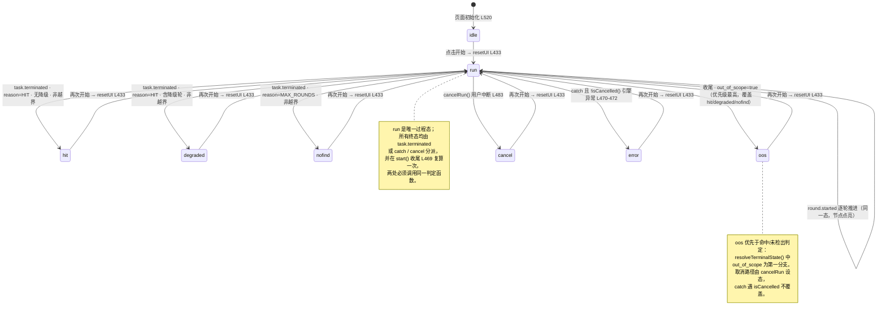
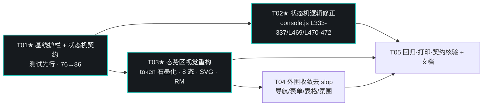

# 任务状态机与态势区重设计（增量设计）

> 架构师：高见远（Gao）｜日期：2026-11-10｜仓库：`D:\AIBBBG\Version1`（git main，HEAD `f121f35`）
> 范围：`webapp/js/console.js`（仅状态语义与呈现相关）、`webapp/css/console.css`、`webapp/console.html`、`docs/scripts/code-review-run-tests.js`
> 性质：**增量重设计**。业务逻辑（MockEngine 三剧本、越界诚信标注、授权闸门、`mock_flag`、打印）零改动；全部静态 DOM id 保留；零外部请求、`file://` 可运行；保持 76 项回归基线并新增状态机断言。

---

## 0. 设计依据与问题定性

### 0.1 已确认的三项决策（不可推翻）
1. **作用对象**：D 盘 `D:\AIBBBG\Version1`，历史不重写。
2. **允许修改 `console.js` 状态机**——仅限状态语义与呈现相关；业务逻辑必须保持不变。
3. **视觉取向：冲击集中核心区**——撞色与视觉冲击集中在「任务状态机 + 攻防/神经元态势」这一个亮点；导航/表单/表格收敛为安静中性；删除与任务状态无关的无意义循环动画（极光呼吸、`▰▱` 数据流滚动、循环扫描）；强化随任务状态推进的转场动画。

### 0.2 核心缺陷（本次要修的根因）
`console.js` 中 `#dash.dataset.state` 共 **7 处写入**，其中两处在成功路径上**重复且都硬编码 `'done'`**：

| 位置 | 函数 / 分支 | 现状 | 问题 |
|---|---|---|---|
| L231–235 | `setDashState(state,label)` 定义 | 写 `dataset.state` + `#dashState` | 本身无问题 |
| L312 | `onEvent` → `task.started` | `setDashState('run','RUNNING')` | 保留 |
| **L333–337** | `onEvent` → **`task.terminated`** | 无条件 `setDashState('done','DONE')` | **缺陷主源**：`HIT` 与 `MAX_ROUNDS` 都显示绿色 DONE |
| L433 | `resetUI()` | `setDashState('run','RUNNING')` | 保留 |
| **L469** | `start()` 成功收尾 | `setDashState(oos?'oos':'done', oos?'SIMULATED':'DONE')` | **二次硬编码**：即使事件分派了新态，这里又覆盖回 `'done'`（非越界时） |
| L470–472 | `start()` `catch` | 仅 `setMsg` + `log` | 引擎异常时 dash 停留在 `run`，无失败态 |
| L483 | `cancelRun()` | `setDashState('cancel','CANCELLED')` | 保留（取消不应被 catch 覆盖） |
| L520 | 初始化 | `setDashState('idle','IDLE')` | 保留 |

**结论**：`CONVERGE_3`（3 轮 HIT）、`NO_CONVERGE`（8 轮 MAX_ROUNDS 未检出）、`DEGRADED`（4 轮含降级命中）三者当前全部收敛到绿色 `DONE`，成功/失败/降级语义混淆；`HttpEngine` 异常（真引擎桩 reject）无失败态。**修正必须同时覆盖 L333–337 与 L469 两处**，否则会出现"事件设了新态、成功收尾又覆盖回 done"的新回归。

### 0.3 设计北极星（unslop 五线）
- **Product**：隔离靶场逐轮自适应探测 WAF、每轮证据可回溯为可打印报告的演示工具，面向答辩与评审观众。
- **Character**：`仪表般精确、电光、证据优先`（禁用 clean / modern / 科技感 等空词）。
- **World**：夜间安全运营台 / 示波器——中性石墨底 + 单一电光青 accent，撞色只在该出现的地方出现。
- **Moments**：① 中央「任务状态机 + 攻防/神经元态势」——节点随轮次点亮、攻防对向流；② 证据链里「从 BLOCKED 到命中」的关键路径高亮。
- **Signature**：一枚随状态变色的链路状态点 + 轮次刻度轨，只出现在状态区，贯穿所有状态。

---

## 1. 状态机设计

### 1.1 完整状态枚举（8 态）

判定优先级（唯一入口 `resolveTerminalState(report)`）：
`out_of_scope` → `MAX_ROUNDS` → `HIT + 降级轮` → `HIT` → 兜底 `error`。

| # | 状态 | `dataset.state` | 灯文案 | 进入条件（事件 / 分支） | 状态点色语义 | 态势区动画表现 | `setDashState` 调用点 |
|---|---|---|---|---|---|---|---|
| 1 | 待机 | `idle` | `IDLE` | 页面初始化 | 中性灰 `--t-3` | 静态：轮次节点全灭、攻防线为暗描边、无流动 | L520（保留） |
| 2 | 运行 | `run` | `RUNNING` | 点击开始（`resetUI`）/`task.started` | 电光青 `--accent`（唯一过程强调色） | 轮次节点按 `round.started` 逐个点亮；攻防对向流低频推进；刻度轨当前格扫描 | L433、L312（保留） |
| 3 | 成功命中 | `hit` | `HIT` | `task.terminated` 且 `reason=HIT` 且 `degraded_rounds.length===0` 且非越界 | 命中绿 `--sig-hit` | 攻防流收敛到接触面；命中轮→结论的关键路径高亮；节点全亮 | **L335（改）**、L469（改） |
| 4 | 未检出 / 未收敛 | `nofind` | `NOT FOUND` | `task.terminated` 且 `reason=MAX_ROUNDS` 且非越界 | 中性 `--t-2` + accent 细描边（既非成功也非失败，如实记录） | 8 轮节点全亮但接触面不收敛；攻防流停在中线；无命中高亮 | **L335（改）**、L469（改） |
| 5 | 降级命中 | `degraded` | `DEGRADED` | `task.terminated` 且 `reason=HIT` 且 `degraded_rounds.length>0` 且非越界 | 命中绿 `--sig-hit` + 中性降级刻痕（叠加标记，不引入第三撞色） | 命中节点全亮；降级轮节点带斜线刻痕；关键路径高亮但旁注"含降级轮，单列" | **L335（改）**、L469（改） |
| 6 | 越界模拟 | `oos` | `SIMULATED` | `out_of_scope=true`（收尾判定，优先于 3/4/5） | 告警品红 `--sig-alert-soft` | 顶部诚信告警带（去感叹号）；攻防线标"纯模拟·零请求"；结论仍"模拟命中" | **L469（改）** |
| 7 | 取消 | `cancel` | `CANCELLED` | `cancelRun()` 用户中断 | 告警朱红 `--sig-alert` | 轮次节点停在中断处（如实反映未跑完）；攻防流冻结；告警带 | L483（保留，catch 不得覆盖） |
| 8 | 失败 | `error` | `ERROR` | `start()` `catch` 且 `!isCancelled()`（引擎异常/桩 reject） | 告警朱红 `--sig-alert` | 接触面断链标记；轮次节点停在异常处；run-panel 转 ERROR 文案 | **L470–472（新增）** |

> 说明：`degraded` 按 team-lead 明确要求设为**独立 `data-state` 值**；其本质是"命中但含降级轮"，故颜色归绿系（成功面）并叠加中性降级刻痕，不新增第三种撞色 hue。当前三剧本映射：`CONVERGE_3 → hit`、`NO_CONVERGE → nofind`、`DEGRADED → degraded`；越界输入（任意剧本）→ `oos`。

### 1.2 状态转移图（Mermaid）



### 1.3 转移表（含判定条件与调用位置）

| 当前态 | 触发事件 / 分支 | 判定条件 | 目标态 | 灯文案 | 调用位置 | 备注 |
|---|---|---|---|---|---|---|
| `idle` | 初始化 | — | `idle` | `IDLE` | L520 | 仅首次加载 |
| `idle`/终态 | 点击「开始分析」→ `resetUI()` | `authChk.checked && startBtn 未 disabled` | `run` | `RUNNING` | L433 | 授权闸门先行 |
| `run` | `task.started` | — | `run` | `RUNNING` | L312 | 与 L433 同态，幂等 |
| `run` | `task.terminated` | `!oos && reason==='HIT' && deg===0` | `hit` | `HIT` | L335 | 读 `ReportStore.draft` |
| `run` | `task.terminated` | `!oos && reason==='HIT' && deg>0` | `degraded` | `DEGRADED` | L335 | `deg = degraded_rounds.length` |
| `run` | `task.terminated` | `!oos && reason==='MAX_ROUNDS'` | `nofind` | `NOT FOUND` | L335 | 如实记录，不计成功 |
| `run` | `start()` 成功收尾 | 同上三分支复算 | `hit`/`degraded`/`nofind` | 同上 | L469 | **必须复用同一函数** |
| `run` | `start()` 成功收尾 | `out_of_scope===true` | `oos` | `SIMULATED` | L469 | 优先分支 |
| `run` | `cancelRun()` | `running===true` | `cancel` | `CANCELLED` | L483 | 刻度轨停在中断处 |
| `run` | `start()` `catch` | `!isCancelled()` | `error` | `ERROR` | L470–472 **新增** | 取消路径不进入 |

---

## 2. 逻辑修正方案（保持 MockEngine 数据不变）

### 2.1 引入纯判定函数 `resolveTerminalState(report)`（新增，建议置于 `setDashState` 附近 L235 之后）

```js
/* 终态判定：唯一语义入口，onEvent 与 start() 收尾共用，避免两处漂移。
   入参 report 可为 ReportStore.draft（事件期已填充完毕）或 analyze 返回值。 */
function resolveTerminalState(report){
  const reason = report && report.terminate_reason;
  const oos    = !!(report && report.task && report.task.out_of_scope);
  const deg    = (report && report.degraded_rounds ? report.degraded_rounds.length : 0) > 0;
  if(oos)                  return {state:'oos',      label:'SIMULATED'}; // 诚信优先
  if(reason === 'MAX_ROUNDS') return {state:'nofind',  label:'NOT FOUND'};
  if(reason === 'HIT' && deg) return {state:'degraded',label:'DEGRADED'};
  if(reason === 'HIT')         return {state:'hit',     label:'HIT'};
  return {state:'error', label:'ERROR'}; // 未知原因兜底
}
```

配套可选封装（减少两处重复）：
```js
function applyTerminalState(report){
  const {state,label} = resolveTerminalState(report);
  setDashState(state,label);
  setRunState(label,'DONE');   // 见 2.5，让运行面板文案随终态切换
  return state;
}
```

> **时序安全**：`MockEngine.analyze` 在 L100 即赋值 `ReportStore.draft`，L122 填 `degraded_rounds`、L136 填 `terminate_reason`、L143 才 `emit('task.terminated')`。故事件回调内读 `ReportStore.draft` 时字段齐全。**MockEngine（含 emit 的 extra）一字不改**。

### 2.2 改动点 A —— `onEvent` 的 `task.terminated` 分支（L333–337）

现状：无条件 `setDashState('done','DONE')`。
改为（结构示意，非最终实现）：

```js
case 'task.terminated':{
  setProgress(100); setThinking(false);
  const r = ReportStore.draft;                 // 此时字段齐全
  applyTerminalState(r);                        // 取代 setDashState('done','DONE')
  paintRail(Math.min(no||maxR,maxR), r && r.degraded_rounds || [...dashDeg]);
  log(`任务终止 · 原因 ${e.terminate_reason}`);
  break;
}
```

### 2.3 改动点 B —— `start()` 成功收尾（L469）

现状：`setDashState(report.task.out_of_scope?'oos':'done', report.task.out_of_scope?'SIMULATED':'DONE');`
改为：
```js
applyTerminalState(report);   // 与事件分支同源，杜绝"事件设新态→收尾覆盖回 done"
```
位置保持在指标收尾（L460–468 `paintRail` / `paintBars`）之后，语义为"仪表数据对齐后落终态"。

### 2.4 改动点 C —— `start()` `catch` 分支（L470–472）新增失败态

```js
}catch(err){
  /* 取消提示与日志由 cancelRun() 统一输出；旧 token 不写日志也不改态 */
  if(!isCancelled()){
    setMsg('分析未完成：'+err.message,'err');
    log(err.message,'warn');
    setRunState('ERROR','DONE');       // 新增
    setDashState('error','ERROR');     // 新增：引擎异常不再停在 run
  }
}
```
> 保留 `if(!isCancelled())` 守卫：取消时由 `cancelRun()`（L483）设 `cancel`，`catch` 不得覆盖。

### 2.5 改动点 D（可选，建议）—— `setRunState` 文案（L271–273）

现状终态显示 `DASHBOARD RETRIEVING INFO... <b>HIT</b>`（"正在取信息"与"已完成"矛盾）。建议加第二参数：
```js
function setRunState(label, phase='RUN'){
  const head = phase==='RUN' ? 'DASHBOARD RETRIEVING INFO...' : 'RUN COMPLETE ·';
  $('#runState').innerHTML = `${head} <b>${esc(label)}</b>`;
}
```
`resetUI` / `task.started` 仍调 `setRunState('RUNNING')`（默认 RUN）；`applyTerminalState` 调 `setRunState(label,'DONE')`。

### 2.6 业务逻辑"零改动"清单（复述约束，供工程师自检）
`SCRIPTS` 三剧本数据与 `terminate_reason` 算法（L48–64、L136）、`OOS_NOTICE` 文案（L19）、`scopeOK`/`aliasOf`/`displayUrl`/`paramRefOf`、`MockEngine`/`HttpEngine`/`AnalysisEngine`、`renderResult`（L341–359）、`renderReport` 五附录与 `exportBtn` 动态注入（L360–413）、授权闸门 `syncStart`（L220–225）、`prefers-reduced-motion`（RM）、打印样式——**均不改**。

---

## 3. 信息架构调整

### 3.1 视线引导顺序与三层分区

保持 `<main>` 内 section 的物理顺序与全部 id 不变，通过**视觉权重**重排视线（不是搬 DOM）：

```
① 核心操作区  #tabNew（任务配置 / 授权闸门 / 开始·取消）   —— 安静中性，单一 accent 描边
        ↓  视线引导
② 状态反馈区  #tasks（态势台 #dash + 运行面板 #run-panel/进度/思考/#terminal）—— 冲击集中点（唯一撞色 + 强转场）
        ↓  视线引导
③ 证据回溯区  #evidence（逐轮表 #roundBody + 结论卡 #resultCard）—— 关键路径高亮（Moment②）
        ↓  视线引导
④ 成果区      #report（报告 #reportCard，含 5 附录 + 导出）—— 中性、可打印
        ↓
   辅助区      #settings（配置快照，降权）
```

### 3.2 分区处理原则

| 分区 | 处理 | 与 unslop 的关系 |
|---|---|---|
| 核心操作区 `#tabNew` | 表单/授权/按钮收敛为中性石墨卡片；开始按钮用 accent 实心但**去 glow/去彩色阴影**；授权提示去感叹号 | 安静中性，衬托核心区 |
| 状态反馈区 `#tasks` | **唯一**允许撞色、状态点、节点点亮、攻防对向流、终态强转场的区域 | 冲击集中核心区；Signature（状态点 + 刻度轨）只在此出现 |
| 证据回溯区 `#evidence` | 表格保持安静；仅对"命中轮所在行 / BLOCKED→命中关键路径"做一次性高亮（`.is-key`），不做循环动画 | Moment②，转场式而非循环式 |
| 成果区 `#report` | 报告走中性排版，保留 5 附录与 `mock_flag` 水印；仅结论词随终态换色（复用语义 token） | 证据优先，禁用渐变文字 |
| 辅助区 `#settings` | 维持降权 | 不抢视线 |

### 3.3 保持不变的 section 顺序 / ID（契约红线）
`#probe`、`#tasks`、`#evidence`、`#report`、`#settings`、`#tabNew`、`#tabHistory` 顺序与 id **不变**；`IntersectionObserver` 观察的 `['probe','tasks','evidence','report','settings']`（L508）保持；`switchTab` 的 `enter/exit`（L183–197）保持。

> **明确不搬 DOM**：逐轮表 `#roundBody` 保留在 `#evidence`（它是"可回溯证据"，非"实时过程"；搬到 `#tasks` 会破坏 IO 观察、打印规则与 JS 选择器契约）。态势台节点点亮（#tasks）与证据表关键路径高亮（#evidence）通过"同一 `round_no`"形成过程→证据的视觉呼应，而非物理合并。此项列入 §8 待明确，供主理人确认。

---

## 4. 态势区视觉设计

### 4.1 构图与 SVG 结构建议（重写 `console.html` L154–169 的 `.fx-situation`）

保留 `viewBox="0 0 1200 240"` 与外层 `.fx-dash`（仍 `aria-hidden="true"`）。移除原 `marker` 的彩色实心箭头、`fx-atk-flow/fx-def-flow` 无限循环、`fx-nodes` 的 `nodePulse` 循环、`fx-frontline` 的 `frontRun` 循环、`fx-dash__scan` 循环。改为**由状态驱动**的静态结构 + 转场：

| 元素（建议 class） | 语义映射 | 驱动方式 |
|---|---|---|
| `.sit__axis--atk`（左→中主轴） | 攻击链 / 探测侧（"AI 在干活"的进度载体） | 中性描边；`data-state=run` 时描边转 accent |
| `.sit__axis--def`（中→右，建议竖向屏障刻线组） | WAF 防线 / 拦截侧 | 中性描边；按 `blocked` 数点亮 `.sit__barrier` |
| `.sit__ring`（中央反馈自环，小回环箭头） | **反馈闭环**（呼应架构评审最关键"层内自环"） | 常态静态；每完成一轮做一次 `scale/opacity` 转场（`.is-pulsing`），表示"本轮反馈已回流" |
| `.sit__node` ×8（`data-r="1..8"`） | 轮次节点，与 `#rail` 的 8 格一一对应 | `round.started` → 对应节点加 `.is-lit`；降级轮加 `.is-degraded`（斜线刻痕）；**不循环呼吸** |
| `.sit__synapse`（中央神经突触，连向节点） | "神经元随轮次点亮" | 每轮点亮时突触做一次 `opacity` 转场；非循环 |
| `.sit__path--key`（命中轮→接触面的连线） | Moment② 关键路径（BLOCKED→命中） | `hit`/`degraded` 态一次性 `.is-key` 高亮（`stroke`/`opacity` 转场） |

**语义映射一句话**：左侧=攻击链（按轮次推进），中央=反馈闭环 + 神经突触（随轮次点亮），右侧=WAF 防线（按拦截数点亮）；命中时一条关键路径从 BLOCKED 链贯穿到接触面。

### 4.2 撞色与中性色阶（具体 hex）

**中性石墨色阶（tinted neutral，唯一冷灰带，取代现深靛蓝 + 极光渐变）**：

| Token | 值 | 用途 |
|---|---|---|
| `--n-0` | `#0E1114` | 页面底（近黑石墨） |
| `--n-1` | `#161A1E` | 一级表面 / 顶栏 |
| `--n-2` | `#1E2429` | 二级面板 |
| `--n-3` | `#2A3238` | 读数区 / 分隔 |
| `--n-4` | `#3A444B` | 描边 / 强分隔线 |
| `--t-1` | `#EDF1F2` | 主文字 |
| `--t-2` | `#A7B2B8` | 次要文字（正文级 ≥4.5:1） |
| `--t-3` | `#8B969D` | 弱标签 / 非正文（建议实算，仅用于 ≥12px 或非关键） |

**单一 accent（过程强调色）**：`--accent:#2FD4C8`（电光青）；`--accent-ink:#061A18`（accent 底上的深字）；`--accent-line:rgba(47,212,200,.45)`；`--accent-dim:rgba(47,212,200,.14)`。

**撞色严格两种**（只在状态语义出现）：

| 撞色 | Token | 值 | 用于状态 |
|---|---|---|---|
| 命中绿（成功面） | `--sig-hit` / `--sig-hit-ink` / `--sig-hit-dim` | `#57C79A` / `#06231A` / `rgba(87,199,154,.14)` | `hit`、`degraded`（叠加中性刻痕） |
| 告警红（风险面，含两个 tone，同属红族、算一种撞色） | `--sig-alert` / `--sig-alert-soft` / `--sig-alert-dim` | 朱红 `#E2606A` / 品红 `#D9487A` / `rgba(226,96,106,.14)` | `cancel`、`error`（朱红）；`oos`（品红） |

`nofind` 用中性 `--t-2` + accent 细描边（非成功非失败，如实记录）；`idle`/`run` 用 accent 与中性，不触碰撞色。**无 hue 渐变、无渐变文字、无发光、无彩色阴影、无大面积色块**。

### 4.3 关键动效清单（触发 / 属性 / 时长 / 缓动 / RM 降级）

统一节奏令牌：`--d-inst:160ms`（即时反馈）、`--d-step:240ms`（轮次点亮）、`--d-state:360ms`（终态转场）；`--ease:cubic-bezier(.2,.7,.2,1)`。

| 动效 | 触发状态 | 动画属性（仅允许这些） | 时长 | 缓动 | reduced-motion 降级 |
|---|---|---|---|---|---|
| 链路状态点变色（Signature） | 每次 `setDashState` | `background-color`、`border-color`、`opacity` | 160ms | linear | 直接置色，无过渡 |
| 轮次节点点亮 | `round.started` / 终态铺满 | `fill`、`opacity`、`transform:scale` | 240ms | `--ease` | 直接置位（亮/灭静态可见） |
| 神经突触回流脉冲 | 每轮完成 | `opacity`、`transform:scale` | 240ms | `--ease` | 无脉冲，节点静态 |
| 攻防对向流 | `data-state=run` | `stroke-dashoffset`、`stroke-opacity`（低频，仅运行期） | 6s linear | linear | 静态虚线，不流动 |
| 关键路径高亮 | `hit`/`degraded` 进入时 | `stroke`、`opacity`（一次性） | 320ms | `--ease` | 静态高亮，保留语义 |
| 终态转场 | 进入任一终态 | `opacity`、`transform`、`border-color` | 360ms | `--ease` | 直接切换 |
| 刻度轨进度 | `round.started` | `background-color`、`border-color`、`transform:scale` | 240ms | `--ease` | 直接置位 |
| 态势氛围明度 | `data-state` 切换 | `opacity` | 240ms | linear | 固定值 |

**硬约束**：装饰动画只转场 `color / background-color / border-color / opacity / transform`，**不碰 `width / height / top / left`**；`@media(prefers-reduced-motion:reduce)` 下 `animation:none;transition:none`、装饰层（原 `.fx-atmos`/`.fx-dash__scan`/`.fx-skeleton` 等）`display:none`，但**状态灯、刻度点亮、关键路径高亮以静态色/静态形态保留**（信息不丢，只去动画）。

> **约束边界与例外（需主理人拍板，见 §8）**：数据比例条现状由 `setMeter/setProgress` 写 `style.width`（L252–254、L209–213），且 76 项基线中的 7 项 `paintBars` 断言依赖 `style.width`。若严格把比例条也改为 `transform:scaleX(p)` 以完全满足"不碰 width"，须同步改写这 7 项断言（即改动基线）。**本设计默认保留 width 实现**，将"不碰 width/height/top/left"限定为**装饰性循环动画与转场**，数据比例条按"数据可视化 + 回归基线"作例外保留，并在文档如实记录。

---

## 5. 文件改动清单（区块 + 行数估计 + 保留契约）

| 文件 | 改动区块 | 行数估计 | 保留不动（关键契约） |
|---|---|---|---|
| `webapp/js/console.js` | ① 新增 `resolveTerminalState` / `applyTerminalState`（L235 后，+18~22 行）；② `onEvent` 的 `task.terminated`（L333–337，改 ~8 行）；③ `start()` 成功收尾（L469，改 1 行）；④ `start()` `catch`（L470–472，+3~4 行）；⑤（可选）`setRunState` 加 `phase` 参（L271–273，改 ~3 行） | 523 → **~550 行**（净 +25~30） | `SCRIPTS`/`MockEngine`/`AnalysisEngine`、`OOS_NOTICE`、`scopeOK`、`renderResult`/`renderReport`/5 附录/`exportBtn` 注入、`syncStart` 授权闸门、`RM`、时间/ID 生成；**全部静态 DOM id 选择器** |
| `webapp/css/console.css` | ① `:root` token 重定为石墨色阶 + 单一 accent + 两种撞色（L20–114 重写）；② 删除氛围循环动画与装饰（L141–205 的极光/网格地板/`▰▱`流/列下落/扫描，及 keyframes L896–948 中的循环项）；③ 态势区重写（L558–595 → 状态驱动结构）；④ 五态选择器 → 八态（L700–741 重写）；⑤ 导航/表单/表格/按钮去发光去渐变去大字距去感叹号；⑥ `@media reduce`（L966–974）强化；⑦ `@media print`（L1020–1079）**仅保留骨架** | 1079 → **~950–1050 行**（删循环多项、增八态与转场） | `@media print` 仍仅输出 `#report` 且含 5 附录；打印隐藏运行/装饰规则；`#cancelBtn.hidden` 的 44×44 命中占位（L476–478）；复选框 44×44 命中框（L529–541） |
| `webapp/console.html` | ① 删除 `.fx-atmos` 无意义循环装饰（L33–42 极光/`▰▱`/列/扫描）；② 顶栏 `.telemetry` 的 `▰▱` 滚动收敛为静态（L57–62）；③ 态势 SVG 重写（L154–169：8 节点 + 反馈环 + 防线 + 关键路径）；④ `oos-notice`/`auth` 相关去感叹号；⑤ head 设计依据注释更新（L4–20） | 327 → **~310–325 行** | **全部静态 DOM id**（dash/dashState/dRound/dMax/rail/railText/dSent/dBlocked/dHit/dRate/dDeg/dTasks/runState/progressBar/gradientBar/thinking/waitText/terminal/roundBody/roundEmpty/resultCard/verdictWord/reportCard/reportEmpty/startBtn/cancelBtn/authChk/authHint/msg/urlInput/typeSel/scriptSel/tabNew/tabHistory/tabBtnNew/tabBtnHistory/historyBody/historyEmpty/historyFrame/soundOffBtn/mTasks/mFindings/mRounds/mMaxNum/cfgMax 等）；section 顺序；`#pt` 结构；head 首帧覆盖脚本；`css/js` 引用顺序；全部 `data-*`/`aria-*`/`role`/`tabindex`；`exportBtn` 仍由 `renderReport` 动态注入 |
| `docs/scripts/code-review-run-tests.js` | ① `__T` 导出增 `resolveTerminalState`、`setDashState`、`onEvent`（L13）；② DOM mock 增强（确认 `#dash.dataset` 可写、`#dashState` 可断言、`ReportStore` 可注入，L16–59）；③ 新增「状态机」断言组（~10 条） | 293 → **~340 行**（+10~12 用例） | **现有 76 项断言全部保持通过**；MockEngine 端到端与 `paintBars`/`paintRail` 断言不动 |
| `docs/06-功能页信息结构改版说明.md` | 追加一行"本次增量见 docs/07" 指针（可选） | +1~2 行 | 原文不动 |
| `docs/07-任务状态机与态势区重设计.md` | 本设计文档（新增） | 新增 | — |

---

## 6. 有序任务列表（给工程师，含依赖与独立验收）

> 增量场景下的"基础设施"= 基线护栏 + 状态契约纯函数 + 测试先行。共 5 个任务；T02/T03 均只依赖 T01，可并行。

| 任务 | 名称 | 源文件 | 依赖 | 优先级 | 独立验收标准 |
|---|---|---|---|---|---|
| **T01** | **基线护栏与状态机契约（先写测试）** | `docs/scripts/code-review-run-tests.js`、`webapp/js/console.js` | — | **P0** | 78+ 项全绿（76 基线不回退 + 新增断言）；`resolveTerminalState` 对三剧本/越界/未知原因返回 `{state,label}` 正确；`node --check` 通过 |
| **T02** | **状态机逻辑修正** | `webapp/js/console.js` | T01 | **P0** | `CONVERGE_3→hit`、`NO_CONVERGE→nofind`、`DEGRADED→degraded`、越界→`oos`、取消→`cancel`（catch 不覆盖）、引擎异常→`error`；L335 与 L469 同结果；MockEngine 数据与业务逻辑零改（`git diff` 仅状态语义区） |
| **T03** | **态势区视觉重构（核心冲击区）** | `webapp/css/console.css`、`webapp/console.html` | T01 | **P0** | 8 态视觉可区分、Signature 状态点随态变色；轮次节点随轮点亮；循环动画清零；仅转场允许属性；`prefers-reduced-motion` 全降级且信息保留；SVG `aria-hidden` |
| **T04** | **外围收敛去 slop** | `webapp/css/console.css`、`webapp/console.html` | T03 | P1 | unslop 硬约束逐条核对（4px 栅格、无 hue 渐变/发光/彩色阴影/渐变文字、无 emoji、无感叹号、无大写宽字距、一套图标一字重、数字 tabular-nums、嵌套圆角相加）；核心区冲击仍在 |
| **T05** | **回归、打印与契约核验 + 文档** | 全部 + `docs/06`、`docs/07` | T02、T03、T04 | P1 | 76+ 全绿、`node --check`、CSS 大括号配平、DOM id 全在、`exportBtn` 动态注入、打印仅 `#report` 含 5 附录、`file://` 冒烟 0 异常；`docs/06` 指针更新 |

### 6.1 任务依赖图（Mermaid）



### 6.2 T01 建议新增断言（占位，工程师按实补充）

| # | 断言 | 期望 |
|---|---|---|
| 1 | `resolveTerminalState({terminate_reason:'HIT',task:{out_of_scope:false},degraded_rounds:[]})` | `{state:'hit',label:'HIT'}` |
| 2 | … `reason:'MAX_ROUNDS'` … | `{state:'nofind',label:'NOT FOUND'}` |
| 3 | … `reason:'HIT', degraded_rounds:[2,3,4]` … | `{state:'degraded',label:'DEGRADED'}` |
| 4 | … `task:{out_of_scope:true}, reason:'HIT'` … | `{state:'oos',label:'SIMULATED'}`（优先级） |
| 5 | … `reason:undefined` … | `{state:'error',label:'ERROR'}` |
| 6 | `setDashState('hit','HIT')` 后 `#dash.dataset.state` | `'hit'` |
| 7 | 同上后 `#dashState.textContent` | `'HIT'` |
| 8 | `MockEngine` 跑 `NO_CONVERGE` 后，用其 report 喂 `resolveTerminalState` | `state==='nofind'`（端到端语义贯通） |
| 9 | `MockEngine` 跑 `DEGRADED` 后同法 | `state==='degraded'` |
| 10 | 取消路径：断言 `catch` 分支在 `isCancelled()` 为真时不写 `error`（可用桩或注入验证） | dash 不被置 `error` |

> 若 `onEvent` 直接单测成本过高，可只测 `resolveTerminalState` + `setDashState` 的契约，并在 T02 验收时用 CDP/浏览器实测事件到终态的映射（呼应 `docs/06 §6` 的实测方式）。

---

## 7. 共享约定（工程师必读）

### 7.1 `data-state` 取值表（唯一权威）
`idle` · `run` · `hit` · `nofind` · `degraded` · `oos` · `cancel` · `error`
—— 不再使用 `done`；所有终态语义由 `resolveTerminalState` 产出，禁止在业务分支里另写字面量。

### 7.2 新增 class / id 命名
- **不新增业务 id**；态势 SVG 结构一律用 class 驱动，外层沿用 `aria-hidden="true"`。
- 建议 class：`.sit`、`.sit__axis`、`.sit__axis--atk`、`.sit__axis--def`、`.sit__ring`、`.sit__node`、`.sit__barrier`、`.sit__synapse`、`.sit__path--key`。
- 状态修饰类：`.is-lit`（节点点亮）、`.is-degraded`（降级刻痕）、`.is-key`（关键路径）、`.is-pulsing`（回流脉冲，一次性）。
- 节点用 `data-r="1..8"` 对齐 `#rail i[data-r]`，JS 以同一 `round_no` 双写（rail + 态势节点）。

### 7.3 CSS 变量 / token（统一定义于 `:root`）
```
/* 中性石墨 */
--n-0:#0E1114; --n-1:#161A1E; --n-2:#1E2429; --n-3:#2A3238; --n-4:#3A444B;
/* 文字三档 */
--t-1:#EDF1F2; --t-2:#A7B2B8; --t-3:#8B969D;
/* 单一 accent */
--accent:#2FD4C8; --accent-ink:#061A18; --accent-line:rgba(47,212,200,.45); --accent-dim:rgba(47,212,200,.14);
/* 撞色两种 */
--sig-hit:#57C79A; --sig-hit-ink:#06231A; --sig-hit-dim:rgba(87,199,154,.14);
--sig-alert:#E2606A; --sig-alert-soft:#D9487A; --sig-alert-dim:rgba(226,96,106,.14);
/* 节奏 */
--d-inst:160ms; --d-step:240ms; --d-state:360ms; --ease:cubic-bezier(.2,.7,.2,1);
```
> 兼容别名（供 `core.css` 的 `.pt/.ripple` 与 HTML 内联样式）：保留 `--accent` 等既有别名映射到新值，避免跨页过渡/涟漪失效。

### 7.4 动效时长 / 缓动统一值
`160ms` 即时反馈 · `240ms` 轮次点亮 · `360ms` 终态转场 · 关键路径 `320ms` · 攻防流 `6s linear`；缓动统一 `--ease:cubic-bezier(.2,.7,.2,1)`（流/呼吸用 `linear`）。`prefers-reduced-motion:reduce` → 全部 `animation:none;transition:none`，装饰层 `display:none`，语义以静态形态保留。

### 7.5 数据与呈现约定
- 所有改动**不触碰** MockEngine 事件序列与字段；`task.terminated` 事件已带 `terminate_reason`，`ReportStore.draft` 已带 `task.out_of_scope` 与 `degraded_rounds`——判定只从这两处读。
- 数字统一格式 + `font-variant-numeric:tabular-nums`；时间仍 ISO 8601；`mock_flag` 全链路不变。
- 状态灯文案为短英文（等宽、正常字距、一种字重），中文释义可置于旁注/`aria-label`；不加宽字距、不加感叹号、不用 emoji。
- 真引擎（未来）接入时，须保证 `task.terminated` 前 `ReportStore.draft` 已填充，或事件附 `terminate_reason/out_of_scope/degraded_rounds`（本演示 `HttpEngine` 为 reject 桩，不受影响）。

---

## 8. 待明确事项（需主理人 / 用户拍板）

| # | 事项 | 本设计默认处理 | 需拍板点 |
|---|---|---|---|
| Q1 | `degraded` 独立态的灯文案 | `DEGRADED`，状态点绿 + 中性降级刻痕（不引入琥珀，严守"两种撞色"） | 是否接受"绿+刻痕"表达降级命中？还是允许琥珀作第三色？ |
| Q2 | 越界 + 命中（`oos` 且 `HIT`，越界版 CONVERGE_3）| `oos` 优先（SIMULATED），结论仍"模拟命中" | 确认 oos 优先级高于 hit/degraded |
| Q3 | 逐轮表是否搬入 `#tasks` | **不搬**，保留在 `#evidence`，靠 `round_no` 呼应 | 确认"过程→证据视觉呼应"替代物理合并 |
| Q4 | "两种撞色"是否允许告警族两个 tone | 允许（朱红 `#E2606A` + 品红 `#D9487A` 同属红族，算一种撞色） | 确认还是严格收敛为单一红 |
| Q5 | 比例条 `width` vs `scaleX` | **保留 `style.width`**（数据可视化 + 76 项基线依赖），"不碰 width" 仅约束装饰动画 | 是否要把 7 项 `paintBars` 断言一并改为 scaleX（即修改基线）以完全满足 unslop 硬约束 |
| Q6 | 状态灯文案语言与字距 | 保留短英文大写读数，但**正常字距/不加宽**（Signature），旁注中文 | 确认大写英文读数是否违反"无大写宽字距标签"（本设计理解为禁"加宽"，不禁大写短读数） |
| Q7 | 状态灯可访问性 | 建议给状态灯容器加 `aria-live="polite"`（属性新增，不删改 id） | 确认是否纳入本次范围 |
| Q8 | `setRunState` 终态前缀 | 建议改为 `RUN COMPLETE · <label>`（改动点 D，可选） | 确认是否一并处理，还是保持原样 |

---

## 9. 设计自检（unslop 反 AI 味清单）

| 约束 | 本设计落实 |
|---|---|
| 4px 间距栅格 | 态势区/卡片 padding、gap 一律 4 的倍数（4/8/12/16/20/24/32） |
| 一个 tinted 中性色阶 + 三档文字 + 单一 accent | `--n-0..4` + `--t-1..3` + `--accent`（电光青） |
| 撞色只在状态语义出现 | 命中绿 / 告警红，仅 8 态中的命中与风险态 |
| 无 hue 渐变 / 渐变文字 / 发光 / 彩色阴影 / 色块 | token 去 `--primary-glow`/`--glow-*`，按钮去 `box-shadow` 光晕 |
| 无 emoji | 删除 `▰▱` 数据流序列；无 emoji |
| 一套图标一种字重 | 统一几何切角/菱形标记；mono 一种字重族 |
| 无大写宽字距标签 | `.lbl` 收窄字距、去 `text-transform:uppercase`（英文 kicker 保留大写但正常字距） |
| 无感叹号 | `.oos-notice::before` 的 `content:"!"` 改为中性几何标记 |
| 数字统一格式 + tabular-nums | 复用既有 `tabular-nums`，新增读数一律沿用 |
| 嵌套圆角相加 | 外 8px / 内 4px（4px 栅格），父子不相撞 |
| 动画只转场 color/border/opacity/transform | 见 §4.3；比例条 width 为数据例外（Q5） |
| reduced-motion 全降级 | 装饰 `display:none`，语义静态保留 |

---

> **交付边界**：本文档为增量设计；工程师按 §6 任务实现，架构师不写实现代码。状态机语义以 §7.1 与 `resolveTerminalState` 为唯一权威，任何业务分支不得另写状态字面量。
