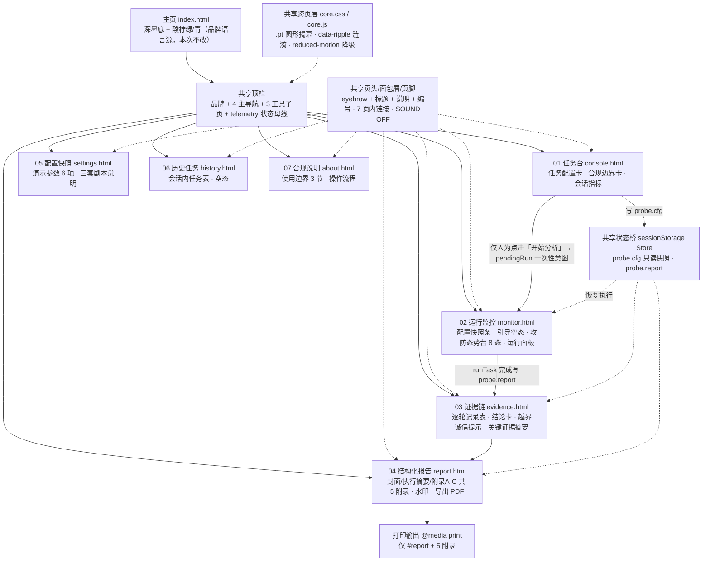

# 10 · 多巴胺风格功能页增量 PRD

> **性质**：增量 PRD，仅描述本次变更，**不重写全量 PRD**。
> **基线**：`D:\AIBBBG\Version1` · git main · HEAD `e8da794`（v0.18.0 台账回填，功能主体 `9e0b6b6`）· 工作树干净 · 历史不重写。
> **依据**：用户原始需求（`@skill:unslop` 功能页重新设计一版…）+ 主理人方向裁决（不可推翻）。
> **下游**：直接交架构师做增量设计与任务分解，故模块清单与视觉规格写到可落地粒度。
> **测试基线**：`code-review-run-tests.js` 101/101、`e2e-pages-test.js` 61/61、`qa-regression-verify.js` 51/51、`v018-visual-spec-check.js` 通过（7 页最低正文对比度 5.2:1、最小字号 11px、1440/1100/768/390 四档零横向溢出）。
> **关联文档**：`docs/08`（v0.17 架构，仍有效）、`docs/09`（v0.18 视觉规格，本次被取代）、`CHANGELOG.md`。

---

## 0. 产品目标与本次变更边界

### 0.1 一句话目标

**把 7 个功能页从 v0.18「冷中性亮底 + 单一钢青 accent + 深色态势台」重设计为「明亮高饱和多巴胺撞色」，同时继承主页 `index.html` 的设计语言（色板、压缩展示字、pill 按钮、mono 全大写宽字距小标签、状态母线、几何光环、涟漪与圆形揭幕、缓动时长 token、图标风格），做到功能、信息架构、业务逻辑、全部交互入口零删减。**

**方向裁决（写入本 PRD 作为约束，不再回问用户）**：

| # | 裁决 |
|---|---|
| 1 | 「与主页视觉风格和设计语言保持一致」= **继承设计语言，不是复制深底**。主页 `--bg:#0a0c0f` 深墨近黑底不迁移到功能页。 |
| 2 | 「避免黑白配色或深蓝灰色系」针对的是 **v0.18 的冷中性 ramp**（`#EDF1F3` 底 / `#101C24` 文字 / `#2A6C7E` 钢青 / `#0A1218` 深色态势台），**不是否定主页的酸柠绿**。功能页表面改为浅亮底 + 高饱和色块。 |
| 3 | 本次是「**主页设计语言 × 多巴胺明亮配色**」的融合，**不是回退 v0.17**（v0.17 的 Bahnschrift 巨标题 + 实心偏移黑阴影 + 硬边切角与主页 pill/酸柠绿/conic 光环不统一，已评审判「偏卡通」）——**不照抄 v0.17**。 |
| 4 | unslop 纪律仍适用：撞色集中在**内容时刻**（卡片色块、状态灯、按钮、图表、态势台），chrome 相对安静；不新增渐变文字、emoji、无意义循环动画、彩色发光堆叠；状态区分不依赖单一颜色；装饰不干扰信息主次。 |

### 0.2 改什么 / 不改什么

| 改什么（本次范围） | 不改什么（冻结边界） |
|---|---|
| `webapp/css/console.css` 的样式层（色板、圆角、字体栈、按钮、态势台配色、状态灯配色、小标签、装饰参数） | **主页**：`webapp/index.html`、`webapp/css/index.css`、`webapp/js/index.js` —— 本次完全不动 |
| 7 个页面的视觉呈现（配色 / 形状 / 层级 / 响应式表现） | **7 个 HTML 的结构、section 顺序、全部静态 DOM `id`、全部 `data-*` / `aria-*` / `role` / `tabindex`** |
| 逐页主色（`--key`）通过既有 `body[data-page]` 钩子覆写 | **共享业务逻辑**：`js/api.js`、`js/console.js`（引擎 + 8 态状态机 + Store）、`js/app.js`（跨页编排 + 呈现层遥测）、`js/core.js`（跨页圆形揭幕 + 涟漪） |
| 视觉规格核验脚本的**色板期望值**（由 QA 阶段同步，阈值不变） | **`css/core.css`**（`.pt` 遮罩 / 涟漪由功能页 `--bg` / `--ink` 驱动，自动随亮底变化，无需改） |
| 文档：`docs/10`（本文）、`CHANGELOG.md`、必要时 `docs/09` 标注「已被取代」（由下游处理） | **共享交互契约**：8 态状态机、仅人为点击「开始分析」触发任务（`pendingRun` 一次性意图、cfg 只读快照）、跨页 `sessionStorage` Store 桥、顶栏 `data-nav` 真翻页 + 圆形揭幕、`exportBtn` 动态注入、打印仅输出 `#report` 且含 5 附录、`prefers-reduced-motion` 全降级、零外部请求、`file://` 可运行 |

---

## 1. 功能模块与内容结构清单（本次需求的显式交付项）

> **保留约束分档**（逐页表末列）：
> **R0 · 原样保留** = 结构、内容元素、全部交互入口、DOM id 与 `data-*` 一律不删不减，仅允许换肤（改 CSS，不改 HTML / JS）；
> **R1 · 可视觉重组** = 允许改配色 / 底色 / 形状 / 布局，但内容元素、结构节点与交互入口不删，且须保留既有的形状 + 线型 + 文字三通道状态编码；
> **R2 · 可呈现层增强** = 允许新增纯视觉元素，不得新增业务逻辑与交互入口。
>
> **全局约束**：下表所有模块默认 **R0**；页面级 `body[data-page]` 取值固定为 `console / monitor / evidence / report / settings / history / about`，不得更改。

### 1.1 全局共享模块（7 页每页均须存在）

| 模块 | 内容元素 | 职责 | 与其他模块关系 | 保留约束 |
|---|---|---|---|---|
| 共享顶栏 | 品牌 `PROBE / LAB`（`<i>` 方点）、4 项主导航（01 任务台 / 02 运行监控 / 03 证据链 / 04 报告）、3 个工具子页图标入口（配置 / 历史 / 说明）、`telemetry` 状态母线（ENGINE / SCOPE / EGRESS 只读遥测）、`is-current` 当前态 | 真翻页导航与只读遥测；`data-nav` 触发圆形揭幕 | 连到全部 7 页 + 主页；读 `core.css/.pt` | **R0**（4+3 入口一个不删） |
| 面包屑与页头 | 面包屑、`eyebrow` 小标签、页面标题、说明段、页面编号徽标（01…07） | 定位当前页并建立层级 | 每页独立，编号与顶栏 `nav-no` 对齐 | **R0** |
| 页脚 | 7 个页内链接（任务台 / 运行监控 / 证据链 / 报告 / 配置 / 历史 / 说明）、边界声明、`#soundOffBtn`（`role="switch"`、`aria-checked`、仅视觉状态无音频） | 全站可达 + 合规边界 + 音效开关 | 连到全部 7 页 | **R0**（7 链接一不删） |
| 跨页过渡层 | `#pt` 圆形揭幕遮罩（`.pt__mark` 品牌标记 + `.pt__dot` 12px 方点）、`[data-ripple]` 涟漪 | 翻页连续性与点击反馈 | 由 `core.css` / `js/core.js` 驱动 | **R0** |
| 空态 / 引导 | 各页「尚未运行 / 请先去任务台」引导卡 + 前往任务台按钮 | 保证未启动任务时页面可用 | 读 Store 是否有 `probe.report` / `probe.cfg` | **R0** |

### 1.2 逐页模块表

#### ① `console.html` 任务台（`data-page="console"`）

| 模块 | 内容元素（含关键 DOM id） | 职责 | 与其他模块关系 | 保留约束 |
|---|---|---|---|---|
| 任务配置卡 | `#urlInput`（Target URL）、`#typeSel`（SQL 注入 / XSS / 文件上传）、`#scriptSel`（演示剧本）、`#authChk`（书面授权勾选）、`#startBtn`（开始分析 →，默认 `disabled`）、`#cancelBtn`（取消）、`#runLink`（`href=monitor.html`，`aria-hidden`、`tabindex="-1"`）、`#msg`（`role="status"` 消息提示）、`#authHint`（授权范围说明） | 采集配置 + 授权闸门 + 触发一次性 `pendingRun` 意图 | 写 `probe.cfg` → 翻页至监控页；`cancelBtn` 切 `cancel` 态 | **R0**（授权勾选与 disabled 逻辑不得动） |
| 合规边界卡 | 使用边界 / 授权范围 / 隔离靶场说明 | 合规声明，防止越界演示误读 | 与 `about.html` 使用边界呼应 | **R0** |
| 会话指标 | `#mTasks`（累计任务）、`#mFindings`（检出漏洞）、`#mRounds`（平均轮次），3 格 KPI | 会话内累计读数 | 与监控页 `#dTasks` 同源 | **R0** |
| 页脚 | 见 §1.1 | 见 §1.1 | 见 §1.1 | **R0** |

#### ② `monitor.html` 运行监控（`data-page="monitor"`）

| 模块 | 内容元素（含关键 DOM id） | 职责 | 与其他模块关系 | 保留约束 |
|---|---|---|---|---|
| 配置快照条 | `#mTarget` / `#mType` / `#mScript` / `#mScope`（4 格，cfg 只读快照） | 展示本次任务配置，只读 | 读 `probe.cfg`；与任务台配置卡对应 | **R0** |
| 引导空态 | `#monitorHint` + `#goConsole`（前往任务台 →） | 未启动任务时的引导 | 读 Store | **R0** |
| **攻防态势台** | `#dash`（`data-state`，8 态灯）、`#dashStateWrap`（`aria-live="polite"`）+ `#dashState`；四段拓扑 SVG：攻击方 → 流量通道 → WAF 防线 → 目标（4 分区框 + 方向箭头 + 4 文字标签）；8 个方形轮次节点（`.sit__node`）；三条线型流量通道 `--atk / --blocked / --hit`；8 根防线竖线；目标方框；`.sit__labels` 分区标签；`.sit__legend` 5 项线图例；`#sitFlowMeta` 实时流状态读数；`#dRound` / `#dMax` / `#rail` 轮次刻度轨 + `#railText`；6 个指标格 `#dSent` / `#dBlocked` / `#dHit` / `#dRate` / `#dDeg` / `#dTasks`（含 `#barSent`…`#barDeg` 比例条） | **全站唯一信息密集焦点**，随 8 态推进可视化攻防过程 | 读 `probe.cfg` 恢复执行；写 `probe.report`；`app.js#bootTelemetry()` 呈现层遥测驱动刷新反馈 | **R1**（必须改亮底 + 高饱和，但四段拓扑、8 节点、3 通道、8 防线、图例、读数、6 指标格**一项不删**；形状/线型/文字三通道状态编码**必须保留**） |
| 运行面板 | spinner、`#runState`、进度条 `#gradientBar`（`role="progressbar"` + `aria-valuenow`）、`#thinking`（模型思考中 + `#waitText`）、`#terminal`（终端日志） | 执行态实时反馈 | 读引擎 8 态；与态势台同步 | **R0** |
| 页脚 | 见 §1.1 | 见 §1.1 | 见 §1.1 | **R0** |

#### ③ `evidence.html` 证据链（`data-page="evidence"`）

| 模块 | 内容元素 | 职责 | 与其他模块关系 | 保留约束 |
|---|---|---|---|---|
| 空态 | 引导卡 + 前往任务台按钮 | 未完成任务时引导 | 读 Store | **R0** |
| 逐轮记录表 | 轮次 / `round_id` / 变形策略 / 响应分类 / 判定 / 耗时 / 降级（含「从 BLOCKED 到命中」关键路径行） | 逐轮可回溯证据 | 读 `probe.report`；结论卡由其汇总 | **R0**（关键路径行不得删） |
| 结论卡 | 探测结论 + 5 个 KV：漏洞类型 / 参数位 / 风险等级 / 置信度 / 判定来源 | 收口判定 | 汇总逐轮表；报告页执行摘要复用 | **R0** |
| 越界诚信提示 | `oos` 态诚信声明 | 合规提示 | 与 `about.html` 边界呼应 | **R0** |
| 关键证据摘要 | 证据摘要段 + 查看结构化报告按钮（`data-nav`） | 引导进入报告 | 翻页至 `report.html` | **R0** |
| 页脚 | 见 §1.1 | 见 §1.1 | 见 §1.1 | **R0** |

#### ④ `report.html` 结构化报告（`data-page="report"`）

| 模块 | 内容元素（含关键 DOM id） | 职责 | 与其他模块关系 | 保留约束 |
|---|---|---|---|---|
| 空态 | `#reportEmpty`（`.no-print`） | 未完成任务时引导 | 读 Store | **R0** |
| 报告主体 | `#reportSection` / `#reportCardWrap` / `#reportCard` / `#reportCardLoading`（恢复中提示） | 承载 5 附录 | 读 `probe.report` | **R0** |
| **5 个附录** | 封面 / 执行摘要 / 附录A 逐轮 / 附录B 模型决策原文 / 附录C 配置快照（`.report-sec`，`break-inside:avoid`） | 可打印的正式报告 | 打印仅输出 `#report` 且 5 附录齐全 | **R0**（一个附录不删） |
| 水印 + 导出 | `.watermark` 水印、`#exportBtn`（由 `renderReport` **动态注入**）导出 PDF | 导出交付 | 由 JS 注入，HTML 中不得静态写死 | **R0**（动态注入机制不得改） |
| 页脚 | 见 §1.1 | 见 §1.1 | 见 §1.1 | **R0** |

#### ⑤ `settings.html` 配置快照（子页，`data-page="settings"`）

| 模块 | 内容元素 | 职责 | 与其他模块关系 | 保留约束 |
|---|---|---|---|---|
| 演示参数 | 6 项：契约版本 / 引擎模式 / 轮次上限 / 节奏 / 适配器 / 规则集 | 只读展示演示常量 | 与任务台 `scriptSel`、监控页 `#dMax`（上限 8）对应 | **R0** |
| 三套演示剧本说明 | 三剧本的逐轮行为说明 | 解释剧本差异 | 与 `scriptSel` 选项对应 | **R0** |
| 页脚 | 见 §1.1 | 见 §1.1 | 见 §1.1 | **R0** |

#### ⑥ `history.html` 历史任务（子页，`data-page="history"`）

| 模块 | 内容元素 | 职责 | 与其他模块关系 | 保留约束 |
|---|---|---|---|---|
| 会话内任务表 | 任务列表（目标 / 类型 / 剧本 / 结果 / 轮次） | 会话内历史回看 | 读 Store；与任务台会话指标同源 | **R0** |
| 空态 | 无任务引导 | 未运行提示 | 读 Store | **R0** |
| 页脚 | 见 §1.1 | 见 §1.1 | 见 §1.1 | **R0** |

#### ⑦ `about.html` 合规说明（子页，`data-page="about"`）

| 模块 | 内容元素 | 职责 | 与其他模块关系 | 保留约束 |
|---|---|---|---|---|
| 使用边界 3 节 | 授权前提 / 隔离靶场 / 禁止越界三节 | 合规边界 | 与任务台合规边界卡、证据链越界诚信提示互相印证 | **R0** |
| 操作流程 | 配置 → 授权 → 启动 → 监控 → 证据 → 报告 | 说明主线动线 | 与 §1.4 信息架构一致 | **R0** |
| 页脚 | 见 §1.1 | 见 §1.1 | 见 §1.1 | **R0** |

> **模块规模汇总**：7 页 × 共享模块 5 类（每页 4 类：顶栏 / 页头 / 页脚 / 跨页层，空态按页计）+ 页面专属模块 **20 个**（任务台 3、监控 4、证据链 5、报告 4、配置 2、历史 2、说明 2，含空态按页归属）；**全部标注 R0 原样保留，仅监控页「攻防态势台」为 R1**。

### 1.3 必须原样保留（不删减交互入口）的重点项

1. 顶栏 **4 主导航 + 3 工具子页**共 7 个入口、页脚 **7 个页内链接**。
2. 任务台「授权勾选 → 开始分析」闸门链：`#authChk` / `#startBtn` / `#cancelBtn` / `#runLink` / `#msg` / `#authHint` 一个不删。
3. 监控页态势台四段拓扑全部结构节点（8 方形轮次节点、3 条线型流量通道、8 根防线竖线、目标方框、分区标签、5 项图例、实时流读数、轮次刻度轨、6 指标格）。
4. 报告页 **5 个附录** + `#exportBtn` 动态注入机制 + `@media print` 仅输出 `#report`。
5. 8 态状态机 `idle / run / hit / nofind / degraded / oos / cancel / error` 及 `data-state` 驱动的**形状 + 线型 + 文字**三通道编码（v0.18 成果，本次保留）。
6. 全部静态 DOM `id`、`data-*`、`aria-*`、`role`、`tabindex`；`prefers-reduced-motion` 全降级；零外部请求、`file://` 可运行。

### 1.4 信息架构图

---

## 2. 用户故事

| # | 用户故事 | 覆盖诉求 | 验收要点 |
|---|---|---|---|
| US-1 | 作为**答辩演示者**，我希望打开功能页就看到明亮活泼、与主页同源的视觉，以便在评审现场从主页切到功能页时不像换了一个产品 | 答辩演示 | 主页 → 任务台切换 1 次内可辨认出同源色板（酸柠绿 / 青）、pill 按钮、mono 全大写宽字距小标签；无大面积黑白 / 深蓝灰 |
| US-2 | 作为**演示操作者**，我希望在任务台填目标 / 选类型 / 选剧本 / 勾授权并点击「开始分析」后才启动任务，且能随时取消，以便控制演示节奏与合规表达 | 配置任务 | 授权未勾选时 `#startBtn` 为 `disabled`；点击后自动真翻页到监控页；只读快照条与输入完全一致；取消切到 `cancel` 态 |
| US-3 | 作为**评审观众**，我希望在运行监控页一眼看懂「攻击方 → 流量通道 → WAF 防线 → 目标」的四段拓扑与 8 态推进，且状态不靠单一颜色辨认 | 查看实时态势 | 8 态各自仍有独立的形状 / 线型 / 文字编码；6 指标格随轮次更新；态势台为浅亮底 + 高饱和多色，不再是深色台 |
| US-4 | 作为**复核者**，我希望在证据链逐轮回溯「从 BLOCKED 到命中」的关键路径，并在报告页导出含 5 附录的 PDF，以便离线存档 | 回看证据与报告 | 逐轮表 7 列齐全、结论卡 5 个 KV 齐全；`#exportBtn` 仍动态注入；打印仅输出 `#report` 且 5 附录齐全 |
| US-5 | 作为**移动端浏览者**，我希望在 390px 手机上不出现横向滚动、能横向滑动主导航、字号不小于 11px 且按钮易点，以便现场用手机快速展示 | 移动端浏览 | 1440 / 1100 / 768 / 390 四档 `scrollWidth <= clientWidth`；触控目标 ≥44px；态势台图例与读数按断点收敛但关键线型保留 |
| US-6 | 作为**合规审阅者**，我希望配置快照、历史任务、合规说明三个子页入口始终可达，边界声明与 SOUND OFF 开关保留，以便核对演示边界 | 合规与可达性 | 顶栏 3 工具入口 + 页脚 7 链接全部可达；边界声明、`#soundOffBtn` 的 `role="switch"` / `aria-checked` 保留 |
| US-7 | 作为**对动效敏感的用户**，我希望开启系统「减少动态效果」后所有动画静态降级且语义不丢失 | 可访问性 | `prefers-reduced-motion:reduce` 下 8 态形状编码、已点亮节点、关键路径、越界提示全部以静态形态保留 |

---

## 3. 需求池 P0 / P1 / P2

> **P0 = 必须有（Must）· P1 = 应该有（Should）· P2 = 可以有（Nice to have）**。每条均给可量化验收标准。

### P0（必须，全部满足方可交付）

| ID | 需求 | 验收标准（可量化） |
|---|---|---|
| P0-1 | **多巴胺明亮撞色且与主页设计语言统一** | 7 页页面底为带色相浅亮底（非纯白 / 非 `#EDF1F3` 冷灰 / 非深蓝灰）；高饱和色块出现在卡片、状态灯、按钮、图表、态势台 ≥5 类内容时刻；色板中酸柠绿 `#c8f560`、青 `#4fe3d0`、珊瑚 `#ff6b6b`、亮黄 `#f5c451` 与主页原值逐字一致；pill 按钮（`--r-pill:9999px`）、`--display` 压缩展示字栈、mono 全大写宽字距小标签（11px / `.12em` / `uppercase`）、`:focus-visible` 酸柠绿焦点环、`--ease` / `--d-*` 时长 token 与主页一致；人工走查 7 页无「换了一个产品」观感 |
| P0-2 | **7 页模块与交互入口零删减** | §1.2 逐页表 **20 个页面专属模块 + 5 类共享模块**全部存在；顶栏 4+3=7 入口、页脚 7 链接、报告 5 附录、态势台 8 节点 / 3 通道 / 8 防线 / 5 图例 / 6 指标格数量逐一相等；`e2e-pages-test.js` 61/61 不回退；全部静态 `id` / `data-*` / `aria-*` / `role` / `tabindex` diff 为 0 |
| P0-3 | **桌面 + 移动响应式** | 1440 / 1100 / 768 / 390 四档视口 `document.documentElement.scrollWidth <= clientWidth`（零横向溢出）；三档布局断点按 §5 生效；最小字号 ≥11px；全部可点击控件 `min-height >= 44px`；`v018-visual-spec-check.js` 视觉核验通过 |
| P0-4 | **正文对比度 ≥4.5:1** | 以 `v018-visual-spec-check.js` 逐层背景合成实算为准，7 页所有正文级文本 ≥4.5:1（大字 ≥3:1）；**现有最低 5.2:1 基线不得回退**；高饱和色块上文字一律用 `--accent-ink:#0a0c0f`，实测 ≥6.9:1（见 §4.5） |
| P0-5 | **业务逻辑零改** | `js/api.js`、`js/console.js`、`js/app.js`、`js/core.js` 文件内容 diff 为 0；8 态状态机取值与迁移不变；「仅人为点击开始分析才触发任务」的 `pendingRun` 一次性意图与 cfg 只读快照语义不变；`code-review-run-tests.js` 101/101、`qa-regression-verify.js` 51/51 不回退 |
| P0-6 | **禁止大面积黑白 / 深蓝灰** | 页面主体不得出现纯 `#FFFFFF` 大面积平铺 + 纯 `#000000` 文字的黑白配对；不得出现 `#EDF1F3` / `#F8FAFB` / `#E6ECEF` / `#E1E8EB` 作为页面主底，不得出现 `#101C24` / `#40525E` / `#536773` 作为文字，不得出现 `#0A1218` / `#101C24` / `#14222B` 深色大面积表面（含态势台）；静态扫描 + 7 页截图走查双重确认 |
| P0-7 | **状态区分不依赖单一颜色** | 8 态均保留「形状 + 线型 + 文字」至少 2 个非颜色通道（空心方 / 实心方 / 内嵌横杠 / 斜线 / 菱形 / 双框 / 叉形；防线虚线↔实线；关键路径实线↔虚线；`#dashState` 文字读数）；去除颜色后灰度截图仍可区分 8 态 |
| P0-8 | **交互契约与可访问性零回退** | `#exportBtn` 仍由 `renderReport` 动态注入；`@media print` 仅输出 `#report` 且 5 附录齐全；`prefers-reduced-motion:reduce` 全降级且静态语义保留（含 console.css 现有 565–579 行兜底）；零外部网络请求、`file://` 直接打开 7 页可用 |

### P1（应该）

| ID | 需求 | 验收标准 |
|---|---|---|
| P1-1 | 逐页主色编码 | 7 个 `body[data-page]` 各有独立 `--key` 主色（§4.1 表），主色集中在页头编号徽标 / 卡片色块 / 主按钮 / 态势台，chrome（顶栏 / 面包屑 / 页脚）保持浅亮安静；单页高饱和覆盖面积 ≥8% 且 ≤35%（避免全屏铺色） |
| P1-2 | 品牌装饰同源 | 品牌 `.brand i` 方点改为 12×12 / `border-radius:2px` / 酸柠绿，与 `core.css .pt__dot` 一致；`.pt` 遮罩随功能页变浅柠底 + 深墨字 + 酸柠绿方点，品牌标记 `PROBE / LAB` 不变 |
| P1-3 | 态势台高饱和多色语义 | 5 支 `--sit-*` 语义色按 §4.1 映射为高饱和亮色；`--sit-bg` 改亮底；拓扑 SVG 节点 / 通道 / 防线在亮底上仍清晰可辨（线条与底色对比 ≥3:1） |
| P1-4 | 动效 token 对齐主页 | `--ease:cubic-bezier(.16,1,.3,1)` / `--ease-2:cubic-bezier(.45,0,.1,1)` / `--d-fast:.16s` / `--d:.5s` / `--d-slow:1s` / `--d-loop:22s` 逐项与 `index.css` 一致；`.btn--primary:hover` 恢复 `translateY(-3px)` + `box-shadow:0 12px 34px rgba(200,245,96,.3)` |
| P1-5 | 打印与 reduced-motion 走查 | 打印输出仍为黑字白底（§6 风险 5 豁免），5 附录 `break-inside:avoid` 生效；reduced-motion 下无残留动画 |

### P2（可选，均有默认值，不阻塞下游）

| ID | 需求 | 验收标准 / 默认 |
|---|---|---|
| P2-1 | 扩展撞色（橙 / 桃粉）用于图表与流量通道多色编码 | **默认：不引入新色相**，仅用主页四色 + 三同族衍生；若架构师需要更多区分，可选橙 `#FF9A3D` / 桃粉 `#FF85B3`，但须配 `#0a0c0f` 深墨字并过对比度核验 |
| P2-2 | 主页 conic-gradient `.halo` 光环在功能页复用 | **默认：不复用**；功能页不新增光环实例（避免装饰干扰信息主次） |
| P2-3 | 逐页主色的浅色氛围层 | 默认：仅保留主页既有 `body::before` 双 radial 氛围层的**同等实现**（酸柠 / 青，`opacity:.7`），不新增第三层 |

---

## 4. 视觉对齐规格（增量）

### 4.1 建议多巴胺色板（具体取值）

#### A. 表面（浅亮底，带色相；无纯白 / 无纯黑 / 无深蓝灰）

| Token（英文） | 取值 | 中文语义 / 用途 |
|---|---|---|
| `--bg` | `#F7FBE8` | 浅柠纸底 · 页面底 / 全局 chrome |
| `--bg-2` | `#EDF6D2` | 浅柠抬升 · 分组底 / 氛围层 |
| `--surface` | `#FFFDF4` | 暖奶油面 · 卡片 / 输入框 / 顶栏工具 |
| `--surface-2` | `#F2F8DC` | 柠绿抬升面 · 激活行 / 表头 / 进度条底 |
| `--line` | `rgba(16,33,10,.12)` | hairline 主分隔线 |
| `--line-2` | `rgba(16,33,10,.24)` | 次级分隔线 |
| `--line-3` | `rgba(16,33,10,.38)` | 强分隔线 |

> 说明：`#FFFDF4` 为**带暖色相的近白面**，不是纯 `#FFFFFF`；允许作为卡片面，但禁止「纯白大面积底 + 纯黑字」的黑白配对。

#### B. 四强调（**主页原值，严格逐字复用**）

| Token | 取值 | 中文语义 |
|---|---|---|
| `--accent` | `#c8f560` | 酸柠绿 · 主强调 / 主按钮底 / 焦点环 / 品牌方点 |
| `--accent-ink` | `#0a0c0f` | 深墨 · **所有高饱和亮色块上的文字**（主页原值，保证对比度） |
| `--accent-soft` | `rgba(200,245,96,.12)` | 酸柠软面 · 命中行 / 提示面 |
| `--accent-2` | `#4fe3d0` | 青 · 命中 / 正向 / 命中路径（与主页语义一致） |
| `--accent2-soft` | `rgba(79,227,208,.12)` | 青软面 |
| `--danger` | `#ff6b6b` | 珊瑚红 · 越界 / 告警 / 攻击流 / 取消 / 异常 |
| `--warn` | `#f5c451` | 亮黄 · 降级 / 拦截 / 待审 |

#### C. 三档文字色（浅亮底上）

| Token | 取值 | 中文语义 | 对 `--bg` 实测对比度 |
|---|---|---|---|
| `--ink` | `#16210E` | 深橄榄墨 · 主文字 / 标题 / 数值 | ≈15.9:1 |
| `--ink-2` | `#3E4A2E` | 中橄榄灰 · 次文字 / 说明 / 表头 | ≈9.0:1 |
| `--ink-3` | `#5A6647` | 弱橄榄灰 · meta / 11px 小标签 / 图例 | ≈5.8:1 |

> 三档均带绿相深墨，与主页 `--accent-ink:#0a0c0f` 同源但**不是纯黑、不是深蓝灰**；最弱档仍 ≥5.8:1，高于 4.5:1 门槛与现有 5.2:1 基线。

#### D. 各页主色（`--key`，通过既有 `body[data-page]` 覆写）

| 页面 | `data-page` | 主色 `--key` | 来源 |
|---|---|---|---|
| 任务台 | `console` | `#c8f560` 酸柠绿 | **主页原值** |
| 运行监控 | `monitor` | `#4fe3d0` 青 | **主页原值** |
| 证据链 | `evidence` | `#f5c451` 亮黄 | **主页原值** |
| 结构化报告 | `report` | `#ff6b6b` 珊瑚红 | **主页原值** |
| 配置快照 | `settings` | `#A9DF3C` 柠绿衍生 | 酸柠绿压深（同族，高饱和） |
| 历史任务 | `history` | `#2FC9B4` 青衍生 | 青压深（同族，高饱和） |
| 合规说明 | `about` | `#F5A623` 黄橙衍生 | 亮黄偏橙（同族，高饱和） |

> **明确不照抄 v0.17 七色轮转**（`docs/08` §2 的青 / 品红 / 黄 / 蓝 / 紫 / 绿 / 橙），尤其**不引入 `#2B47F0` 蓝 / `#6D4DE0` 紫**等冷调，避免与「避免深蓝灰色系」及主页色板冲突。四主流程页直接用主页四原色，是本方案「与主页统一」最硬的保证。

#### E. 语义色（8 态 + 态势台，均另配形状 / 线型）

| 语义 | 取值 | 中文含义 | 非颜色通道（**必须保留**） |
|---|---|---|---|
| `idle` | `--ink-3` `#5A6647` | 待机 / 空态 | 空心方 + 文字 `IDLE` |
| `run` | `--accent` `#c8f560` | 运行中 | 实心方 + 文字 `RUN` |
| `hit` | `--accent-2` `#4fe3d0` | 命中 / 检出 | 菱形 + 文字 `HIT` |
| `nofind` | `--ink-2` `#3E4A2E` | 未发现 | 内嵌横杠 + 文字 |
| `degraded` | `--warn` `#f5c451` | 降级 | 斜线 + 文字 |
| `oos` | `--danger` `#ff6b6b` | 越界 | 双框 + 文字 |
| `cancel` / `error` | `--danger` `#ff6b6b` | 取消 / 异常 | 叉形 + 文字 |
| `--sit-bg` | `#EAF7CE` | **态势台底（替代深色 `#0A1218`）** | 浅柠亮底 |
| `--sit-panel` | `#FFFDF4` | 态势台指标格面 | 暖奶油 |
| `--sit-atk` | `#ff6b6b` | 攻击链 / 攻击流 | 实线箭头 |
| `--sit-def` | `#f5c451` | WAF 防线 / 拦截 | 竖线 + 虚线↔实线 |
| `--sit-node` | `#16210E` 线 + `#c8f560` 点亮 | 轮次节点 | 方形 `<rect>` / 降级斜纹 |
| `--sit-hit` | `#4fe3d0` | 命中路径 | 关键路径实线↔虚线 |
| `--sit-deg` | `#F5A623` | 降级刻痕 | 刻痕形状 |

> 8 态的 `--st-*` / `--dot-*` token 名**全部保留**（HTML / JS / 内联样式依赖），仅改映射值；`docs/09` §3 A13 的形状编码与 §4.1 表态「颜色只是第二通道」的结论**本次继承**。

### 4.2 颜色语义说明

- **酸柠绿 / 青 / 珊瑚 / 亮黄** = 主页品牌色 → 同时充当**主强调、命中正向、告警越界、降级拦截**四支语义，一色一义不混用；这样既保持高饱和撞色，又不引入主页之外的陌生色相。
- **撞色分布**：chrome（顶栏 / 面包屑 / 页脚）只使用 `--bg` / `--surface` / `--ink-*` / `--line-*`，保持安静；高饱和只出现在**内容时刻**——页头编号徽标、卡片色块、8 态灯、pill 主按钮、图表比例条、态势台拓扑与指标格。
- **逐页主色**只做「页面身份编码」，不铺满背景；单页高饱和覆盖建议 8%–35%，避免全屏铺色造成信息主次失衡。

### 4.3 布局 / 字体 / 图标 / 按钮 / 交互 逐项对齐主页

| 维度 | 主页取值（已核对 `index.css`） | 本次功能页对齐方式 | 与 v0.18 的差异 |
|---|---|---|---|
| **布局** | `.wrap` 流体容器，`max-width` 上限、32px 安全边距；4px 栅格；卡片内边距 24px；顶栏 76px | 沿用 v0.18 布局骨架（`.wrap` `max-width:1440px` / `padding:0 32px`，≤700 → 16px；顶栏 64px / 主导航 56px / 页脚 48+24px）；**只把圆角改为主页 `--r:12px` / `--r-sm:8px` / `--r-pill:9999px`**（卡片 12px、内层 8px、按钮全 pill） | v0.18 为 `--r:4px` / `--r-in:2px` 近直角、无 pill |
| **字体 · 标题 / 按钮 / 数值** | `--display: "Roboto Condensed","Bahnschrift SemiCondensed","DIN Condensed","Arial Narrow",sans-serif`；body `font-stretch:condensed; letter-spacing:-.02em` | `--display` 改回主页压缩展示字栈，用于页面标题、按钮、KPI 数值；**不恢复 v0.17 的 88px / 800 字重巨标题**，H1 沿用 32px/500、Display 沿用 40px/500 | v0.18 `--display:var(--body)`（Inter 系统界面字），弃用压缩展示字 |
| **字体 · 正文 / 中文** | 主页 body 用同一 `--display` 栈 | **中文正文保留 `--body`（Inter / PingFang SC / Microsoft YaHei / Noto Sans CJK SC）与正常字距**，避免负字距伤中文可读性；`font-variant-numeric:tabular-nums` 保留 | — |
| **字体 · mono** | `--mono: "Roboto Mono","Cascadia Mono","Consolas",monospace` | `--mono` 改回主页栈，用于数字 / 元信息 / 终端 | v0.18 为 IBM Plex Mono / JetBrains Mono |
| **小标签** | `.eyebrow/.kicker/.tag/.cell-label/.foot-label/.lbl { font:11px/1.5 var(--mono); letter-spacing:.12em; text-transform:uppercase; color:var(--muted) }` | 完全一致，仅把 `color` 换为 `--ink-3`（保证 ≥5.8:1）；中文文案不变，`uppercase` 自然只作用于英文部分 | v0.18 为 12–13px / 正常字距 / 无大写 / 次级文字色 |
| **图标** | 内联 SVG 线性描边、`aria-hidden="true"`、`currentColor` | **不新增图标、不换图标库、不引入 emoji**；沿用现有 24 viewBox 线性 SVG，颜色随 `currentColor` 继承新文字色；`.brand i` 由 10×10 直角方点改为 **12×12 / `border-radius:2px` / 酸柠绿**，与 `core.css .pt__dot` 12px 方点一致 | v0.18 品牌点为 10×10 钢青直角方点 |
| **按钮** | `.btn`：`min-height:52px`、`padding:0 30px`、`border-radius:var(--r-pill)`、`font:600 16px var(--display)`、`letter-spacing:.02em`；primary 酸柠底 + `--accent-ink` 深墨字，hover `translateY(-3px)` + `box-shadow:0 12px 34px rgba(200,245,96,.3)`；ghost 透明底 + `--line-2` 描边、hover 酸柠边字；disabled `opacity:.4` | `.btn-solid/.btn-ghost/.btn-grad` 三套**统一收敛到主页 `.btn` 规格**；primary 一律酸柠底深墨字（不再每页变色）；`:focus-visible{outline:2px solid var(--accent);outline-offset:3px}`；52px 已满足触控 ≥44px | v0.18 按钮为 4px 圆角、钢青底白字、hover 仅 140ms 变色、无位移 |
| **交互 / 动效** | `--ease:cubic-bezier(.16,1,.3,1)`、`--ease-2:cubic-bezier(.45,0,.1,1)`、`--d-fast:.16s` / `--d:.5s` / `--d-slow:1s` / `--d-loop:22s`；`.pt` 圆形揭幕（clip-path circle 0→150%，.5s）；`[data-ripple]` 涟漪 .6s；`:focus-visible` 酸柠环；`prefers-reduced-motion` 降级 | 全部 token 逐项对齐主页；保留 `core.css` 圆形揭幕与涟漪（无需改文件）；`prefers-reduced-motion:reduce` 沿用 console.css 565–579 行静态语义兜底 | v0.18 用 `--ease:cubic-bezier(.22,1,.36,1)`、140/220/360ms、无 hover 位移、无发光 |
| **装饰** | `.halo` conic-gradient（酸柠→青→暗）+ `--d-loop` 自转、`body::before` 双 radial 氛围层、`rise/dotFlash/stageIn/ping/blink-circle` 等 | **继承但不新增更多**：主页既有的 radial 氛围、`box-shadow` 发光、全大写宽字距标签、hover 位移属**真实品牌语言**，本次按「继承但不新增更多实例」处理；功能页**不复制主页 `.halo` 光环作新装饰** | v0.18 明确「无 hue 渐变 / 无发光 / 无彩色阴影」 |

> **unslop 注记**：主页的 radial-gradient 氛围层、`box-shadow` 发光、全大写宽字距标签、hover 位移在 unslop 中属 slop 信号，但它们是**既有真实品牌语言**，本次按「继承但不新增更多」处理；不得叠加渐变文字、emoji、无意义循环动画、彩色发光堆叠。

### 4.4 明确禁止

1. **大面积黑白配对**：纯 `#FFFFFF` 大面积平铺 + 纯 `#000000` 文字。
2. **v0.18 冷中性 ramp 作页面主底**：`#EDF1F3` / `#F8FAFB` / `#E6ECEF` / `#E1E8EB`。
3. **深蓝灰文字与主 accent**：`#101C24` / `#40525E` / `#536773` 文字、`#2A6C7E` / `#1B4C5A` 钢青作为唯一主强调。
4. **深蓝灰大面积表面（含态势台）**：`#0A1218` / `#101C24` / `#14222B` / `#0a0c0f` 系。
5. **v0.17 卡通化元素回潮**：88px / 800 字重压缩黑巨标题、150px 巨页码、`8px 8px 0` / `5px 5px 0` 实心偏移黑阴影、硬边 `clip-path` 切角、霓虹七色轮转、全页 32px 电路网格。
6. **新增 slop**：渐变文字、emoji、3D / 拟人插画、紫蓝渐变、无意义循环动画、彩色发光堆叠、装饰性发光球。
7. **状态区分只靠颜色**：不得移除形状 / 线型 / 文字通道。
8. **打印介质黑白豁免见 §6 风险 5**：`@media print` 的黑字白底**不受本条约束**（输出介质，非页面风格）。

### 4.5 高饱和底上文字对比度的保障方案

**四条硬规则**：

- **R-1**：任何高饱和亮色块（酸柠绿 / 青 / 亮黄 / 珊瑚 / 各页主色 / 态势台语义色）上的文字，**一律使用 `--accent-ink:#0a0c0f` 深墨**，不使用白字（避免「白字 + 深块」把深色大面积带回页面）。
- **R-2**：浅亮底上的文字只用三档 `--ink / --ink-2 / --ink-3`，最弱档 `--ink-3` 实测 ≈5.8:1，仍高于 4.5:1；11px 小标签只能用 `--ink-3` 及以上，不得更浅。
- **R-3**：状态灯 / 图表色块本身**不承载文字**；若必须在色块内放字，加深墨底衬或 `--accent-ink` 描边，并纳入对比度实算。
- **R-4**：验收以 `v018-visual-spec-check.js` 的逐层背景合成实算为准，正文级 ≥4.5:1（大字 ≥3:1），**目标维持现有最低 5.2:1 不回退**。

**关键组合实算（WCAG 相对亮度法）**：

| 前景 / 背景 | 对比度 | 结论 |
|---|---|---|
| `#0a0c0f` / `#c8f560` 酸柠绿 | ≈15.6:1 | ✅ |
| `#0a0c0f` / `#4fe3d0` 青 | ≈12.1:1 | ✅ |
| `#0a0c0f` / `#f5c451` 亮黄 | ≈11.8:1 | ✅ |
| `#0a0c0f` / `#ff6b6b` 珊瑚 | ≈6.9:1 | ✅（四色中最低，仍远超 4.5） |
| `#0a0c0f` / `#A9DF3C`、`#2FC9B4`、`#F5A623` 三衍生主色 | ≈12.1 / 9.3 / 9.5:1 | ✅ |
| `#5A6647`（最弱文字） / `#F7FBE8` 页面底 | ≈5.8:1 | ✅ |

> 结论：**四支主页强调色 + 三支同族衍生色全部可安全承载深墨字**，无需为亮色块单独设计深色版文字色，也不必引入白字深块。

---

## 5. 响应式口径

> 现有 `console.css` 断点为 `@media(max-width:1100px)` 与 `@media(max-width:700px)`；测试四档为 **1440 / 1100 / 768 / 390**。注意 **768 落在 1100 断点内、700 断点外**，属平板档，须单独核验不溢出。

| 档位 | 视口 | 布局变化 | 验收标准 |
|---|---|---|---|
| **桌面** | ≥1100（含 1440） | `.wrap` `max-width:1440px` / `padding:0 32px`；`.form-grid` 2 列、`.result-grid` 3 列、`.metrics` / `.kpis` 6 格、`.dash__body` 2 列；顶栏单行、主导航全显、`.net` 遥测全显；态势台完整四段拓扑 + 5 图例 + 流读数 | `scrollWidth <= clientWidth`；正文对比度 ≥4.5:1；最小字号 ≥11px；按钮 52px / 控件 ≥44px |
| **平板** | 768–1100（含 768、1100） | 命中 `max-width:1100px`：`.form-grid` 2 列、`.result-grid` 3 列、`.grid-2` 单列、`.dash__body` 单列（态势台与运行面板纵向堆叠）；顶栏仍单行，`.wrap` 仍 32px | 768 / 1100 两档零横向溢出；单列后卡片不出现内容裁切；态势台 SVG `xMidYMid meet` 不变形 |
| **移动** | ≤700（含 390） | 命中 `max-width:700px`：`.wrap` 16px；顶栏 `flex-wrap`、`.mainnav` `order:3` + `flex:1 0 100%` + `overflow-x:auto`（可横向滑动，页面本身不溢出）、`.tools` 右对齐、`.net` 隐藏；`.page-head` 纵向、`.page-title` 26px、`.page-no` 隐藏；`.form-grid/.grid-3/.metrics/.kpis/.result-grid/.config-grid/.cover` 全 1 列；`.matrix` 2 列；`.fx-dash` 高 184px；`.sit__labels` 3 列 11px、隐藏 `.sit__label--target`；`.sit__legend` 仅保留前 3 项关键线型、`.sit__flowmeta` 隐藏；`footer` 纵向 | 390 档零横向溢出；顶栏主导航可横向滚动但 `documentElement` 不产生横向滚动条；最小字号 ≥11px；触控目标 ≥44px；关键 3 项线型图例保留；`prefers-reduced-motion` 与 `@media print` 规则不回退 |

**通用验收**：四档统一执行 `scrollWidth <= clientWidth`；`v018-visual-spec-check.js` 视觉核验通过；`e2e-pages-test.js` 61/61 不回退；逐页人工走查顶栏 7 入口与页脚 7 链接在三档下均可达（隐藏项除外，但链接节点不删）。

---

## 6. 风险与待明确事项

> **每项自带推荐默认，下游可直接开工，无需等待拍板。**

| # | 事项 | 风险 | **推荐默认（可直接执行）** |
|---|---|---|---|
| 1 | 亮底能否使用近白卡片面 | 机械理解「避免黑白」会连浅色卡片一起禁掉，导致亮底信息层级塌掉 | **允许**带色相暖白 `#FFFDF4` 作卡片面；仅禁止「纯 `#FFFFFF` 大面积 + 纯黑字」配对与纯白大面积平铺 |
| 2 | 是否复用 v0.17 七色轮转作逐页主色 | 蓝 `#2B47F0` / 紫 `#6D4DE0` 偏冷，与「避免深蓝灰」和主页色板冲突，且属「照抄 v0.17」 | **否**。四主流程页用主页四原色，三子页用同族高饱和衍生（§4.1 D）；不引入紫蓝 |
| 3 | `.pt` 圆形揭幕遮罩随功能页变亮底，与主页深底跳转观感是否一致 | `core.css` `.pt` 用 `var(--bg)` / `var(--ink)`，功能页亮底后遮罩变浅柠底 + 深墨字 | **接受，不改 `core.css`**。遮罩为浅柠底 + 深墨字 + 12px 酸柠绿方点，`PROBE / LAB` 品牌标记不变；这正是「同一设计语言、不同亮度表面」的体现 |
| 4 | 态势台是否保留深色 | 用户明确禁止深蓝灰大面积；但态势台是唯一信息密集焦点，改亮底后怕线条看不清 | **不保留深色**，`--sit-bg:#EAF7CE` 亮底 + 高饱和多色；拓扑线条用 `--ink` / `--ink-2` 保证 ≥3:1；**形状 + 线型 + 文字三通道编码必须保留** |
| 5 | `@media print` 仍是黑字白底，是否违反「避免黑白」 | 若机械套用禁止项会误伤打印输出，且影响 PDF 交付 | **豁免**。打印属输出介质、非页面风格；`body{background:#fff;color:#111}` 保持不动，仅 `#report` 5 附录输出规则不变 |
| 6 | 是否新增字体文件 / 图标库 / 动效库 | 破坏「零外部请求、`file://` 可运行」 | **全部不新增**。复用系统字体栈与现有内联 SVG；不加载任何外部资源 |
| 7 | 视觉核验脚本的色板期望值是否同步 | 换色板后旧期望值会误报 | **阈值不变**（≥4.5:1 / ≥11px / 1440·1100·768·390 四档零溢出），仅由 **QA 阶段**同步色板期望值；本 PRD 不改任何脚本 |
| 8 | `--display` 压缩展示字是否用于中文正文 | 主页 `letter-spacing:-.02em` 负字距对中文可读性有损，且 v0.17 正是因此判「偏卡通」 | **否**。压缩展示字仅用于标题 / 按钮 / KPI 数值；中文正文保留 `--body` 与正常字距；不恢复 88px / 800 字重 |
| 9 | 主页 radial 氛围 / `box-shadow` 发光 / 全大写宽字距标签 / hover 位移属 unslop slop 信号 | 与 unslop「chrome 安静」张力 | **按既有真实品牌语言「继承但不新增更多」**：这四类只在主页已有的对等位置复刻，不扩张实例数、不叠加新发光层、不新增渐变文字 / emoji / 循环动画 |
| 10 | HTML 内联样式依赖旧 token 名 | 若架构师删除 `--sig-alert` / `--accent` 等旧别名，`monitor.html:49`、`report.html:39` 等内联 `border-left` 会失效 | **全部旧 token 名保留为别名**，只改映射值（详见附录 A） |

---

## 7. unslop 审计注记

### 7.1 v0.18 中与本次方向冲突的信号（已核对 `console.css` 与 `docs/09`）

| # | 信号 | 具体取值 / 位置 | 与本次方向的冲突 | 处理原则 |
|---|---|---|---|---|
| B1 | 克制冷静冷中性 ramp | `--n-bg:#EDF1F3` / `--n-surface:#F8FAFB` / `--n-raised:#E6ECEF` / `--n-sunken:#E1E8EB`（`console.css:31`） | 用户明确要求明亮高饱和、避免黑白与深蓝灰 | **替换为 §4.1 A 浅柠亮底** |
| B2 | 深蓝灰文字三档 | `--t-1:#101C24` / `--t-2:#40525E` / `--t-3:#536773`（`console.css:33`） | 冷调深蓝灰，与多巴胺撞色相反 | **替换为 §4.1 C 三档橄榄墨** |
| B3 | 单一低饱和 accent（覆盖 <5%） | `--accent:#2A6C7E` 钢青 / `--accent-ink:#1B4C5A`（`console.css:36`） | 全站只有一个低饱和冷色，无撞色 | **替换为 §4.1 B 主页四强调 + D 逐页主色** |
| B4 | 语义色全部低饱和 | `#3C7A61` / `#96694C` / `#9A5462` / `#82702F` / `#A0503F` / `#5C6F7A`（`console.css:40-45`） | 状态色不明亮、不活泼 | **映射到 §4.1 E 高饱和语义色**；token 名保留 |
| B5 | 深色态势台（全站唯一深色区） | `--sit-bg:#0A1218` / `--sit-panel:#101C24` / `--sit-raised:#14222B`（`console.css:56`） | 明确违反「避免深蓝灰色系」 | **改亮底 `#EAF7CE`**；拓扑结构、形状编码全部保留 |
| B6 | 近直角、无 pill | `--r:4px` / `--r-in:2px`（`console.css:74`） | 与主页 pill 圆角按钮语言不统一 | **改为主页 `--r:12px` / `--r-sm:8px` / `--r-pill:9999px`** |
| B7 | 弃用压缩展示字、小标签降为安静 meta | `--display:var(--body)`（Inter）、`.lbl` 13px / `.eyebrow` 12px 正常字距、无 uppercase（`console.css:79,124-125`；`docs/09` A15/A16） | 与主页 `--display` / mono 全大写宽字距小标签语言不统一 | **改回主页字体栈与 11px/.12em/uppercase 小标签**；但**不回到 v0.17 的 88px/800 巨标题**（见 §6 风险 8） |
| B8 | 动效只转场、无 hover 位移、无发光 | `docs/09` §4.4；hover 仅 140ms 变色 | 与主页 `translateY(-3px)` + `box-shadow` 发光品牌语言不统一 | **对齐主页按钮 hover 与缓动时长 token**；仅限既有品牌位置，不新增发光堆叠 |
| B9 | 网格底纹只在态势台内、`opacity:.45` | `docs/09` §3 A7 | 本身不冲突，但改亮底后需重新核验可见度 | **保留机制**，亮度按新底调整，不作为装饰扩张 |

### 7.2 本次必须**保留**的 v0.18 unslop 成果（不得随换色一起推翻）

1. **形状 + 线型 + 文字三通道状态编码**（`docs/09` A13）：空心方 / 实心方 / 内嵌横杠 / 斜线 / 菱形 / 双框 / 叉形；防线虚线↔实线；关键路径实线↔虚线；`#dashState` 文字读数。→ 满足主理人裁决 4「状态区分不依赖单一颜色」。
2. **方形轮次节点 + `viewBox 0 0 1200 200` + `xMidYMid meet`**（A10）、四段拓扑 / 分区标签 / 线图例 / 实时流读数（A12 新增信息增强）。
3. **无 emoji、无渐变文字、无发光球 / 彩色阴影堆叠、无紫蓝渐变、无拟人插画**。
4. **chrome 安静、装饰不干扰信息主次**；动画只转场、无 `transition-all`、无弹跳放大；`prefers-reduced-motion` 全降级且静态语义保留。
5. **全站字重收敛 400 / 500 / 600**，层级由字号 + 颜色承担，不靠字重泛滥。

### 7.3 处理原则（四条）

1. **只换样式层皮肤与形态参数**，不动 HTML 结构、不动 JS、不动业务逻辑、不动信息架构。
2. **撞色集中在内容时刻**（卡片色块、状态灯、按钮、图表、态势台），chrome 相对安静；单页高饱和覆盖 8%–35%。
3. **保留 v0.18 三通道状态编码**，颜色只作第二通道；去除颜色后灰度仍可辨认 8 态。
4. **主页既有品牌语言「继承但不新增更多」**：radial 氛围、`box-shadow` 发光、全大写宽字距标签、hover 位移按对等位置复刻，不扩张实例、不新增渐变文字 / emoji / 无意义循环动画 / 彩色发光堆叠；主页 `.halo` 光环不复制到功能页作新装饰。

---

## 附录 A · 给架构师的落地注记（非需求，仅降低返工）

> 以下为核对仓库后的事实提示，**不构成需求约束**，实现路径由架构师自行裁定。

1. **改色板的最优切入点**：`webapp/css/console.css:31-105` 已有完整的 `:root` 基础色 + **一整层语义别名**（`--cyan / --mag / --yel / --blu / --verm / --vio / --grn / --green / --blue / --red / --yellow / --lime / --violet / --accent-2 / --primary / --panel / --card / --hair / --grid / --st-* / --dot-*` 等全部指向基础色）。优先替换基础色值与别名映射，**HTML / JS 可零改动**（`docs/09` §4.1 亦如此说明）。
2. ⚠️ **旧 token 名必须保留为别名**：HTML 存在内联样式直接引用旧 token，例如 `monitor.html:49` 的 `border-left:2px solid var(--sig-alert)`、`report.html:39` 的 `var(--accent)`。若删除 `--sig-alert` / `--accent` 等名，内联样式会静默失效（见 §6 风险 10）。
3. **逐页主色有现成钩子**：`console.css:107-109` 的 `body[data-page]` 规则仍在，v0.18 只保留钩子、不再切色（注释明确写「保留…供脚本 / 未来扩展可读」）。7 个取值经核对为 `console / monitor / evidence / report / settings / history / about`，可直接承载 §4.1 D 的 `--key` 覆写，无需改 HTML。
4. **`core.css` 无需改动**：`.pt` 遮罩用 `var(--bg)` / `var(--ink)`、`.pt__dot` 用 `var(--accent)`，随功能页新 token 自动变为浅柠底 + 深墨字 + 酸柠绿方点；`.ripple` 用 `currentColor` 亦自动适配。
5. **冻结文件清单**：`webapp/index.html`、`webapp/css/index.css`、`webapp/js/index.js`、`webapp/js/api.js`、`webapp/js/console.js`、`webapp/js/app.js`、`webapp/js/core.js`、`webapp/css/core.css` —— 本次不改。
6. **打印与降级规则不动**：`console.css:565-594` 的 `@media(prefers-reduced-motion:reduce)` 静态语义兜底与 `@media print`（仅 `#report`、5 附录、黑字白底豁免）保持。
7. **响应式断点不动**：`console.css:533`（1100）与 `:539`（700）两条媒体查询骨架保留，只调内部布局与视觉参数；四档核验口径见 §5。

---

*本 PRD 为增量文档，仅约束本次多巴胺风格重设计；v0.17 架构（`docs/08`）与全部共享交互契约继续有效。*
