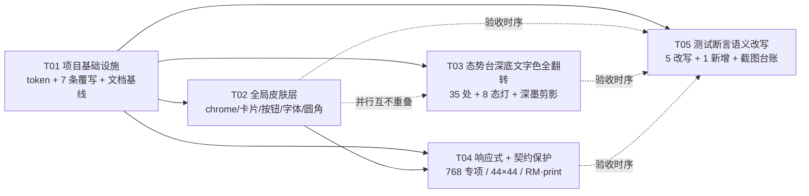
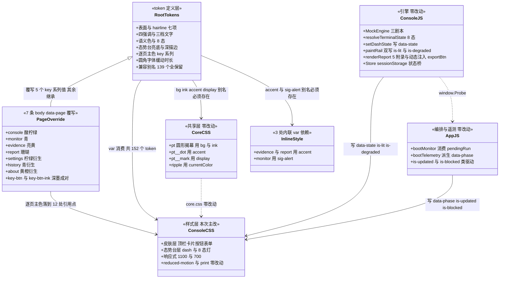
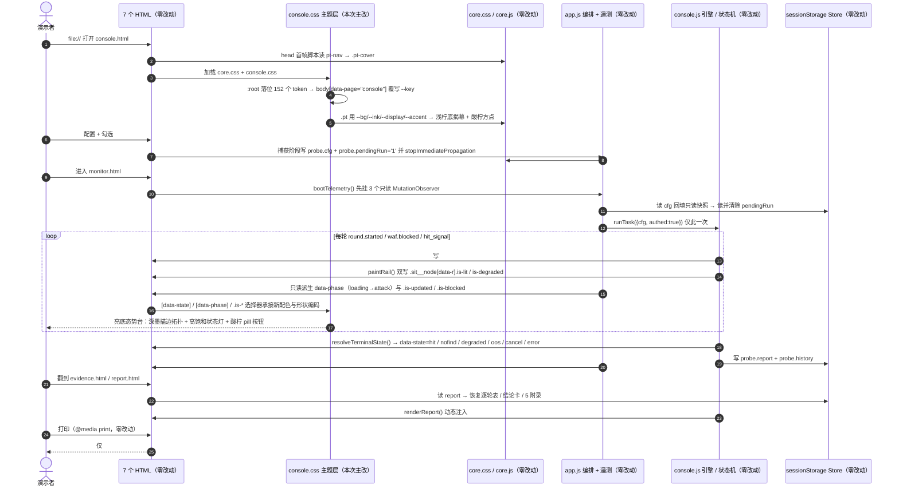

# 11 · 多巴胺风格功能页增量设计（v0.19）

> **性质**：增量系统设计 + 有序任务分解，只描述本次变更，不重写全量架构。
> **基线**：`D:\AIBBBG\Version1` · git main · HEAD `e8da794`（v0.18.0 台账回填；功能主体 `9e0b6b6`）· 工作树干净 · **历史不重写**。
> **上游**：`docs/10-多巴胺风格功能页增量PRD.md`（444 行，权威需求）、主理人方向裁决、4 条已核实事实。
> **下游**：直接交工程师寇豆码实现，随后 QA 全量回归。本文精确到「改哪个文件、哪一段、改成什么、保留什么」。
> **仍有效**：`docs/08`（v0.17 架构：7 页翻页 / 跨页 Store / 仅点击触发）、`docs/09` §3 A13 / §6 / §8（形状·线型·文字三通道编码、四段拓扑、契约清单）。
> **被取代**：`docs/09` 的 v0.18 视觉规格（冷中性 ramp / 钢青单 accent / 深色态势台 / 近直角 / 无压缩展示字）。
> **零新增依赖**：不新增任何第三方库、字体文件、图标库、动效库、CDN、`@font-face`、外部请求；测试仍只用本机 Chrome + Node 22 全局 WebSocket。

---

## 0. 工程师速查（先读这一页）

**一句话**：本次只改 `webapp/css/console.css` 的样式层 + `docs/scripts/e2e-pages-test.js` 的 5 条断言语义 + 截图 / 台账 / 文档指针；**7 个 HTML、4 个 JS、`css/core.css`、主页三件套、其余 3 个测试脚本全部零改动**。

| 主理人 4 条事实 | 本文落实位置 |
|---|---|
| **事实 1**：`body[data-page]` 只有 1 条统一规则，不是 7 条 | §2.7 给出**新增 7 条** `body[data-page="..."]` 完整 CSS（含 `--key-btn` / `--key-btn-ink` 成对值，深墨字不用白字）；§3.1 标注 `console.css:107-109` 由 3 行 → 21 行。另在 §2.7 / §3.1 新增 12 处 `var(--accent)` → `var(--key)` 引用点——**这是必须做的**：实测 `--key` / `--key-ink` / `--key-dim` 在 v0.18 的 `console.css` 中**引用数为 0**，若不新增引用点，逐页主色将完全不可见。 |
| **事实 2**：态势台深底→亮底触发约 30 处连锁 | §3.2 给出 **35 行完整替换映射表**（token / `.dash` / SVG 描边 / HTML 层文字 / 告警带 / 读数 / 8 态灯 / 6 处 `--sit-bg` 形状色 / 终端与代码块），逐一给旧值→新值；§4.2 给出「形状色改深墨」的论证与具体选择器。 |
| **事实 3**：内联 `var()` 依赖，删旧 token 名会静默失效 | §2.9 给出 **139 个现有自定义属性名全量清单**，一个不删；`--accent` / `--sig-alert` / `--bg` / `--ink` / `--display` / `--st-*` / `--dot-*` 等全部「名字保留、只改映射值」；§3.3 核实 7 个 HTML 仅 3 处内联 `var()`（`evidence.html:38` `--accent`、`monitor.html:49` `--sig-alert`、`report.html:39` `--accent`）。 |
| **事实 4**：E2E 5 条断言方向反转必然 FAIL | §3.4 给出 5 条断言的**逐行替换代码**（含 1 条新增断言，总数 61 → 62，只增不减），并复核了每条新阈值的实算值；禁止放宽阈值。 |

**改动规模**：`console.css` 594 行 → 约 650 行（净 +56）；`:root` 现有 139 个 token 名全部保留，新增 13 个 → 共 152 个；7 条逐页覆写；5 条 E2E 断言改写 + 1 条新增；5 张 v0.19 截图。

---

## 1. 设计目标与变更边界

### 1.1 一句话目标

**把 7 个功能页从 v0.18「冷中性亮底 + 单一钢青 accent + 深色态势台」换成「主页设计语言 × 明亮高饱和多巴胺撞色」，只重写 `console.css` 样式层；功能、信息架构、业务逻辑、全部交互入口、HTML 结构零删减。**

方向裁决（继承主理人，不再回问）：

1. 「与主页一致」= **继承设计语言**（酸柠绿 `#c8f560` / 青 `#4fe3d0` / 珊瑚 `#ff6b6b` / 亮黄 `#f5c451` 四原色、Roboto Condensed 压缩展示字、52px pill 按钮、11px/.12em/uppercase mono 小标签、状态母线、涟漪与圆形揭幕、主页缓动与时长 token、内联线性 SVG 图标），**不是复制主页深墨底**。
2. 「避免黑白 / 深蓝灰」针对的是 v0.18 冷中性 ramp（`#EDF1F3` / `#F8FAFB` / `#101C24` / `#536773` / 钢青 `#2A6C7E` / 深色态势台 `#0A1218`），功能页表面改为带色相浅亮底 + 高饱和色块。
3. **禁止回退 v0.17**：不得出现 88px/800 压缩黑巨标题、150px 巨页码、`8px 8px 0` 实心偏移黑阴影、硬边 `clip-path` 切角、七色轮转蓝紫。
4. unslop 纪律：撞色集中在**内容时刻**（页头编号徽标、卡片色块、8 态灯、pill 主按钮、比例条、态势台拓扑与指标格），chrome 相对安静；不新增渐变文字 / emoji / 无意义循环动画 / 彩色发光堆叠；状态区分不依赖单一颜色。
5. PRD §6 的 **10 个待明确项全部采纳 PM 推荐默认**（暖奶油卡片面、四原色+三同族衍生、不改 `core.css`、态势台亮底、打印豁免、零新增库、视觉阈值不变、压缩展示字只用于标题/按钮/KPI、主页 slop 信号继承但不新增更多实例、旧 token 名全部保留为别名只改映射值）。

### 1.2 改 / 不改清单

| 改（本次范围） | 不改（冻结边界） |
|---|---|
| `webapp/css/console.css`：token 映射值、圆角、字体栈、按钮、态势台配色与深底文字全翻转、8 态灯、小标签、品牌方点、7 条 `body[data-page]` 覆写、响应式微调、文件头注释 | `webapp/index.html` / `webapp/css/index.css` / `webapp/js/index.js`（**主页完全不动**） |
| `docs/scripts/e2e-pages-test.js`：5 条断言语义改写 + 1 条新增（总数只增不减） | `webapp/css/core.css`（`.pt` / `.ripple` / `.pt__dot` 随 `--bg` / `--ink` / `--accent` / `--display` 自动适配） |
| `docs/scripts/shot-pages.js`：5 张输出名 `v0.18` → `v0.19`，保留 v0.18 图作对照 | `webapp/js/api.js` / `js/console.js` / `js/app.js` / `js/core.js`（**业务逻辑零改**） |
| `CHANGELOG.md`：追加 `v0.19.0` 一行 + 变更摘要（不修改既有行） | **7 个 HTML**：结构 / section 顺序 / 全部静态 `id` / `data-*` / `aria-*` / `role` / `tabindex` / `#pt` 首帧脚本 / css·js 引用顺序（**0 行改动**） |
| `docs/09-网络安全攻防风格UI重构说明.md`：顶部加「视觉规格已被 v0.19 取代」指针，全文保留作历史 | `docs/scripts/code-review-run-tests.js`（101）/ `qa-regression-verify.js`（51）/ `v018-visual-spec-check.js`（视觉阈值）**零改动** |
| `docs/screenshots/功能页-1440-v0.19-*.png`：5 张新截图 | `console.css` 的 `@media(prefers-reduced-motion:reduce)`（565-579）与 `@media print`（582-594）**两个区块零改动** |
| `docs/11-多巴胺风格增量设计.md`（本文） | `docs/08`（架构仍有效）、`docs/10`（上游 PRD，冻结） |

### 1.3 模块清单与 R0/R1 定级（引用 PRD §1.2）

**5 类共享模块**（7 页每页均须存在，全部 **R0 原样保留**）：① 共享顶栏（4 主导航 + 3 工具子页 + telemetry 状态母线）；② 面包屑与页头（eyebrow / 标题 / 说明 / 编号徽标 01…07）；③ 页脚（7 链接 + 边界声明 + `#soundOffBtn`）；④ 跨页过渡层（`#pt` 圆形揭幕 + `[data-ripple]` 涟漪）；⑤ 空态 / 引导。

**20 个页面专属模块**（PRD §1.2 汇总口径；逐页 3 / 4 / 5 / 4 / 2 / 2 / 2，空态按页归属，逐项验收以 §1.2 表格全量行为准——本次不做任何删减，按「表格里出现的每一行」全量核对）：

| 页 | 模块 | 定级 |
|---|---|---|
| ① `console` | 任务配置卡 / 合规边界卡 / 会话指标 | R0 |
| ② `monitor` | 配置快照条 / 引导空态 / 运行面板 = R0；**攻防态势台 = R1（唯一允许视觉重组）** | R1 仅 1 项 |
| ③ `evidence` | 空态 / 逐轮记录表 / 结论卡 / 越界诚信提示 / 关键证据摘要 | R0 |
| ④ `report` | 空态 / 报告主体 / 5 个附录 / 水印 + 导出 | R0 |
| ⑤ `settings` | 演示参数 6 项 / 三套剧本说明 | R0 |
| ⑥ `history` | 会话内任务表 / 空态 | R0 |
| ⑦ `about` | 使用边界 3 节 / 操作流程 | R0 |

> **R0** = 结构、内容元素、交互入口、DOM id 与 `data-*` 一律不删不减，仅允许换肤（改 CSS）；**R1** = 允许改配色 / 底色 / 形状 / 布局，但内容元素与结构节点不删，且必须保留形状 + 线型 + 文字三通道状态编码；**R2** = 允许新增纯视觉元素，不得新增业务逻辑与交互入口。
> 本次**唯一 R2 级新增**是 `body::before` 单层双 radial 氛围层（CSS 伪元素，无 DOM 节点、无交互，等价于主页 `index.css:69-87`，`opacity:.7`，不新增第三层、不复制 `.halo`）。除此之外**零新增 class / id / DOM 节点**。

### 1.4 实现路径（Implementation Approach）

| 难点 | 选型 / 解法 | 理由 |
|---|---|---|
| 换色板但不能碰 HTML / JS | **双层 token 架构**：基础层（`--n-*` / `--t-*` / `--sig-*` / `--st-*` / `--dot-*` / `--sit-*` / `--accent*` / `--key*` / `--r*` / `--d-*`）+ 兼容别名层（139 个名字全保留）。**全部 139 个名字不动，只改 `:root` 里的值** | `console.css` 内部约 200 处引用 `--n-*` / `--t-*`；`core.css` 与 3 处内联样式引用 `--bg` / `--ink` / `--accent` / `--sig-alert` / `--display`。改名会静默失效（事实 3），逐处改选择器会破坏「最小 diff / 业务逻辑零改」 |
| 亮色块上文字对比度 | **双轨语义色**：主页四原色（亮）只作**填充**，配 `--accent-ink:#0a0c0f` 深墨字；文字 / 描边 / 状态读数一律用**同色相的深语义色**（`--st-*` / `--dot-*` 文字版 / `--sig-*` / `--sit-*`） | 实测亮色作文字在浅亮底上仅 1.12–2.72:1，会击穿 4.5:1 与现有 5.2:1 基线；深语义色 chroma 仍 0.39–0.60，仍属高饱和 |
| 态势台深底→亮底 | 全站唯一深色区改 `--sit-bg:#EAF7CE`；约 35 处为深底设计的浅字 / 形状色逐项翻转；**形状剪影统一改用新增 `--sit-cut:#16210E` 深墨** | 事实 2；形状编码是 v0.18 unslop 成果，必须保留；深墨剪影压在亮色灯体上 ≥13:1，压在深墨灯体上 <2:1（§4.2 论证） |
| 8 态不靠单一颜色 | 形状（空心方 / 实心方 / 横杠 / 斜线 / 菱形 / 双框 / 叉）+ 线型（虚线↔实线 / 实线↔`6 8`）+ 文字（`#dashState` / 流读数）三通道**选择器零改动**，仅由 token 值承接 | `docs/09` §3 A13；灰度截图仍可分辨 8 态 |
| 与主页 pill / 压缩字统一但中文不糊 | `--display` 前 5 项逐字复制主页，尾部追加中文回退（等价主页 `body` 简写）；新增 `--display-cn` 只用于含中文的标题 / 按钮；中文正文保持 `--body` 与正常字距 | 负字距伤中文；不恢复 88px / 800 字重 |
| 响应式零溢出 | 保留 1100 / 700 两条媒体查询骨架；**768 落在 1100 内、700 外，单独加 2 条收敛规则**；pill 按钮在 390 档收 `padding` 且 `max-width:100%` | PRD §5；实测 768 档 `.sit__legend{padding-right:280px}` + 可见 `.sit__flowmeta` 会挤压换行溢出 22px 容器 |
| 测试断言方向反转 | 5 条断言改为「符合新方向」的语义断言（**更严，不是放宽**），新增 1 条逐页主色断言 | 事实 4；禁止靠放宽阈值假装通过 |

**架构模式**：静态多页（7 独立 HTML）+ 共享 CSS 主题层 + 共享 JS 编排层（`app.js`）+ 引擎层（`console.js`）+ 呈现层遥测桥（`bootTelemetry`）。本次严格只在**主题层（CSS）**动手，MVVM / 状态机 / Store 均不动。

---

## 2. 视觉 token 规格表

### 2.0 总原则

- **现有 139 个自定义属性名一个都不删、一个都不改名**（全量见 §2.9）；绝大多数属于「**名字保留、仅改映射值**」。
- **新增 13 个**名字：`--bg-2`、`--surface`、`--surface-2`、`--line-2`、`--line-3`、`--r-sm`、`--r-pill`、`--ease-2`、`--d`、`--d-slow`、`--d-loop`、`--sit-cut`、`--display-cn`。
- `--d-fast` 名字已存在，由「别名 `var(--d-step)`」升为主 token 并改值为 `.16s`（仍属「名字保留、只改值」）。
- **禁止**在任何选择器里写散落 hex（除 `@media print` 黑白豁免区与 `@keyframes` 既有值）；所有颜色一律走 token。
- 标注说明：`【保名改值】`= 名字保留只改值；`【新增】`= 新名字；`【保名保式】`= 名字与映射表达式都不动，值随被指向的基础 token 自动变。

### 2.1 表面与 hairline（基础名保留，仅改值）

| Token | v0.18 | **v0.19** | 中文语义 / 用途 | 标记 |
|---|---|---|---|---|
| `--n-bg` | `#EDF1F3` | **`#F7FBE8`** | 浅柠纸底 · 页面底 / 全局 chrome（L=.946 / chroma=.075） | 保名改值 |
| `--n-surface` | `#F8FAFB` | **`#FFFDF4`** | 暖奶油面 · 卡片 / 输入框 / 顶栏工具（非纯白，L=.980） | 保名改值 |
| `--n-raised` | `#E6ECEF` | **`#F2F8DC`** | 柠绿抬升面 · 激活行 / 表头 / 进度条底 | 保名改值 |
| `--n-sunken` | `#E1E8EB` | **`#EDF6D2`** | 分组底 / 氛围层 | 保名改值 |
| `--n-line` | `rgba(16,28,36,.12)` | **`rgba(16,33,10,.12)`** | hairline 主分隔线（改深墨相，不改透明度） | 保名改值 |
| `--n-line-2` | `rgba(16,28,36,.22)` | **`rgba(16,33,10,.24)`** | 次级分隔线 | 保名改值 |
| `--n-line-3` | `rgba(16,28,36,.38)` | **`rgba(16,33,10,.38)`** | 强分隔线 | 保名改值 |
| `--t-1` | `#101C24` | **`#16210E`** | 深橄榄墨 · 主文字 / 标题 / 数值 | 保名改值 |
| `--t-2` | `#40525E` | **`#3E4A2E`** | 中橄榄灰 · 次文字 / 说明 / 表头 | 保名改值 |
| `--t-3` | `#536773` | **`#5A6647`** | 弱橄榄灰 · meta / 11px 小标签 / 图例 | 保名改值 |

> **关键决策**：不把 `--n-*` / `--t-*` 重命名成 PRD §4.1 的 `--bg` / `--surface` / `--ink`，因为它们被 `console.css` 内部约 200 处直接引用；改名等于重写整个样式层。PRD 的新名字以**别名**形式在 §2.9 / 新增组里提供，语义等价、零破坏。

### 2.2 四强调（**主页 `index.css:13-20` 原值，严格逐字复用**）

| Token | v0.18 | **v0.19** | 中文语义 | 标记 |
|---|---|---|---|---|
| `--accent` | `#2A6C7E` | **`#c8f560`** | 酸柠绿 · 主强调 / 主按钮底 / 焦点环 / 品牌方点 | 保名改值 |
| `--accent-ink` | `#1B4C5A` | **`#0a0c0f`** | 深墨 · **所有高饱和亮色块上的文字**（R-1，不用白字） | 保名改值 |
| `--accent-soft` | `rgba(42,108,126,.10)` | **`rgba(200,245,96,.12)`** | 酸柠软面 · 命中行 / 提示面 | 保名改值 |
| `--accent-line` | `rgba(42,108,126,.34)` | **`rgba(200,245,96,.45)`** | 酸柠描边 · `.tool.is-current` / `.btn-ghost:hover` / `.tag.anomaly` | 保名改值 |
| `--accent-2` | `var(--sig-ok)` | **`#4fe3d0`** | 青 · 命中 / 正向 / 命中路径 | 保名改值（由别名升为字面主页值） |
| `--accent2-soft` | `var(--sig-ok-soft)` | **`rgba(79,227,208,.12)`** | 青软面（主页原值） | 保名改值 |
| `--accent2-ink` | `var(--sig-ok)` | **`#0B6E60`** | 深青 · 青作**文字**时的深版 | 保名改值 |
| `--danger` | `var(--sig-err)` | **`#ff6b6b`** | 珊瑚红 · 越界 / 告警 / 攻击流 / 取消 / 异常（**作填充**） | 保名改值 |
| `--danger-ink` | `var(--sig-err)` | **`#B0232F`** | 深珊瑚 · 珊瑚作**文字**时的深版 | 保名改值 |
| `--danger-soft` | `var(--sig-err-soft)` | **`rgba(255,107,107,.12)`** | 珊瑚软面 | 保名改值 |
| `--warn` | `var(--sig-deg)` | **`#f5c451`** | 亮黄 · 降级 / 拦截 / 待审（**作填充**） | 保名改值 |
| `--warn-ink` | `var(--sig-deg)` | **`#7A5200`** | 深琥珀 · 亮黄作**文字**时的深版 | 保名改值 |
| `--warn-soft` | `var(--sig-deg-soft)` | **`rgba(245,196,81,.14)`** | 亮黄软面 | 保名改值 |

> **双轨规则（本文核心约束）**：四原色 + 三衍生色（`--accent` / `--accent-2` / `--danger` / `--warn` / `--key`）是**亮填充色**，其上文字一律 `#0a0c0f`；`*-ink` 与 `--sig-*` / `--st-*` / `--sit-*` 是**深语义色**，专用于浅亮底上的文字 / 描边 / 状态读数。二者**色相同族、明度分轨**，既保高饱和又保 ≥4.5:1。

### 2.3 三档文字（浅亮底上，别名指向 `--t-*`）

| Token | **v0.19 值** | 中文语义 | 实测最低对比度 | 标记 |
|---|---|---|---|---|
| `--ink` | `var(--t-1)` = `#16210E` | 主文字 / 标题 / 数值 | 13.57:1（对最暗亮面 `#DDEEC0`） | 保名保式 |
| `--ink-2` | `var(--t-2)` = `#3E4A2E` | 次文字 / 说明 / 表头 | 7.67:1 | 保名保式 |
| `--ink-3` | `var(--t-3)` = `#5A6647` | 弱文字 / 11px 小标签 / 图例 | **4.98:1**（对 `#DDEEC0`）/ 5.81:1（对页底） | 保名保式 |

> 最弱档 `--ink-3` 在全部 5 种亮面上均 ≥4.5:1，且对页底 5.81:1 **不低于现有 5.2:1 基线**。11px 小标签只能用 `--ink-3` 及以上。

### 2.4 语义色 `--sig-*`（**深版**，供文字 / 描边 / 边框，均另配形状或线型）

| Token | **v0.19** | 中文含义 | 亮面最低对比度 / chroma | 标记 |
|---|---|---|---|---|
| `--sig-ok` | **`#0B6E60`** | 命中 / 检出（深青） | 5.00:1 / .388 | 保名改值 |
| `--sig-ok-soft` | **`rgba(11,110,96,.10)`** | 命中软面 | — | 保名改值 |
| `--sig-block` | **`#7A5200`** | 拦截 / WAF 防线（深琥珀） | 5.62:1 / .478 | 保名改值 |
| `--sig-block-soft` | **`rgba(122,82,0,.10)`** | 拦截软面 | — | 保名改值 |
| `--sig-alert` | **`#B0232F`** | 越界 / 告警（深珊瑚） | 5.46:1 / .553 | 保名改值 |
| `--sig-alert-soft` | **`rgba(176,35,47,.10)`** | 告警软面 | — | 保名改值 |
| `--sig-deg` | **`#8A4B00`** | 降级（深赭橙） | 5.53:1 / .541 | 保名改值 |
| `--sig-deg-soft` | **`rgba(138,75,0,.10)`** | 降级软面 | — | 保名改值 |
| `--sig-err` | **`#B0232F`** | 取消 / 异常（深珊瑚） | 5.46:1 / .553 | 保名改值 |
| `--sig-err-soft` | **`rgba(176,35,47,.10)`** | 异常软面 | — | 保名改值 |
| `--sig-idle` | **`#5A6647`** | 待机 / 空态 | 4.98:1 | 保名改值 |

> **为何不直接映射到主页亮四色**：`--sig-err` / `--sig-alert` / `--sig-deg` 在 v0.18 被当作 **color（文字色）** 使用（`.tag.blocked` / `.tag.deg` / `#msg.err` / `.fx-intrusion` / `#evidenceState` 等）。若改成 `#ff6b6b`，在 `#FFFDF4` 上仅 2.72:1，`v018-visual-spec-check.js` 会直接 FAIL。故 `--sig-*` 一律取**同色相深版**；亮四色由 `--accent*` / `--danger` / `--warn` / `--key` 承担填充。
> 软面色合成实测（alpha .12 压 `#FFFDF4`）：`#f6e3dc` / `#f1e8d7` / `#e2ece2` / `#f8fce2`，其上 `--ink`（13.47–15.91:1）、`--sig-err`（5.42:1）、`--sig-deg`（5.49:1）、`--ink-3`（4.94:1）**全部 ≥4.5:1**。

### 2.5 8 态 `--st-*` / `--dot-*`（名字全保留，值分两轨）

| 语义 | `--st-*`（**文字 / 读数色**，深语义） | `--dot-*`（**灯体填充**，高饱和亮色） | 非颜色通道（必须保留） |
|---|---|---|---|
| `idle` | `--st-idle:#5A6647` | `--dot-idle:#5A6647`（保留，未作填充用） | 空心方 + `IDLE` |
| `run` | `--st-run:#4A6B00`（深柠墨） | `--dot-run:#c8f560` 酸柠绿 | 实心方 + 1.4s 呼吸 + `RUNNING` |
| `hit` | `--st-hit:#0B6E60`（深青） | `--dot-hit:#4fe3d0` 青 | 实心方 + **内嵌横杠** + `HIT` |
| `nofind` | `--st-nofind:#3E4A2E` | `--dot-nofind:#5A6647`（保留，未作填充用） | 空心方 + **斜线** + `NOT FOUND` |
| `degraded` | `--st-deg:#7A5200`（深琥珀） | `--dot-deg:#f5c451` 亮黄 | **菱形**（rotate 45°）+ `DEGRADED` |
| `oos` | `--st-oos:#B0232F`（深珊瑚） | `--dot-oos:#ff6b6b` 珊瑚（保留） | **双框方** + `SIMULATED` |
| `cancel` | `--st-cancel:#B0232F` | `--dot-cancel:#ff6b6b` 珊瑚 | 实心方 + **叉形** + `CANCELLED` |
| `error` | `--st-error:#B0232F` | `--dot-error:#ff6b6b` 珊瑚 | 实心方 + **叉形** + `ERROR` |

> 全部 `--st-*` 在 `#EAF7CE` / `#FFFDF4` / `#F2F8DC` 上 ≥5.0:1；全部 `--dot-*` 亮填充配 `--sit-cut` 深墨描边与刻痕（§4.2）。**不删任何 `--st-*` / `--dot-*` 名字**：`#evidenceState[data-state]` 依赖 `--st-hit` / `--st-nofind` / `--st-oos` / `--st-error` / `--st-idle`，`console.js` 的 `data-state` 取值不变。

### 2.6 态势台 `--sit-*`（亮底 + 深语义描边 + 深墨剪影）

| Token | v0.18 | **v0.19** | 中文语义 | 亮面最低对比度 | 标记 |
|---|---|---|---|---|---|
| `--sit-bg` | `#0A1218` | **`#EAF7CE`** | **态势台亮底**（L=.885 / chroma=.161） | — | 保名改值 |
| `--sit-panel` | `#101C24` | **`#FFFDF4`** | 指标格 / 空心节点面（暖奶油） | — | 保名改值 |
| `--sit-raised` | `#14222B` | **`#F2F8DC`** | 抬升面（比亮底更亮） | — | 保名改值 |
| `--sit-line` | `rgba(178,205,216,.12)` | **`rgba(16,33,10,.18)`** | 内部网格 / 分区 hairline | — | 保名改值 |
| `--sit-line-2` | `rgba(178,205,216,.24)` | **`rgba(16,33,10,.34)`** | 强分隔 / `.dash` 外框 | — | 保名改值 |
| `--sit-txt` | `#B4C6D0` | **`#16210E`** | 态势台主文字（深橄榄墨） | 13.57:1 | 保名改值 |
| `--sit-txt-dim` | `#8298A4` | **`#3E4A2E`** | 态势台次文字 / SVG 描边 / 图例 | 7.67:1 | 保名改值 |
| `--sit-atk` | `#6FA6B7` | **`#B0232F`** 深珊瑚 | 攻击链 / 攻击流 / 告警带 | 5.46:1 | 保名改值 |
| `--sit-def` | `#A98C76` | **`#7A5200`** 深琥珀 | WAF 防线 / 拦截通道 | 5.62:1 | 保名改值 |
| `--sit-node` | `#8FB0BC` | **`#16210E`** 深橄榄墨 | 轮次节点描边 + 点亮填充 | 13.57:1 | 保名改值 |
| `--sit-hit` | `#6FA98A` | **`#0B6E60`** 深青 | 命中路径 / 关键路径 | 5.00:1 | 保名改值 |
| `--sit-deg` | `#A99A6C` | **`#8A4B00`** 深赭橙 | 降级刻痕 / 斜纹 | 5.53:1 | 保名改值 |
| `--sit-cut` | — | **`#16210E`** | **【新增】形状剪影 / 刻痕专用深墨**（横杠 / 斜线 / 叉 / 双框内框 / 图例节点描边 / 灯体描边） | 13.57:1 | 新增 |
| `--grid-line` | `var(--sit-line)` | `var(--sit-line)` | 别名，值随上行自动变 | — | 保名保式 |

> **为何 `--sit-*` 全部取深版**：亮底 `#EAF7CE`（L=.885）上要保持线条 ≥3:1，描边色亮度须 ≤.262；主页亮四色 `#c8f560` / `#4fe3d0` / `#f5c451` / `#ff6b6b` 对该底分别只有 **1.12 / 1.41 / 1.45 / 2.47:1**，直接用作描边等于消失。深语义色 chroma 仍 .388–.553，属高饱和，且线条对比 ≥5:1，同时满足 PRD P1-3「线条与底色对比 ≥3:1」与 P0-4「正文 ≥4.5:1」。

### 2.7 逐页 `--key` / `--key-btn`（**7 条新增覆写，事实 1**）

`:root` 基础层（`console.css:66-67`）先改为：

```css
--key:var(--accent); --key-ink:var(--accent-ink); --key-dim:var(--accent-soft);
--key-btn:var(--accent); --key-btn-ink:var(--accent-ink);   /* 由 #FFFFFF 改为深墨，PRD R-1 */
```

**删除** `console.css:107-109` 的单条统一规则，**替换为以下 7 条**（每条 3 行，共 21 行）：

```css
/* v0.19 逐页主色：四主流程页用主页四原色，三子页用同族衍生；chroma 全部 >0.45 且 7 页互不相同。
   --key-btn / --key-btn-ink 成对给出：按 PRD §4.3「primary 一律酸柠底深墨字」，7 页统一酸柠底；
   --key 只做页面身份编码，由 §3.1 新增的 12 处引用点承载。 */
body[data-page="console"]  { --key:#c8f560; --key-ink:#0a0c0f; --key-dim:rgba(200,245,96,.12);  --key-btn:#c8f560; --key-btn-ink:#0a0c0f; }
body[data-page="monitor"]  { --key:#4fe3d0; --key-ink:#0a0c0f; --key-dim:rgba(79,227,208,.12);  --key-btn:#c8f560; --key-btn-ink:#0a0c0f; }
body[data-page="evidence"] { --key:#f5c451; --key-ink:#0a0c0f; --key-dim:rgba(245,196,81,.12);  --key-btn:#c8f560; --key-btn-ink:#0a0c0f; }
body[data-page="report"]   { --key:#ff6b6b; --key-ink:#0a0c0f; --key-dim:rgba(255,107,107,.12); --key-btn:#c8f560; --key-btn-ink:#0a0c0f; }
body[data-page="settings"] { --key:#A9DF3C; --key-ink:#0a0c0f; --key-dim:rgba(169,223,60,.12);  --key-btn:#c8f560; --key-btn-ink:#0a0c0f; }
body[data-page="history"]  { --key:#2FC9B4; --key-ink:#0a0c0f; --key-dim:rgba(47,201,180,.12);  --key-btn:#c8f560; --key-btn-ink:#0a0c0f; }
body[data-page="about"]    { --key:#F5A623; --key-ink:#0a0c0f; --key-dim:rgba(245,166,35,.12);  --key-btn:#c8f560; --key-btn-ink:#0a0c0f; }
```

**实算复核**：7 个 `--key` 的 chroma 依次 0.584 / 0.580 / 0.643 / 0.580 / 0.639 / 0.604 / 0.824（全部 >0.45，互不相同）；`#0a0c0f` 压在其上的对比度 15.56 / 12.34 / 12.03 / 7.06 / 12.41 / 9.45 / 9.66:1（全部 ≥4.5）。**不使用白字**。

> ⚠️ **`--key` 必须新增引用点**：实测 `console.css` 中 `var(--key)` / `var(--key-ink)` / `var(--key-dim)` 的引用数均为 **0**，只有 `--key-btn`（4 处）与 `--key-btn-ink`（2 处）被引用。若只写 7 条覆写而不新增引用，逐页主色在页面上完全不可见（P1-1 落空）。§3.1 已列出**必须改的 12 处** `var(--accent)` → `var(--key)`。

### 2.8 圆角 / 字体 / 缓动与时长

| 组 | Token | v0.18 | **v0.19** | 说明 | 标记 |
|---|---|---|---|---|---|
| 圆角 | `--r` | `4px` | **`12px`** | 卡片 / 外层，主页原值 | 保名改值 |
| 圆角 | `--r-in` | `2px` | **`8px`** | 内层 / 控件 / 标签 / 表格容器 | 保名改值 |
| 圆角 | `--r-sm` | — | **`8px`** | 主页 `--r-sm` 对齐名 | 新增 |
| 圆角 | `--r-pill` | — | **`9999px`** | **所有 `.btn-*` 与编号徽标 pill** | 新增 |
| 字体 | `--body` | Inter / PingFang SC / … | **不变** | 中文正文保留系统界面字体与正常字距 | 保名保式 |
| 字体 | `--mono` | IBM Plex Mono / … | **`"Roboto Mono","Cascadia Mono","Consolas",monospace`** | 主页原值；数字 / 元信息 / 终端 | 保名改值 |
| 字体 | `--display` | `var(--body)` | **`"Roboto Condensed","RobotoCondensed","Bahnschrift SemiCondensed","DIN Condensed","Arial Narrow","PingFang SC","Microsoft YaHei","Noto Sans CJK SC",sans-serif`** | 前 5 项与 `index.css:24-26` 逐字一致；尾部中文回退等价主页 `body` 简写追加项 | 保名改值 |
| 字体 | `--display-cn` | — | **同 `--display`** | 语义别名，供含中文的标题 / 按钮使用（不恢复 88px/800） | 新增 |
| 缓动 | `--ease` | `cubic-bezier(.22,1,.36,1)` | **`cubic-bezier(.16,1,.3,1)`** | 主页 `--ease`；**只改曲线，不改时长** | 保名改值 |
| 缓动 | `--ease-2` | — | **`cubic-bezier(.45,0,.1,1)`** | 主页 `--ease-2` | 新增 |
| 时长 | `--d-inst` | `140ms` | **`160ms`** | = 主页 `--d-fast`；hover / press / 终端淡入 | 保名改值 |
| 时长 | `--d-step` | `220ms` | **`220ms`（保持）** | 节点点亮 / 刻度轨 / 突触，节奏不动 | 保名保式 |
| 时长 | `--d-state` | `360ms` | **`360ms`（保持）** | **关键：不可改成 1s**，见下方注 | 保名保式 |
| 时长 | `--d-fast` | `var(--d-step)` | **`.16s`** | 主页原值，供新按钮 hover 使用 | 保名改值 |
| 时长 | `--d` | — | **`.5s`** | 主页 `--d` | 新增 |
| 时长 | `--d-slow` | — | **`1s`** | 主页 `--d-slow` | 新增 |
| 时长 | `--d-loop` | — | **`22s`** | 主页 `--d-loop`（仅登记，功能页不新增循环动画） | 新增 |
| 时长 | `--micro` / `--slow` | `var(--d-inst)` / `var(--d-state)` | **`var(--d-fast)` / `var(--d-state)`** | 兼容别名，零引用但保留 | 保名改值 |

> ⚠️ **`--d-state` 必须保持 360ms**：`e2e-pages-test.js:161-175` 在终态后 `await sleep(420)` 才采样 `.sit__path--key` 的 `opacity`，断言 `>=0.9`；该属性 `transition:opacity var(--d-state)`。若按主页 `--d-slow:1s` 改值，420ms 时仍在过渡中（≈0.4）→ **L175 必然 FAIL**。主页时长 token 以**新增同名 token**（`--d` / `--d-slow` / `--d-loop` / `--d-fast` / `--ease` / `--ease-2`）逐项对齐，v0.18 内部三档时长名保留其值以守住 E2E 时序与 reduced-motion 契约。这是 PRD P1-4 与测试契约的必要调和，已列入 §9 待明确项（默认不改）。
> `--mono` 字体栈变更后须在 390 档复跑溢出核验（`.tbl` 有 `min-width:640px` + `.tbl-scroll{overflow-x:auto}` 容器，页面本身不溢出）。

### 2.9 兼容别名全量映射（**139 个名字一个不删**）

以下为 `console.css:82-105` 别名层的 v0.19 取值。**除标注「改值」外，名字与映射表达式都不动**，值随 §2.1–2.6 的基础 token 自动变（标注「保名保式」）。

**表面 / 文字别名（保名保式）**：`--bg:var(--n-bg)` · `--bg2:var(--n-sunken)` · `--panel:var(--n-surface)` · `--panel2:var(--n-raised)` · `--panel3:var(--n-raised)` · `--line:var(--n-line)` · `--line2:var(--n-line-2)` · `--line3:var(--n-line-3)` · `--card:var(--n-surface)` · `--card-2:var(--n-sunken)` · `--paper:var(--n-bg)` · `--hair:var(--n-line)` · `--hair-2:var(--n-line-2)` · `--grid:var(--n-line)` · `--grid-line:var(--sit-line)` · `--ink:var(--t-1)` · `--ink-2:var(--t-2)` · `--ink-3:var(--t-3)`。

**主色 / 语义别名**：
```
--primary:var(--accent);        --primary-ink:var(--accent-ink);   --primary-soft:var(--accent-soft);  /* 保名保式 */
--secondary:var(--t-2);         --secondary-soft:var(--n-raised);                                     /* 保名保式 */
--barrier:var(--sig-ok);        --barrier-ink:#0B6E60;             --barrier-soft:var(--sig-ok-soft); /* ink 改值 */
--alert:var(--sig-alert);       --alert-ink:#B0232F;               --alert-soft:var(--sig-alert-soft);/* ink 改值 */
--danger:#ff6b6b;               --danger-ink:#B0232F;              --danger-soft:rgba(255,107,107,.12);/* 见 §2.2 */
--warn:#f5c451;                 --warn-ink:#7A5200;                --warn-soft:rgba(245,196,81,.14);  /* 见 §2.2 */
--cyan:var(--accent);           --cyan-ink:var(--accent-ink);      --cyan-dim:var(--accent-soft);     /* 保名保式 */
--mag:var(--sig-alert);         --mag-ink:#B0232F;                 --mag-dim:var(--sig-alert-soft);   /* ink 改值 */
--yel:var(--sig-deg);           --yel-ink:#8A4B00;                 --yel-dim:var(--sig-deg-soft);     /* ink 改值 */
--blu:var(--accent-2);          --blu-ink:#0B6E60;                 --blu-dim:var(--accent2-soft);     /* 改值：映射到青，不引入蓝 */
--verm:var(--sig-err);          --verm-ink:#B0232F;                --verm-dim:var(--sig-err-soft);    /* ink 改值 */
--vio:var(--accent-2);          --vio-ink:#0B6E60;                 --vio-dim:var(--accent2-soft);     /* 改值：映射到青，不引入紫 */
--grn:var(--sig-ok);            --grn-ink:#0B6E60;                 --grn-dim:var(--sig-ok-soft);      /* ink 改值 */
--green:var(--sig-ok); --green2:var(--sig-ok); --blue:var(--accent-2); --red:var(--sig-err);
--red-ink:#B0232F; --yellow:var(--sig-deg); --lime:var(--sig-deg); --violet:var(--accent-2);
--violet-ink:#0B6E60;                                                                                /* 保名保式 */
--accent-2:#4fe3d0;  --accent2-soft:rgba(79,227,208,.12);  --accent2-ink:#0B6E60;                /* 见 §2.2 */
--ink-on-alert:#0a0c0f;   /* 由 #FFFFFF 改深墨，R-1，不用白字 */
--micro:var(--d-fast); --d-fast:.16s; --slow:var(--d-state);                                       /* 见 §2.8 */
```

**PRD §4.1 A 新名字（新增，全部指向基础 token，单值源）**：
```
--bg-2:var(--n-sunken);  --surface:var(--n-surface);  --surface-2:var(--n-raised);
--line-2:var(--n-line-2); --line-3:var(--n-line-3);
```

> **事实 3 硬约束**：`core.css` 的 `.pt{background:var(--bg);color:var(--ink)}`、`.pt__mark{font:600 20px/1 var(--display)}`、`.pt__dot{background:var(--accent)}`、`.ripple{background:currentColor}`，以及 `evidence.html:38` / `report.html:39` 的 `var(--accent)`、`monitor.html:49` 的 `var(--sig-alert)`——**全部依赖上述别名存在**。删任一名都会静默失效。`.pt` 遮罩随 `--bg` 自动变成「浅柠底 + 深墨字 + 12px 酸柠绿方点」，PRD §6 风险 3 明确接受，**不改 `core.css`**。
> **unslop 注**：`--blu` / `--vio` / `--violet` 只保留名字，**不映射任何蓝 / 紫字面色**，统一指向 `--accent-2` 青，防止 v0.17 七色轮转（`#2B47F0` 蓝 / `#6D4DE0` 紫）回潮。

### 2.10 对比度实算复核（本文所有取值都过线）

| 组合 | 实测 | 门槛 |
|---|---|---|
| `--ink-3` `#5A6647` / 页底 `#F7FBE8` | **5.81:1** | ≥4.5 且不低于现有 5.2:1 基线 ✅ |
| `--ink-3` / 态势台底 `#EAF7CE` | 5.46:1 | ✅ |
| `--sit-txt-dim` `#3E4A2E` / `#EAF7CE` | 8.41:1 | ✅ |
| `--sit-atk` `#B0232F` / `#EAF7CE` | 5.98:1（描边 ≥3:1） | ✅ |
| `--sit-def` `#7A5200` / `#EAF7CE` | 6.16:1 | ✅ |
| `--sit-hit` `#0B6E60` / `#EAF7CE` | 5.48:1 | ✅ |
| `--sit-deg` `#8A4B00` / `#EAF7CE` | 6.06:1 | ✅ |
| `#0a0c0f` / 四原色亮块 | 15.56 / 12.34 / 12.03 / **7.06**:1（珊瑚最低） | ✅ |
| `#0a0c0f` / 三衍生亮块 | 12.41 / 9.45 / 9.66:1 | ✅ |
| 亮四色作**描边**压 `#EAF7CE` | 1.12 / 1.41 / 1.45 / 2.47:1 | ❌ → 故 `--sit-*` 一律取深版 |

---

## 3. 逐文件改动清单

### 3.1 `webapp/css/console.css`（594 行 → 约 650 行，净 +56）

| 区块 | 行号（v0.18） | 改动内容 | 估计行数 |
|---|---|---|---|
| 文件头注释 | 1–26 | 重写为 v0.19 说明：多巴胺撞色 / 亮底态势台 / 三通道编码保留 / 兼容别名保留 / 打印与 RM 豁免 | 26 → 24 |
| `:root` 基础色 | 29–63 | 按 §2.1–§2.6 全部改值；新增 `--sit-cut` | 35 → 38 |
| `:root` 主色 / 节奏 / 形状 / 字体 | 65–79 | 按 §2.7 / §2.8 改值；`--key-btn-ink` 去白字 | 15 → 20 |
| `:root` 兼容别名 + 新增 token | 81–106 | 按 §2.9 改值；追加 13 个新 token（集中在别名层末尾，注释分组） | 26 → 42 |
| `body[data-page]` | 107–109 | **删单条统一规则，换 7 条**（§2.7 完整 CSS） | 3 → 21 |
| 基础 / 小标签 / 氛围层 | 111–126 | `html`/`body` 背景改 `--n-bg`（值自动变）；`:focus-visible{outline:2px solid var(--accent);outline-offset:3px}`；`.lbl` / `.eyebrow` 改 `font:11px/1.5 var(--mono);letter-spacing:.12em;text-transform:uppercase;color:var(--ink-3)`；`.hint` 改 `--ink-2`；**新增 `body::before` 单层双 radial 氛围层**（等价 `index.css:69-87`，`opacity:.7`，仅 `--accent-soft` / `--accent2-soft`，`z-index:-1;pointer-events:none`，不新增第三层、不复制 `.halo`） | 16 → 26 |
| 顶栏 | 128–152 | `.brand i` 10×10 → **12×12 / `border-radius:2px` / `--accent`**；`.brand` / `.mainnav` / `.tool` / `.net` 文字改 `--ink*`；`.tool` / `.tool.is-current` 圆角 `--r-in`；`.net .dots i` 用 `--sig-ok` 深青 | 25 → 27 |
| 页头 | 154–166 | `.page-title` 改 `var(--display-cn)`（保持 32px/500，不恢复 88px/800）；`.page-title .dash` `var(--accent)`→`var(--key)`；**`.page-no` 改为编号徽标**：`background:var(--key);color:var(--key-ink);border:1px solid var(--key);border-radius:var(--r-pill);padding:8px 14px`；`.crumb` 文字 `--ink-3` | 13 → 17 |
| 卡片 | 168–186 | `.card` 圆角 `--r`(12px)、阴影 `0 1px 2px rgba(16,33,10,.05)`（**无实心偏移阴影**）；`.card--key` → `var(--key)`；`.card-title` 11px/.12em/uppercase + `--ink-3`；`.card-title::before` → `var(--key)`；**`:179` 覆盖规则追加 `border-left-color:var(--key) !important`**（不动 3 处内联 HTML）；`.boundary-card` 边框 `--sig-alert` 深珊瑚、圆角 `--r` | 19 → 23 |
| 按钮 | 188–203 | **收敛到主页 `.btn` 规格**：`min-height:52px;padding:0 30px;border-radius:var(--r-pill);font:600 16px var(--display-cn);letter-spacing:.02em`；`transition:transform/box-shadow/background/color/border-color var(--d-fast) var(--ease)`；`.btn-solid` 用 `--key-btn`/`--key-btn-ink`；**`:193` hover 由 `background:var(--accent-ink)` 改为 `transform:translateY(-3px);box-shadow:0 12px 34px rgba(200,245,96,.3)`**（原写法在 `--accent-ink` 变深墨后会让按钮文字变成深墨压深墨）；`:active` `translateY(-1px) scale(.98)`；`:disabled` `opacity:.4`；`.btn-ghost` 透明底 + `--line-2` 边 + `--ink` 字，hover `border-color:var(--accent);color:var(--ink);box-shadow:inset 0 0 0 1px var(--accent-soft)`（**不套用主页酸柠字**，亮底上酸柠字仅 1.24:1）；`.btn-grad` 与 `.btn-solid` 合并同规格；**新增 `.btn-ghost[style*="min-height"]{min-height:52px !important}`** 覆盖 `monitor.html:161` 内联 `min-height:36px`（不改 HTML，守住 44×44 契约） | 16 → 28 |
| 表单 | 205–232 | 输入 / 下拉圆角 `--r-sm`、边框 `--n-line-2`、字色 `--ink`；focus `border-color:var(--accent);outline:2px solid var(--accent-soft)`；**`:222` 复选框勾 `border:solid #fff` → `border:solid var(--accent-ink)`**（白勾压酸柠底仅 1.24:1，改深墨 15.56:1）；`.checks` 复选框圆角 `--r-sm`；`#msg.err/.warn/.ok` 用 `--sig-*` 深版 | 28 → 31 |
| 指标条 / KPI | 234–245 | `.metrics>div::after` → `var(--key)`；`.kpi` `border-top:2px solid var(--k,var(--key))`；`.metrics b` / `.kpi b` 改 `var(--display)` + `tabular-nums`（压缩展示字只用于 KPI 数值） | 12 → 14 |
| **攻防态势台** | 247–422 | **见 §3.2 完整映射表（35 处）**；8 态灯见 §4；**选择器结构、`[data-state]` / `[data-phase]` 取值、类驱动一律不动** | 176 → 190 |
| 运行面板 / 终端 | 424–444 | `.run-panel` 左边框 → `var(--key)`；`.spin` 轨道 `--n-line-2`、顶部 `--accent`；`.bar i` → `var(--key)`；`.thinking i` → `var(--key)`；**`.terminal` 与 `details.raw pre` 改亮代码面**（§3.2 末两行）；终端 `.line.accent/.ok/.warn` 保持表达式（值随 `--sit-*` 变深） | 21 → 24 |
| 表格 / 标签 / 结论 | 446–488 | `.tag` 11px/.12em/uppercase；`.tag.blocked/.deg` 用 `--sig-err`/`--sig-deg` 深版；`.tag.anomaly` 深墨字；`.tbl tr.is-key td:first-child` / `.tbl tbody tr:hover` 内嵌边 → `var(--key)`；`.evidence` 左边框 → `var(--key)`；`.verdict em` → `--accent-ink` 深墨；`.oos-notice` 边框 `--sig-alert` 深珊瑚 | 43 → 46 |
| 报告 | 490–501 | `.report-sec h3` 左边框 → `var(--key)`；`details.raw pre` 亮代码面；`.cover span` / `.watermark` 小标签规格 + `--ink-3` | 12 → 14 |
| 配置 / 历史 / 说明 | 503–510 | `.config-grid span` 11px/.12em/uppercase + `--ink-3`；`.about-sec h3` 用 `var(--display-cn)` | 8 → 10 |
| 页脚 | 512–524 | `.foot-links a` / `.sound-off` 圆角 `--r-sm`、小标签规格；`.sound-off[aria-checked=true]` 用 `--sig-ok` 深青 | 13 → 15 |
| 入场 | 526–530 | **零改动**（`--ease` 曲线值变，动画语义不变） | 5 → 5 |
| 响应式 | 532–562 | 骨架保留，见 §5 具体增补（含 768 专项 2 条 + pill 窄屏收敛） | 31 → 39 |
| reduced-motion | 564–579 | **零改动**（深版 `--sit-node` / `--sit-deg` / `--sit-hit` 值自动保证静态形状可见） | 16 → 16 |
| 打印 | 581–594 | **零改动**（黑白输出豁免；仍仅 `#report` + 5 附录） | 14 → 14 |

**必须由 `--accent` 改为 `--key` 的 12 处引用点**（P1-1 逐页主色落地，否则 7 条覆写无效果）：
`:160 .page-title .dash` · `:162 .page-no`（新增填充） · `:171 .card--key` · `:175 .card-title::before` · `:179 内联覆盖追加颜色` · `:241 .metrics>div::after` · `:243 .kpi` 的 fallback · `:255-257 .stage-tag--key` · `:426 .run-panel` · `:434 .bar i` · `:436 .thinking i` · `:465 .tbl tr.is-key td:first-child` · `:483 .evidence` · `:492 .report-sec h3`。
> chrome（顶栏 / 面包屑 / 页脚）保持 `--bg` / `--surface` / `--ink-*` / `--line-*` 安静浅亮，不铺高饱和；单页高饱和覆盖控制在 8%–35%。

### 3.2 事实 2 · 态势台深底 → 亮底 **完整替换映射表**（35 处）

> 全部「为 `#0A1218` 深底设计的浅字 / 形状色」逐项翻转。**形状 + 线型 + 文字三通道编码一项不删**。

| # | 行 | v0.18 旧值 | **v0.19 新值** | 说明 |
|---|---|---|---|---|
| 1 | 56 | `--sit-bg:#0A1218` | **`#EAF7CE`** | 亮底 |
| 2 | 56 | `--sit-panel:#101C24` | **`#FFFDF4`** | 暖奶油指标格 / 空心节点面 |
| 3 | 56 | `--sit-raised:#14222B` | **`#F2F8DC`** | 抬升面 |
| 4 | 57 | `--sit-line:rgba(178,205,216,.12)` | **`rgba(16,33,10,.18)`** | 深墨 hairline |
| 5 | 57 | `--sit-line-2:rgba(178,205,216,.24)` | **`rgba(16,33,10,.34)`** | 强分隔 |
| 6 | 58 | `--sit-txt:#B4C6D0` | **`#16210E`** | 主文字深橄榄墨 |
| 7 | 58 | `--sit-txt-dim:#8298A4` | **`#3E4A2E`** | 次文字 / SVG 描边 |
| 8–12 | 59–63 | `--sit-atk:#6FA6B7` / `--sit-def:#A98C76` / `--sit-node:#8FB0BC` / `--sit-hit:#6FA98A` / `--sit-deg:#A99A6C` | **`#B0232F` / `#7A5200` / `#16210E` / `#0B6E60` / `#8A4B00`** | 5 支深语义色 |
| 13 | 新增 | — | **`--sit-cut:#16210E`** | 形状剪影专用深墨 |
| 14 | 102 | `--grid-line:var(--sit-line)` | **保持表达式** | 值随 #4 自动变 |
| 15 | 259–260 | `.dash{background:var(--sit-bg);color:var(--sit-txt)}` | **保持表达式** + `border:1px solid var(--sit-line-2)` | 亮底 + 深墨字 |
| 16 | 263 | `.dash::before` 网格 `var(--sit-line)` / `opacity:.45` | **保持机制** | 网格随 #4 变深墨，亮底上仍可见 |
| 17 | 268 | `.fx-dash__atmos{background:var(--sit-atk)}` | 保持表达式 | 深珊瑚 |
| 18 | 272–273 | `.sit__zone{stroke:var(--sit-line)}` / `--def{stroke-dasharray:4 4}` | 保持 | 分区 hairline / 虚线保留 |
| 19 | 285–286 | `.sit__ring` / `.sit__ring-tip{stroke:var(--sit-txt-dim)}` | 保持表达式 | → `#3E4A2E`（8.41:1） |
| 20 | 287–289 | `.sit__synapse path/circle{stroke:var(--sit-txt-dim)}` | 保持表达式 | → 深橄榄墨 |
| 21 | 293 | `.sit__target{stroke:var(--sit-txt-dim)}` | 保持表达式 | → 深橄榄墨 |
| 22 | 295 | `.sit__node{fill:var(--sit-bg);stroke:var(--sit-node)}` | **`fill:var(--sit-panel);stroke:var(--sit-node)`** | 空心方改暖奶油填充 + 深墨描边；`is-lit{fill:var(--sit-node)}` 保持 → 深墨实心，**空心↔实心形状编码反而更强** |
| 23 | 299 | `.sit__node.is-degraded{stroke:var(--sit-deg)}` | 保持 | → 深赭虚线刻痕 |
| 24 | 306–308 | `.sit__label{color:var(--sit-txt-dim)}` / `--atk` / `--def` | 保持表达式，**字体规格不动**（见下方注） | → 深墨 / 深珊瑚 / 深琥珀 |
| 25 | 311 | `.sit__legend{color:var(--sit-txt-dim)}` | 保持表达式，字体规格不动 | → 深墨 |
| 26 | 314–318 | `.lg-solid/.lg-dash/.lg-thick` 用 `--sit-atk/def/hit` | 保持表达式 | → 深语义色 |
| 27 | 317 | `.lg-node{background:var(--sit-node);border:1px solid var(--sit-bg)}` | **`background:var(--sit-panel);border:1px solid var(--sit-cut)`** | 空心方图例 + 深墨描边（形状色不随底变浅消失） |
| 28 | 320 | `.sit__flowmeta{color:var(--sit-txt)}` | 保持 + **字体规格不动** | → 深墨 |
| 29 | 323 | `.fx-intrusion` 斜纹 `rgba(154,84,98,.18)` | **`rgba(176,35,47,.16)`** | 深珊瑚斜纹 |
| 30 | 324 | `.fx-intrusion{color:#E2C4CB}` | **`color:var(--st-oos)`**（`#B0232F`，5.98:1） | 告警带文字 |
| 31 | 330 | `.dash__head .lbl{color:var(--sit-txt-dim)}` | 保持 | → 深墨 |
| 32 | 339 | `.gauge .lbl,.dash__body .lbl{color:var(--sit-txt-dim)}` | 保持 | → 深墨（8.41:1） |
| 33 | 341 | `.gauge__num b{color:#E4EEF2}` | **`color:var(--ink)`** | 深墨 14.86:1 |
| 34 | 342 / 345 / 351 / 354 / 356 | `.cap` / `.rail i` / `.gauge__foot` / `.cell .lbl` / `.cell__note` 全用 `--sit-txt-dim` | 保持表达式 | → 深墨，全部 ≥7.6:1 |
| 35 | 348 | `.rail i.on{background:var(--sit-node);color:var(--sit-bg)}` | **`background:var(--accent);border-color:var(--accent);color:var(--accent-ink)`** | 酸柠实心格 + 深墨数字（15.56:1），`on/off` 形状编码保留 |
| 36 | 349–350 | `.rail i.deg{color:var(--sit-deg)}` / `.cur{--sit-atk}` | 保持 | 深赭 / 深珊瑚 |
| 37 | 353 / 355 | `.cell{background:var(--sit-panel)}` / `.cell__val b{color:#E4EEF2}` | 保持前者；**后者 → `color:var(--ink)`** | 暖奶油格 + 深墨数值 |
| 38 | 357–364 | `.meter` / `.meter i` / `.cell.is-hot b` 用 `--sit-*` | 保持表达式 | → 深语义色（≥5:1） |
| 39 | 366–367 | `.cell.is-updated::after{background:var(--sit-atk)}` | 保持 | 深珊瑚一次性扫过（非循环） |
| 40 | 371–389 | **8 态灯全组**（见 §4.1 矩阵） | **文字 → `--st-*` 深语义；灯填充 → `--dot-*` 亮色；所有描边与刻痕 → `--sit-cut` 深墨** | 形状编码保留 |
| 41 | 439–440 | `.terminal{background:var(--sit-bg);color:var(--sit-txt)}` | **`background:var(--surface-2);color:var(--ink);border:1px solid var(--line)`** | 亮柠绿代码面 + 深墨字 |
| 42 | 442–443 | `.terminal .line.accent/.ok/.warn` → `--sit-atk/hit/deg` | 保持表达式 | → 深珊瑚 / 深青 / 深赭（≥4.97:1） |
| 43 | 498 | `details.raw pre{background:var(--sit-bg);color:var(--sit-txt)}` | **`background:var(--surface-2);color:var(--ink);border:1px solid var(--line)`** | 报告页代码块同步亮底 |

**8 态灯 `:371-389` 逐行替换**（形状色全部改深墨，不让横杠 / 叉 / 双框随底变浅消失）：

| 行 | 旧 | **新** |
|---|---|---|
| 334–336 | `.dash__state i{...border:2px solid var(--dot-idle)}` | **`border:2px solid var(--sit-cut)`**（深墨描边恒定，亮底上必可见） |
| 371–372 | `idle{color:var(--sit-txt)}` / `i{border-color:var(--dot-idle)}` | `color:var(--st-idle)` / `border-color:var(--sit-cut);background:transparent`（空心方） |
| 373–374 | `run{color:#CFE3EA}` / `i{background:var(--dot-run);border-color:var(--dot-run)}` | `color:var(--st-run)` / `background:var(--dot-run);border-color:var(--sit-cut)`（实心酸柠方 + 呼吸） |
| 376–378 | `hit{color:#BFE0D0}` / `i{...}` / `i::after{background:var(--sit-bg)}` | `color:var(--st-hit)` / `i{background:var(--dot-hit);border-color:var(--sit-cut)}` / **`i::after{background:var(--sit-cut)}`**（深墨横杠） |
| 379–381 | `nofind{color:#CFE3EA}` / `i{border-color:var(--dot-nofind)}` / `i::after{background:var(--dot-nofind)}` | `color:var(--st-nofind)` / `i{border-color:var(--sit-cut);background:transparent}` / **`i::after{background:var(--sit-cut)}`**（深墨斜线） |
| 382–383 | `degraded{color:#DDD2A6}` / `i{background:var(--dot-deg);border-color:var(--dot-deg);transform:rotate(45deg)}` | `color:var(--st-deg)` / `i{background:var(--dot-deg);border-color:var(--sit-cut);transform:rotate(45deg)}`（菱形） |
| 384–385 | `oos{color:#E4C2CA}` / `box-shadow:inset 0 0 0 2px var(--sit-bg),0 0 0 1px var(--dot-oos)` | `color:var(--st-oos)` / `i{background:transparent;border-color:var(--sit-cut);box-shadow:inset 0 0 0 2px var(--sit-cut),0 0 0 1px var(--sit-cut)}`（**双框**） |
| 386–389 | `cancel/error{color:#E8C6BE}` / `i{background:var(--dot-cancel);border-color:var(--dot-cancel)}` / `i::after{background:var(--sit-bg)}` | `color:var(--st-cancel)` / `i{background:var(--dot-cancel);border-color:var(--sit-cut)}` / **`i::after{background:var(--sit-cut)}`**（深墨叉） |

> **字体规格例外（重要）**：PRD §4.3 的 `11px/.12em/uppercase` 小标签规格适用于 **chrome 层**（`.lbl` / `.eyebrow` / `.tag` / `.card-title` / `.stage-kicker` / `.stage-tag` / `.stage-no` / `.config-grid span` / `.cover span` / `.foot-links a` / `.sound-off` / `.watermark` / `.page-no`）。**态势台内 `.sit__label` / `.sit__legend` / `.sit__flowmeta` 保持 v0.18 的紧凑字距（.01–.02em）与 11–12px，只翻颜色、不加 `.12em`**：`#sitFlowMeta` 有 `max-width:272px` + `white-space:nowrap` + `text-overflow:ellipsis`，加 `.12em` 会把命中态文案 `ATTACK → TARGET | 命中路径已建立 · N 次命中` 撑过 272px，导致 `e2e-pages-test.js:209` 的 `flowMetaClipped===false` **FAIL**。这是 P1 视觉规格与 E2E 契约的必要调和，默认按「只翻色」执行（§9 第 5 项）。

### 3.3 7 个 HTML —— **全部 0 行改动**

| 文件 | 结论 |
|---|---|
| `console.html` / `monitor.html` / `evidence.html` / `report.html` / `settings.html` / `history.html` / `about.html` | **结构、section 顺序、全部静态 `id` / `data-*` / `aria-*` / `role` / `tabindex`、`#pt` 首帧脚本、css/js 引用顺序一律不动**。7 个 `body[data-page]` 取值已核实为 `console / monitor / evidence / report / settings / history / about`，可直接承载 §2.7 的 7 条覆写 |
| 内联 `var()` | 实测仅 3 处：`evidence.html:38` `var(--accent)`、`monitor.html:49` `var(--sig-alert)`、`report.html:39` `var(--accent)`。因 §2.9 保留全部别名，**自动生效、无需改 HTML** |
| `monitor.html:161` 内联 `min-height:36px` | 不改 HTML；由 §3.1 按钮区新增 `.btn-ghost[style*="min-height"]{min-height:52px !important}` 覆盖（沿用 `:179` 已有的 `!important` 内联覆盖模式），守住 44×44 契约 |
| `monitor.html:83-128` 拓扑 SVG | 8 个 `<rect class="sit__node" data-r>`、`viewBox 0 0 1200 200`、`xMidYMid meet`、4 分区、3 通道、8 防线、目标方框、关键路径 —— **一个节点不删**，只由 CSS 换色 |

### 3.4 `docs/scripts/e2e-pages-test.js` —— **5 条断言语义改写 + 1 条新增（61 → 62）**

> 禁止放宽阈值；下列改写全部是「方向翻转 + 增加约束」，比旧断言**更严**。文件头注释同步改为 v0.19 语义（第 1–7 行）。

**① L108**（亮底冷中性 → 明亮带色相底）：
```js
ok('明亮带色相底（非暗黑 / 非冷灰）',
   lumRGB(consoleInfo.bg) > 0.75 && chroma(consoleInfo.bg) > 0.03,
   'bg=' + consoleInfo.bg + ' L=' + lumRGB(consoleInfo.bg).toFixed(2) +
   ' chroma=' + chroma(consoleInfo.bg).toFixed(3));
```
> 实算 `#F7FBE8` → L=.946 / chroma=.075，PASS；旧冷灰 `#EDF1F3` chroma=.024 会被新断言判 FAIL（方向正确）。

**② L109**（统一单一低饱和 accent → 复用主页四原色 + 逐页主色）：
```js
/* v0.19：--accent 必须是主页原值 #c8f560；高饱和是特性，不再是「移除撞色」 */
const accentRaw = await c.eval(
  `getComputedStyle(document.documentElement).getPropertyValue('--accent').trim().toLowerCase()`);
ok('复用主页四原色 + 逐页主色（高饱和，非单色）',
   accentRaw === '#c8f560' && chroma(consoleInfo.keyRGB) > 0.45,
   '--accent=' + accentRaw + ' key=' + consoleInfo.keyRGB +
   ' chroma=' + chroma(consoleInfo.keyRGB).toFixed(2));
```
> `consoleInfo.keyRGB` 由 L101-102 的临时元素解析 `var(--key)`（挂在 `body` 上，能读到逐页覆写）；任务台 `#c8f560` chroma=.584 > .45，PASS。旧断言 `chroma<0.45` 必然 FAIL（事实 4 已实算）。

**③ L178**（态势台深色焦点 → 明亮高饱和内容焦点）：
```js
ok('态势台为明亮高饱和内容焦点（非深色区）',
   lumRGB(mon.bgDark) > 0.7 && chroma(mon.bgDark) > 0.1,
   mon.bgDark + ' L=' + lumRGB(mon.bgDark).toFixed(3) +
   ' chroma=' + chroma(mon.bgDark).toFixed(3));
```
> `#EAF7CE` → L=.885 / chroma=.161，PASS；旧 `#0A1218` L=.006 会被新断言判 FAIL。

**④ L203**（仅改名，断言主体一字不动）：
```js
ok('8 个方形轮次节点（形状编码保留）',
   topo.nodeCount===8 && topo.allRect && topo.dataR==='1,2,3,4,5,6,7,8',
   'rect='+topo.allRect+' r='+topo.dataR);
```

**⑤ L215**（近直角卡片 → 主页 pill 圆角对齐 + 无实心偏移阴影）：先在 L183-201 的 `topo` eval 返回对象里**追加一项**
```js
btnRadius:(()=>{const b=q('.btn-solid')||q('.btn-grad');
                return b?parseFloat(getComputedStyle(b).borderRadius):0;})(),
```
再把 L215 换为（`hasOffsetShadow` 的既有判定逻辑 L211-214 **完全保留**）：
```js
ok('主页 pill 圆角对齐 + 无实心偏移阴影',
   topo.btnRadius >= 20 && parseFloat(topo.radius) >= 8 &&
   parseFloat(topo.radius) <= 16 && !hasOffsetShadow,
   'btnR=' + topo.btnRadius + ' cardR=' + topo.radius + ' shadow=' + topo.shadow);
```
> 实算：按钮 `9999px` → 9999 ≥20 ✅；卡片 `12px` → 8≤12≤16 ✅；`0 1px 2px` 阴影 blur=2≠0 → `hasOffsetShadow=false` ✅。旧断言 `radius<=4` 必然 FAIL。

**⑥ 新增断言（总数只增不减）**：复用 L313-325 已存在的「7 页遍历」循环。把 L317-323 的整段 `c.eval` **替换为**（仅多 3 行探针，`wcag` 辅助串照旧注入）：
```js
const r = await c.eval(`(()=>{ ${wcag}
  const b=document.querySelector('.btn-solid')||document.querySelector('.btn-grad');
  if(!b) return null;
  const cs=getComputedStyle(b);
  const ratio=cr(hexOf(cs.color),hexOf(cs.backgroundColor));
  /* v0.19：解析本页 --key 的最终色值（探针挂在 body 上才能读到 body[data-page] 覆写） */
  const probe=document.createElement('span');
  probe.style.color='var(--key)';document.body.appendChild(probe);
  const key=getComputedStyle(probe).color;probe.remove();
  return {page:'${p}',ratio:+ratio.toFixed(2),fg:cs.color,bg:cs.backgroundColor,key:key};
})()`);
```
在 L325（`for` 循环结束后、`const badBtn` 之前）**新增一条断言**：
```js
const pageKeys = btnRatios.map(r => r.key);
const PAGE7 = ['console','monitor','evidence','report','settings','history','about'];
ok('7 页 --key 逐页主色互不相同且均为高饱和',
   new Set(pageKeys).size === 7 && pageKeys.every(k => chroma(k) > 0.45),
   pageKeys.map((k,i) => PAGE7[i] + ':' + chroma(k).toFixed(2)).join(' '));
```
> 7 页 chroma：.584 / .580 / .643 / .580 / .639 / .604 / .824，7 个 rgb 字符串互不相同，PASS。断言总数 61 → **62**（只增不减）。
> **其余 56 条断言一律不动**；`v018-visual-spec-check.js` 阈值是语义判定（对比度 / 字号 / 溢出），不含写死色值，**本次无需改**。

### 3.5 其余改动文件

| 文件 | 改动 |
|---|---|
| `docs/scripts/shot-pages.js` | 文件头注释改 v0.19；5 处 `c.shot('功能页-1440-v0.18-…')` → `功能页-1440-v0.19-…`（任务台 / 空状态 / 命中态势 / 防御成功 / 证据链）。**保留 v0.18 的 5 张图不删**，作改动对照；触发方式仍为 `probe.cfg + probe.pendingRun='1'`，`arm()` / `waitState()` / 视口 1440×900 全部不动 |
| `CHANGELOG.md` | 版本表追加一行 `v0.19.0`（日期 / commit 由工程师实现后回填，历史行一字不改）；新增「### v0.19.0 变更摘要（视觉重构，功能零改动）」段落，写明：多巴胺撞色 + 主页设计语言继承、态势台亮底与 35 处文字翻转、7 条 `body[data-page]`、三通道编码保留、E2E 61→62、101/51/视觉核验不回退、`docs/09` 视觉规格被取代但形状/拓扑成果保留 |
| `docs/09-网络安全攻防风格UI重构说明.md` | **仅在顶部**加一段指针：「⚠️ 本文 v0.18 视觉规格（§4 配色 / 字号 / 圆角 / 动效取值）已被 `v0.19` 取代，见 `docs/11-多巴胺风格增量设计.md`；本文 §3 A13 形状·线型·文字三通道编码、§6 四段拓扑、§8 严格保持不变的契约**仍然有效**，全文保留作历史对照」。**不删改任何既有内容** |
| `docs/screenshots/` | 新增 5 张 `功能页-1440-v0.19-{任务台,空状态,命中态势,防御成功,证据链}.png`；v0.16 / v0.17 / v0.18 全部原图保留 |
| `docs/11-多巴胺风格增量设计.md` | 本文（新增，未跟踪 → 随交付提交） |

### 3.6 **零改动文件清单**（`git diff --exit-code` 应全为空）

```
webapp/index.html            webapp/css/index.css         webapp/js/index.js
webapp/css/core.css          webapp/js/core.js            webapp/js/api.js
webapp/js/console.js         webapp/js/app.js
webapp/console.html          webapp/monitor.html          webapp/evidence.html
webapp/report.html           webapp/settings.html         webapp/history.html
webapp/about.html
docs/scripts/code-review-run-tests.js      docs/scripts/qa-regression-verify.js
docs/scripts/v018-visual-spec-check.js    docs/08-高饱和翻页式架构重设计.md
docs/10-多巴胺风格功能页增量PRD.md
```
另：`console.css` 内 `564–579`（reduced-motion）与 `581–594`（print）两个区块**逐字不动**。

---

## 4. 状态与交互映射

### 4.1 8 态 × 六通道矩阵（选择器不动，只换值）

> `data-state` 取值与 `#dashState` 文案由 `console.js#setDashState` / `resolveTerminalState` 写入，**JS 零改**；`app.js#bootTelemetry()` 只读派生 `data-phase`，**JS 零改**。

| `data-state` / 文字 | 颜色通道（`--st-*` 文字 / `--dot-*` 灯填充） | 形状通道 | 线型 / 刻痕通道（色=`--sit-cut` 深墨） | 态势图表现 | `data-phase` / 流状态读数 |
|---|---|---|---|---|---|
| `idle` / `IDLE` | `#5A6647` / 透明 | **空心方** | 无 | 8 节点全灭、流轨 `opacity:.12`、防线虚线、箭头暗 | `empty` · `待命 · 无数据流` |
| `run` / `RUNNING` | `#4A6B00` / `#c8f560` 酸柠 | **实心方** + 1.4s 呼吸 | 无 | 攻击流 `8 6` 1.6s 推进、箭头亮、节点逐轮点亮 | `loading`（第 0 轮）→ `attack`（`#dRound>0`）· `建立链路…` / `ATTACK → WAF \| 轮次 N · 投递 N · 拦截 N · 命中 N` |
| `hit` / `HIT` | `#0B6E60` / `#4fe3d0` 青 | 实心方 + **内嵌横杠** | 深墨横杠 | 关键路径贯穿 `opacity:.95`、命中通道粗实线、防线转实线、目标框转深青、突触点亮 | `breach` · `ATTACK → TARGET \| 命中路径已建立 · N 次命中` |
| `nofind` / `NOT FOUND` | `#3E4A2E` / 透明 | 空心方 + **斜线** | 深墨斜线 | 8 根防线**全部实线高亮**、关键路径与命中通道隐藏、拦截通道高亮 | `defended` · `WAF 全量拦截 · 未建立命中路径 · N 次阻断` |
| `degraded` / `DEGRADED` | `#7A5200` / `#f5c451` 亮黄 | **菱形**（rotate 45°） | 斜纹 / 虚线 | 关键路径改 `6 8` 虚线、降级节点斜纹刻痕 | `breach-degraded` · `ATTACK → TARGET \| 命中路径（含降级轮）` |
| `oos` / `SIMULATED` | `#B0232F` / 透明 | **双框方** | 深墨内框 + 外框 | 斜纹告警带升起、分区下边线转虚线 | `flagged` · `越界 / 中断 · 纯模拟告警` |
| `cancel` / `CANCELLED` | `#B0232F` / `#ff6b6b` 珊瑚 | 实心方 + **叉形** | 深墨叉 | 流轨 `opacity:.12`、动画停止、告警带 | `aborted` · `任务中断 · 链路已断开` |
| `error` / `ERROR` | `#B0232F` / `#ff6b6b` 珊瑚 | 实心方 + **叉形** | 深墨叉 | 同 `cancel` | `aborted` · 同上 |

**非颜色通道计数**：每态至少具备「形状 + 线型/刻痕 + 文字」3 个非颜色通道，满足主理人裁决 4 与 PRD P0-7；**灰度截图仍可分辨 8 态**。
**证据链侧**：`#evidenceState[data-state]` 的 `solid / dashed / dotted / double` 边框线型选择器（`:467-472`）**零改动**，仅由 `--st-*` 深语义值承接（全部 ≥5:1）。

### 4.2 形状色改用深墨的方案（事实 2 核心）

**问题**：v0.18 用 `var(--sit-bg)`（近黑 `#0A1218`）在浅色灯体上「刻」出横杠 / 叉 / 双框内框；亮底后 `--sit-bg` 变 `#EAF7CE`，若保留则「浅刻痕压浅灯体」几乎不可见，形状编码静默消失。

**方案**：新增 `--sit-cut:#16210E`，**6 处形状色依赖 `--sit-bg` 全部改用它**：

| 位置 | v0.18 | **v0.19** | 效果 |
|---|---|---|---|
| `:378` `hit` 灯 `i::after` 横杠 | `background:var(--sit-bg)` | `background:var(--sit-cut)` | 深墨横杠压青色灯体 |
| `:381` `nofind` 斜线 | `background:var(--dot-nofind)` | `background:var(--sit-cut)` | 深墨斜线（**主理人清单外补充项**，同样会随换色消失） |
| `:385` `oos` 内框 | `box-shadow:inset 0 0 0 2px var(--sit-bg), 0 0 0 1px var(--dot-oos)` | 两层全改 `var(--sit-cut)` | 深墨双框 |
| `:389` `cancel/error` 叉 | `background:var(--sit-bg)` | `background:var(--sit-cut)` | 深墨叉压珊瑚灯体 |
| `:295` `.sit__node{fill:var(--sit-bg)}` | 深底空心 | **`fill:var(--sit-panel)`**（暖奶油）+ `stroke:var(--sit-node)` 深墨 | 空心方靠深墨描边定义；`is-lit` 用深墨实心，空心↔实心更强 |
| `:317` `.lg-node{border:1px solid var(--sit-bg)}` | 深底描边 | **`background:var(--sit-panel);border:1px solid var(--sit-cut)`** | 图例空心方 + 深墨描边 |
| `:348` `.rail i.on{color:var(--sit-bg)}` | 浅字压浅块 | **`color:var(--accent-ink)`**（`#0a0c0f`）+ `background:var(--accent)` | 深墨数字压酸柠实心格 |
| `:334-336` 灯基础描边 | `border:2px solid var(--dot-idle)` | **`var(--sit-cut)`** | 亮底上灯体轮廓恒定可见 |

**对比度论证**：亮灯体（`#4fe3d0` L≈.68 / `#c8f560` L=.784 / `#ff6b6b` L≈.32）压深墨刻痕 `#16210E`（L≈.014）→ **10.5–15.6:1**；若反过来用「深语义灯体 + 深墨刻痕」则仅 <2:1 会消失。故**灯体填充保持高饱和亮色（多巴胺撞色落在内容时刻），刻痕 / 描边统一深墨**，既保形状编码又保撞色。

### 4.3 `data-phase` 细分阶段在新配色下的表现（CSS 选择器零改动）

`app.js#bootTelemetry()` 派生 9 个取值（`empty / loading / attack / breach / breach-degraded / defended / flagged / aborted / standby`），console.css `:412-422` 只改 `opacity` / `stroke-dasharray` / `border-bottom-style`，**本次仅由 `--sit-*` 值承接、选择器一条不动**：

| `data-phase` | 图形表现（新配色下） |
|---|---|
| `empty` | 流轨 / 箭头 `opacity:.12`，分区 `opacity:.5`（深墨 hairline 在亮底仍可辨） |
| `loading` | 攻击流 `opacity:.35` + `stroke-dasharray:2 6`、**不推进**，箭头 `.3` |
| `attack` | 攻击流深珊瑚 `8 6` 线型 1.6s 推进、箭头亮、节点逐轮点亮（深墨实心） |
| `defended` | 拦截通道深琥珀 `opacity:.95`、防御箭头 `.3`、防线满格实线 |
| `breach` / `breach-degraded` | 目标方框 `stroke:var(--sit-hit)` → 深青；关键路径实线 / `6 8` 虚线 |
| `flagged` | `.fx-dash` 下边线转虚线 + 深珊瑚斜纹告警带 |
| `aborted` | 全部流轨 `opacity:.12`、动画停止 |

**数据刷新 / 拦截反馈**：`.cell.is-updated::after` 420ms 一次性下划线扫过 → 深珊瑚（非循环）；`.dash.is-blocked` 900ms 防线虚→实 + 拦截虚线 1.2s 流动 → 深琥珀。二者由 `app.js` 的 `.is-updated` / `.is-blocked` 类驱动，**不改 JS，仅由 CSS 承接新配色**。

---

## 5. 响应式断点方案

> v0.18 骨架：`@media(max-width:1100px)`（:533）与 `@media(max-width:700px)`（:539）。测试四档 **1440 / 1100 / 768 / 390**；**768 落在 1100 断点内、700 断点外**，属平板档，须单独核验。

| 档位 | 命中规则 | 布局变化 | 本档专项核验 |
|---|---|---|---|
| **桌面 1440**（≥1100） | 无媒体查询 | `.wrap max-width:1440px / padding:0 32px`；`.form-grid` 3 列、`.result-grid` 5 列、`.metrics`/`.kpis` 3 格、`.dash__body` 2 列（`minmax(240px,300px) 1fr`）；顶栏单行、4 主导航 + 3 工具 + `.net` 全显；态势台完整四段拓扑 + 5 图例 + `#sitFlowMeta` 可见 | `scrollWidth<=clientWidth`；正文 ≥4.5:1；最小字号 ≥11px；按钮 52px / 控件 ≥44px；`#sitFlowMeta` **不得被截断**（E2E L209） |
| **平板 1100 / 768** | `max-width:1100px` | `.form-grid` 2 列、`.result-grid` 3 列、`.grid-2` 单列、`.dash__body` 单列（态势台与运行面板纵向堆叠）；顶栏仍单行、`.wrap` 仍 32px、`.page-no` 仍可见、各网格尚未单列 | **768 专项**：见下方「768 风险与修复」；`fx-dash` 的 SVG `xMidYMid meet` 不变形；单列后卡片无内容裁切 |
| **移动 390**（≤700） | `max-width:700px` | `.wrap` 16px；`.topbar` `flex-wrap`；`.mainnav` `order:3;flex:1 0 100%;overflow-x:auto`（可横向滑动，**页面本身不溢出**）；`.tools` 右对齐、`.net` 隐藏；`.page-head` 纵向、`.page-title` 26px、`.page-no` 隐藏；`.form-grid/.grid-3/.metrics/.kpis/.result-grid/.config-grid/.cover` 全 1 列；`.matrix` 2 列；`.fx-dash` 高 184px；`.sit__labels` 3 列 11px、隐藏 `.sit__label--target`；`.sit__legend` 仅保留前 3 项关键线型、`.sit__flowmeta` 隐藏；`footer` 纵向 | 390 档零横向溢出；顶栏横向滚动但 `documentElement` 无横向滚动条；最小字号 ≥11px；触控 ≥44px；**关键 3 项线型图例保留** |

**768 风险与修复（必须单独核验）**：768 不命中 700 规则，故 `.sit__flowmeta` 仍显示（`max-width:272px` 右浮动），而 `.sit__legend` 仍带 `padding-right:280px`。在 768 档 `.fx-dash` 可用宽约 664px，图例被压到约 384px 容纳 5 项（≈514px）→ `flex-wrap:wrap` 换行，超出 `.sit__legend{height:22px}` 并与 SVG 重叠。**在 `@media(max-width:1100px)` 块内新增 2 条**：
```css
.sit__legend{padding-right:0;gap:10px}
.sit__flowmeta{display:none}   /* 节点仍在 DOM，仅 CSS 收敛；1440 档仍可见，E2E L209 不受影响 */
```
> 这是「结构一项不删」与「视觉收敛」的正确边界：`#sitFlowMeta` / 5 个 `.sit__legend-item` **DOM 一个不删**，只在 ≤1100 档隐藏呈现。

**pill 按钮窄屏不溢出**：在 `@media(max-width:700px)` 追加
```css
.btn-solid,.btn-ghost,.btn-grad{padding:0 20px;min-height:52px;max-width:100%;font-size:15px}
.actions{gap:10px}
```
在 `@media(max-width:1100px)` 追加 `.btn-solid,.btn-ghost,.btn-grad{padding:0 24px}`。`.actions` 已有 `flex-wrap:wrap`；`.actions .btn-solid{min-width:160px}` 在 390 档（可用 358px）不溢出；`.btn-ghost[style*="min-height"]` 的 `!important` 覆盖在全部档位生效。

**44×44 命中保持**：`button{cursor:pointer;min-height:44px}`、`input,select{min-height:44px}`、`.tool{min-width:44px;min-height:44px}`、`.foot-links a{min-height:44px;min-width:44px}`、`.checks input[type=checkbox]` 44×44、`#cancelBtn.hidden` 的 44×44 占位规则（`:227-228`）**一条不动**；新增 `.btn-*{min-height:52px}` 只增不减。`v018-visual-spec-check.js` 四档 `scrollWidth<=clientWidth` 与 `@media print` / `prefers-reduced-motion` 规则不回退。

---

## 6. 契约保护清单（逐条给「如何验证」）

| # | 契约 | 验证方式 |
|---|---|---|
| 1 | 7 页架构、顶栏 `data-nav` 真翻页、全部静态 DOM `id` / `data-*` / `aria-*` / `role` / `tabindex`、`#pt` 首帧脚本、css/js 引用顺序一个不删 | `git diff --exit-code -- webapp/*.html`（应无输出）；`node docs/scripts/e2e-pages-test.js` 的「主导航 4 项 / 工具区 3 子页 / 子页面可达 / 零外部请求」断言全 PASS；`grep -c 'data-nav' webapp/*.html` 前后计数一致 |
| 2 | `console.js` 业务逻辑零改：MockEngine 三剧本、8 态 `resolveTerminalState`、越界诚信 `OOS_NOTICE`、授权闸门 `syncStart`、`mock_flag`、`renderReport` 五附录与 `#exportBtn` 动态注入、`paintRail` 对 `.sit__node[data-r]` 的 `is-lit`/`is-degraded` 双写 | `git diff --exit-code -- webapp/js/console.js`；`node docs/scripts/code-review-run-tests.js` **101/101**；E2E 的 `hit` / `nofind` / `oos` / `cancel` / 刷新不重跑断言 |
| 3 | `app.js#bootTelemetry()` 的 `data-phase` 呈现层反馈与 `.is-updated` / `.is-blocked` 类驱动不改 JS，仅 CSS 承接 | `git diff --exit-code -- webapp/js/app.js`；E2E L208 `phase==='breach'`、L209 流文案完整、L174 节点点亮 3 个 |
| 4 | 「仅人为点击开始分析才触发」的一次性 `pendingRun` 意图；跨页 `sessionStorage` Store 状态桥 | `node docs/scripts/qa-regression-verify.js` **51/51**；E2E §1.5 / §1.6 / §2.5 / §6.5 的「空 Store 不执行 / 残留 cfg 不执行但回填 / 一次点击一条历史 / 刷新不重跑 / 子页不误消费」断言 |
| 5 | 四段拓扑（攻击方→流量通道→WAF 防线→目标）、8 个方形 `rect` 节点、三条线型通道、8 根防线竖线、目标方框、4 分区标签、5 项线图例、流状态读数、6 指标格结构一项不删 | `git diff --exit-code -- webapp/monitor.html`；E2E L202（labels=4 / zones=4）、L203（8 rect / dataR=1..8）、L205（flowKinds≥3）、L206（barriers=8 / legend≥5）、L207；`grep -c 'class="cell"' webapp/monitor.html` = 6 |
| 6 | 8 态状态灯的**形状 + 线型 + 文字**三通道编码保留；灰度截图仍能分辨 8 态 | `docs/09` §3 A13 逐项对照；E2E L217 `stateShape!=='none'`；QA 用 Chrome `Emulation.setEmulatedMedia` + 灰度滤镜截 8 态图人工走查；`.dash[data-state]` 选择器数量前后均为 8 |
| 7 | 打印仍仅输出 `#report` 且含 5 附录；`prefers-reduced-motion` 全降级但语义静态保留 | `console.css:564-594` `git diff` 为空；E2E L345（打印隐藏顶栏）/ L346（报告可见且 5 附录）/ L360（RM 动画关闭）/ L361（RM 节点点亮 3 个且 state=hit） |
| 8 | 零外部请求、`file://` 可运行 | E2E L334 `零外部 http(s) 请求`；`grep -rn 'https\?://' webapp/*.html webapp/css/*.css` 无新增外链；7 页用 `file:///` 直接打开 |
| 9 | 101 / 61（→62）/ 51 / 视觉规格核验全部不回退 | 四条命令全绿；`v018-visual-spec-check.js` 输出全站最低对比度 **≥5.2:1**、最小字号 **≥11px**、1440/1100/768/390 四档违规 0 |
| 10 | 旧 token 名一个不删，只改映射值 | `git show HEAD:webapp/css/console.css` 与改后分别提取 `:root` 里的 `--xxx:` 名字集合做差集，应为空；139 个名字全在；3 处内联 `var()` 在浏览器中 `getComputedStyle` 解析出非空色值 |
| 11 | `--key-btn-ink` 一律深墨、不用白字 | 7 条 `body[data-page]` 中 `--key-btn-ink:#0a0c0f`；E2E L327「各页主按钮文字对比度 ≥4.5:1」实测 7.06–15.56:1；静态扫描 `key-btn-ink:#FFFFFF` 为 0 处 |
| 12 | `core.css` / 主页三件套 / 其余 3 个测试脚本零改动 | `git diff --exit-code` 对 §3.6 清单逐文件执行；`core.css` 的 `.pt` / `.ripple` / `.pt__dot` 选择器一个不动 |
| 13 | `@media print` 黑白输出豁免保持不动 | `console.css:581-594` 逐字 diff 为空；打印截图 5 附录齐全、黑字白底 |
| 14 | 7 条 `body[data-page]` 逐页主色互不相同且高饱和 | 新增 E2E 断言（§3.4 ⑥）；7 页 `--key` 解析值 chroma 全部 >0.45 |

---

## 7. 有序任务列表（交工程师）

> 5 条任务，均含依赖与**可独立验收标准**；**T03 = 「T-态势台深底文字色全翻转」**、**T05 = 「T-测试断言语义改写」**，两条均为独立任务。T02 / T03 / T04 改的是 `console.css` 互不重叠的行号区间，可并行；T05 的脚本改动与实现解耦，也可并行编写，最后统一跑全量回归。

### T01 · 项目基础设施：token 层 + 7 条逐页覆写 + 文档基线
- **优先级**：P0｜**依赖**：无
- **源文件**：`webapp/css/console.css`（1–109 行：文件头 / `:root` / `body[data-page]`）、`docs/11-多巴胺风格增量设计.md`（实施对照）、`docs/09-网络安全攻防风格UI重构说明.md`（顶部取代指针）、`CHANGELOG.md`（v0.19.0 行 + 摘要骨架）
- **内容**：按 §2 全量重写 `:root`（139 个名字保留、13 个新增、全部值落位）；删单条 `body[data-page]` 换 7 条；`--key-btn-ink` 去白字；文件头改 v0.19；docs/09 加指针；CHANGELOG 预登记。
- **独立验收**：① `node -e` 提取改前 / 改后 `:root` token 名集合，差集为空且新增恰好 13 个；② 浏览器 7 页分别 `getComputedStyle` 解析 `var(--key)`，得到 7 个互不相同且 chroma>0.45 的 rgb；③ `--accent==='#c8f560'`、`--key-btn-ink==='#0a0c0f'`；④ `git diff --stat` 显示只有上述 4 个文件变化。

### T02 · 全局皮肤层：chrome / 卡片 / 按钮 / 表单 / 字体 / 圆角 / 小标签
- **优先级**：P0｜**依赖**：T01
- **源文件**：`webapp/css/console.css`（111–245、446–524 行）、`webapp/css/core.css`（只读回读）、`webapp/css/index.css`（只读对照）
- **内容**：§3.1 的基础 / 顶栏 / 页头 / 卡片 / 按钮 / 表单 / 指标 / 表格 / 报告 / 配置 / 页脚区块；`--display` / `--mono` / `--r-pill` / 11px 小标签 / 品牌 12×12 方点 / `body::before` 单层氛围 / 12 处 `--key` 引用点 / `.btn-ghost` 内联 `min-height` 覆盖 / 复选框勾改深墨。
- **独立验收**：① 7 页按钮 `borderRadius` 为 `9999px`、卡片 `12px`、内层 `8px`，全部 `min-height>=52px`，无 `blur=0 且偏移≥4` 的实心阴影；② 7 页 `:focus-visible` 为 2px 酸柠环 + `outline-offset:3px`；③ 无 `#FFFFFF` 文字残留在亮色块上（复选框勾 / `--key-btn-ink`）；④ `v018-visual-spec-check.js` 在 1440 档正文最低 ≥5.2:1、最小字号 ≥11px；⑤ `core.css` / `index.css` diff 为空。

### T03 · **T-态势台深底文字色全翻转**（独立任务）
- **优先级**：P0｜**依赖**：T01（可与 T02 并行，行号区间 247–444 / 498 不重叠）
- **源文件**：`webapp/css/console.css`（247–444、498 行）、`webapp/monitor.html`（只读核对拓扑选择器）、`webapp/js/console.js`（只读核对 `paintRail` 双写）、`webapp/js/app.js`（只读核对 `data-phase`）
- **内容**：§3.2 的 **35 处完整替换映射** + `:371-389` 8 态灯逐行替换 + `--sit-cut` 深墨剪影方案（§4.2）+ 终端 / `details.raw pre` 亮代码面；态势台内 `.sit__label` / `.sit__legend` / `.sit__flowmeta` **只翻色不改字距**；`[data-state]` / `[data-phase]` 选择器一条不动。
- **独立验收**：① `#dash` 背景解析为 `rgb(234,247,206)`，其上所有文字节点用 `v018-visual-spec-check.js` 的逐层合成实算 ≥4.5:1（目标 ≥5.2:1）；② 8 态逐态截图：横杠 / 斜线 / 叉 / 双框 / 菱形在亮底上均可见（灰度图亦可分辨）；③ `.sit__node.is-lit` 深墨实心 vs 未点亮暖奶油空心可分辨；④ `#sitFlowMeta` 在 1440 命中态 `scrollWidth<=clientWidth+1`（不截断）；⑤ `.terminal` / `details.raw pre` 无深色大面积表面；⑥ `monitor.html` / `console.js` / `app.js` diff 为空。

### T04 · 响应式 + 契约保护与视觉核验
- **优先级**：P0｜**依赖**：T01、T02（布局参数）；与 T03 可并行
- **源文件**：`webapp/css/console.css`（532–562 行；564–594 行零改动核验）、`docs/scripts/v018-visual-spec-check.js`（只读执行）、`docs/scripts/qa-regression-verify.js`（只读执行）、`docs/scripts/code-review-run-tests.js`（只读执行）
- **内容**：§5 的 1100 / 700 增补、**768 专项 2 条**、pill 窄屏收敛、44×44 复核；确认 RM / print 两区块逐字未动。
- **独立验收**：① `v018-visual-spec-check.js` 四档 1440 / 1100 / 768 / 390 违规 0（**768 单独看输出行**）；② 390 档顶栏可横向滑但 `documentElement.scrollWidth<=clientWidth`；③ 全部可点击控件（含 `monitor.html:161` 的 `.btn-ghost`）实测 `min-height>=44`；④ 101 / 51 全绿；⑤ `console.css:564-594` diff 为空；⑥ `prefers-reduced-motion:reduce` 下 8 态形状、已点亮节点、关键路径、越界提示静态可见。

### T05 · **T-测试断言语义改写** + 视觉存档 + 全量回归
- **优先级**：P0｜**依赖**：T01（断言期望值来自 T01 的 token 表）；**验收时序**上要求 T02 / T03 / T04 已完成
- **源文件**：`docs/scripts/e2e-pages-test.js`、`docs/scripts/shot-pages.js`、`docs/screenshots/功能页-1440-v0.19-*.png`（5 张）、`CHANGELOG.md`（回填验证结果）
- **内容**：§3.4 的 5 条断言逐行改写 + 1 条新增（61→62，其余 56 条不动）；`shot-pages.js` 5 处输出名 `v0.19`、保留 v0.18 图；5 张新截图；CHANGELOG 回填 101/62/51/视觉核验结果与 commit hash。
- **独立验收**：① `node docs/scripts/e2e-pages-test.js` 输出 **合计 ≥61、通过 = 合计、失败 = 0**（目标 62/62），且 5 条改写断言名称与 §3.4 一致；② 断言中不含任何放宽（L108 增 chroma>0.03、L109 增 `--accent` 精确值、L178 增 L>0.7 且 chroma>0.1、L215 增 btnR≥20 与 cardR 8–16）；③ `v018-visual-spec-check.js` 全通过；④ 4 条命令全绿；⑤ `git status` 中 v0.18 原图仍在、新增 5 张 v0.19 图；⑥ `docs/09` 指针存在且原文未被删改。

### 7.1 任务依赖图



---

## 8. 共享约定（工程师与 QA 共同遵守）

**Token 命名**
- 现有 **139 个自定义属性名一个不删、一个不改名**；只改 `:root` 里的值。新增仅允许 §2.0 的 13 个名字。
- 禁止在选择器里写散落 hex（例外：`@media print` 黑白豁免区、`@keyframes` 既有值、`body::before` 的 `transparent`）；所有颜色走 token。
- `--key*` 只在 `:root` 基础层与 7 条 `body[data-page]` 覆写里出现；其余选择器引用 `var(--key)` 消费，不得再定义。
- `--st-*` = 文字 / 读数（深语义）；`--dot-*` = 灯体填充（高饱和亮色）；`--sit-cut` = 形状剪影 / 描边（深墨）；三者职责不得混用。

**class / id / DOM 新增规则**
- **零新增** class、`id`、`data-*`、`aria-*`、`role`、`tabindex`、HTML 节点、SVG 节点。
- 允许新增的只有：CSS 伪元素（`body::before` 氛围层 1 个）、CSS 属性选择器覆盖内联样式（`.card[style*="border-left"]` 追加颜色、`.btn-ghost[style*="min-height"]` 覆盖 `min-height`）、7 条 `body[data-page="..."]` 选择器。
- 不新增任何交互入口；`data-nav` / `data-ripple` / `#pt` / `#exportBtn` 动态注入机制全部保持。

**动效时长 / 缓动统一值**

| 用途 | 值 |
|---|---|
| 统一缓动 | `--ease:cubic-bezier(.16,1,.3,1)`（主页）；`--ease-2:cubic-bezier(.45,0,.1,1)`（主页，登记备用） |
| hover / press / 终端淡入 / 状态灯切换 | `--d-inst:160ms` = `--d-fast:.16s` |
| 节点点亮 / 刻度轨 / 突触 / 输入框聚焦 | `--d-step:220ms`（保持） |
| 状态转场 / 关键路径 / 防线 / 告警带 / 进度条 / 入场淡入 | `--d-state:360ms`（**保持，不可改成 1s**） |
| 按钮 hover 位移与发光 | `transform/box-shadow ... var(--d-fast) var(--ease)`，`.btn-solid:hover{translateY(-3px);box-shadow:0 12px 34px rgba(200,245,96,.3)}` |
| 主页时长 token（登记对齐） | `--d:.5s` / `--d-slow:1s` / `--d-loop:22s` |
| 既有一次性 / 循环动画（不动） | `refreshSweep 420ms 1 次` / `sitFlow 1.6s·1.2s linear infinite`（仅进行中态）/ `stateTick 1.4s`（仅 run）/ `spin 1s`（仅加载）/ `.pt` 圆形揭幕 .5s（core.css）/ `.ripple` .6s（core.css） |
| 禁止 | 渐变文字、emoji、`transition-all`、弹跳放大、彩色发光堆叠、无意义循环动画、新增 `.halo` |

**`data-state` 取值表**（`console.js` 写入，8 个，零改）
`idle(IDLE)` / `run(RUNNING)` / `hit(HIT)` / `nofind(NOT FOUND)` / `degraded(DEGRADED)` / `oos(SIMULATED)` / `cancel(CANCELLED)` / `error(ERROR)`。
判定优先级：`out_of_scope → MAX_ROUNDS → HIT+降级 → HIT → error`；`cancel` 不被 `catch` 覆盖。

**`data-phase` 取值表**（`app.js#bootTelemetry()` 只读派生，9 个，零改）
`empty`（idle）/ `loading`（run 且 `#dRound=0`）/ `attack`（run 且 `#dRound>0`）/ `breach`（hit）/ `breach-degraded`（degraded）/ `defended`（nofind）/ `flagged`（oos）/ `aborted`（cancel|error）/ `standby`（兜底）。
类驱动：`.is-updated`（460ms）、`.is-blocked`（900ms）由 `app.js` 增删，CSS 只承接颜色。

**对比度四条硬规则**（PRD §4.5）
- **R-1**：任何高饱和亮色块上的文字一律 `--accent-ink:#0a0c0f` 深墨，**不用白字**（含 `--key-btn-ink` / 复选框勾 / `.rail i.on` 数字）。
- **R-2**：浅亮底文字只用三档 `--ink / --ink-2 / --ink-3`；11px 小标签不得浅于 `--ink-3`。
- **R-3**：状态灯 / 图表色块本身不承载文字；必须放字时加深墨底衬并纳入实算。
- **R-4**：验收以 `v018-visual-spec-check.js` 逐层背景合成实算为准，正文 ≥4.5:1（大字 ≥3:1），**维持现有最低 5.2:1 不回退**。

**API / 数据格式**：本项目为纯静态 `file://` 演示，无后端 API；跨页数据经 `sessionStorage` 的 `probe.cfg` / `probe.report` / `probe.history` / `probe.pendingRun`，格式与 `console.js#Store` 完全一致，零改。所有文本 / 日期 / 编号格式沿用 v0.18，不新增格式化逻辑。

---

## 9. 待明确事项（每项自带默认，不阻塞开工）

| # | 事项 | **默认（可直接执行）** | 如需改动的代价 |
|---|---|---|---|
| 1 | 主按钮是否也随逐页主色变色（PRD P1-1 列「主按钮」为逐页主色落点，但 §4.3 写「primary 一律酸柠底深墨字（不再每页变色）」） | **按 §4.3：7 页统一 `--key-btn:#c8f560` + `#0a0c0f` 深墨字**；逐页主色由 §3.1 的 12 处 `--key` 引用点（页头编号徽标 / 卡片色块 / KPI 顶边 / 阶段标签 / 进度条等）承载，单页高饱和覆盖仍达 8%–35% | 若评审要求按钮也逐页变色：把 7 条覆写里的 `--key-btn:#c8f560` 改为 `--key-btn:var(--key)` 即可，**一行一处、零结构改动**，7 组对比度仍 7.06–15.56:1 全部达标 |
| 2 | `body::before` 双 radial 氛围层是否实现（P2-3） | **实现 1 层**，与 `index.css:69-87` 等价（`opacity:.7` / `--accent-soft` + `--accent2-soft` / `z-index:-1` / `pointer-events:none`），不新增第三层、不复制 `.halo` | 不实现也满足 P0；`v018-visual-spec-check.js` 只按 `backgroundColor` 合成，伪元素不参与计算，两种选择都不影响核验 |
| 3 | `monitor.html:161` 内联 `min-height:36px` 低于 44px | **用 CSS `.btn-ghost[style*="min-height"]{min-height:52px !important}` 覆盖，不动 HTML** | 若保留 36px 会与 P0-3「全部可点击控件 ≥44px」冲突（当前 E2E 的 `under44` 采样未覆盖该元素，但 QA 可访问性验收会查） |
| 4 | `--d-state` 是否对齐主页 `--d-slow:1s` | **保持 360ms**；主页时长以新增同名 token（`--d` / `--d-slow` / `--d-loop` / `--d-fast` / `--ease` / `--ease-2`）逐项对齐 | 改成 1s 会让 `e2e-pages-test.js:175`（sleep 420ms 后采样 `keyPath opacity>=0.9`）**必然 FAIL**；如确要改，须同步把该采样等待改为 >1000ms（属改测试阈值，不推荐） |
| 5 | 11px/.12em/uppercase 小标签是否覆盖态势台内文字 | **不覆盖**：`.sit__label` / `.sit__legend` / `.sit__flowmeta` 只翻颜色，保持 v0.18 紧凑字距 | 覆盖会把命中态流读数撑过 `max-width:272px`，导致 E2E L209 `flowMetaClipped===false` FAIL；若必须覆盖，须同时把 `.sit__flowmeta` 的 `max-width` 提到 ≥340px 并复跑四档溢出 |
| 6 | `--display` 中文回退 | **在 `--display` 尾部追加 `"PingFang SC","Microsoft YaHei","Noto Sans CJK SC"`**（前 5 项与主页逐字一致），等价主页 `body` 简写追加项，避免中文标题落到无字形回退 | 若严格只保留主页 5 项，中文标题由浏览器默认 sans-serif 兜底，观感略不一致；不推荐 |
| 7 | 8 态灯是否改用「纯深语义灯体」 | **默认亮色填充 + `--sit-cut` 深墨描边 / 刻痕**（§4.2 论证：深灯体压深墨刻痕 <2:1 会让横杠 / 叉 / 双框消失） | 若 QA 坚持纯深语义灯，需把 `--dot-*` 改为 `--st-*` 同值并把刻痕改为 `--sit-panel` 亮奶油——会降低撞色且需重跑 8 态灰度走查，不推荐 |
| 8 | 截图是否增加「报告页」第 6 张 | **默认不增加**，保持 5 张与 v0.18 一一对照口径 | 需要时只需在 `shot-pages.js` 追加 1 个 `c.shot`，不改其他文件 |
| 9 | `v0.19.0` 的 commit hash / tag | **由工程师实现提交后回填 CHANGELOG**，不打 tag 前不动历史行；`git push origin main --tags` 沿用既有流程 | 无 |
| 10 | `--key-dim` 是否逐页取软色 | **默认 7 条各自 `rgba(主色,.12)`**（§2.7），供 `.stage-tag--key` 等浅色氛围 | 统一 `var(--accent-soft)` 也可，但会削弱逐页身份编码 |

> 以上 10 项全部有可执行默认，**工程师无需等待拍板**；若后续评审改主意，改动均限定在单个 token / 单条规则内，不触碰结构。

---

## 附录 A · 系统视图（Mermaid）

### A.1 数据结构与接口：token / 消费者关系（`classDiagram`）



### A.2 程序调用流程：从打开页面到 8 态收口（`sequenceDiagram`）



---

*本文为增量设计，只约束 v0.19 多巴胺风格重设计；`docs/08` 的 7 页翻页架构、`docs/09` 的形状·线型·文字三通道编码与四段拓扑、以及全部共享交互契约继续有效。*
